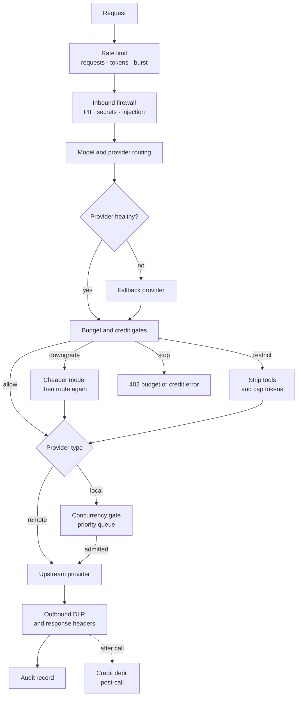
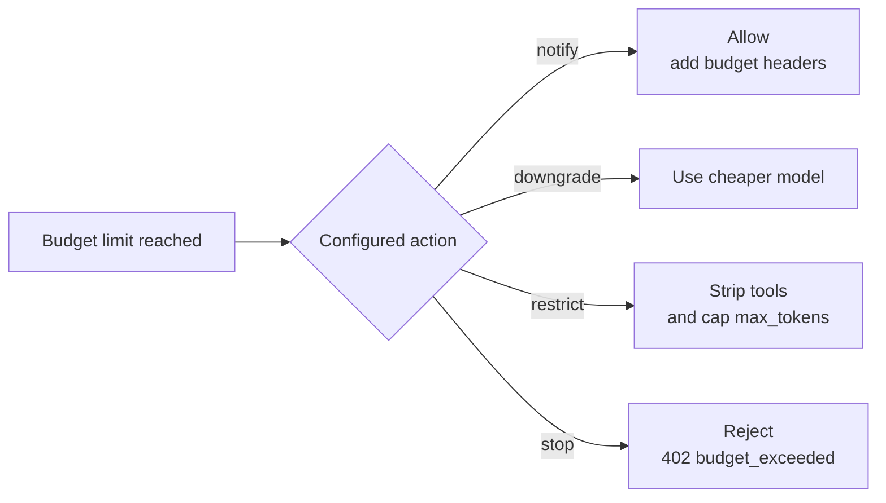

This reference covers the Gateway mechanisms that bound model calls on the request path: response
and embedding caches, a per-key rate limiter, local-engine concurrency admission, a per-provider
circuit breaker that drives the fallback chain, and budgets across user, agent, and session scopes.

## Request-path map

This is the conceptual order for a governed model request. Cache hits may short-circuit provider
dispatch; local concurrency applies only to the local engine; and a post-call credit debit never
retroactively blocks the call that produced it.



## Caching

Three caches sit in front of the provider.

| Cache | Behavior | Keying | Default |
|---|---|---|---|
| Exact | Returns a previously generated response for the same request | Hash of organization, credential, provider, model, messages, and tools, with a TTL and max-entry cap | On |
| Semantic | Returns a prior response when the request embedding is sufficiently close | Cosine similarity against prior requests from the same organization and credential, above a threshold, with the same TTL and max-entry cap | Off |
| Embedding | Returns stored vectors for `/v1/embeddings` inputs it has embedded before | Organization, credential, provider, routed model, `dimensions`, `encoding_format`, and a hash of each normalized input, with a TTL plus entry and byte caps | Off |

The exact and semantic caches are partitioned by organization, by calling credential, and, when the request carries a user identity, by user. One member of an organization never receives another member's cached response, and two API keys never read each other's cached answers, even when neither key belongs to an organization. Requests without a user identity share their organization and credential partition.

Agents that share a credential can share an entry. Every cache hit therefore runs the requesting agent's own outbound firewall and output evaluators before it is returned, so a stricter agent is never served a response that was only checked against a looser agent's policy.

The exact and semantic caches evict expired entries with a background task. When a cache reaches `[cache] max_entries`, it drops its oldest entries first. The semantic cache embeds each request with a configured embedding model and returns a stored response when similarity clears the threshold. A cached response carries `x-cache: HIT` (`MISS` otherwise).

<Callout type="warn">
  The semantic cache is off by default and needs a configured embedding model. It returns a prior
  response when a new request is close enough, so enable it only where near-duplicate answers are
  acceptable.
</Callout>

### Embedding cache

The embedding cache stores each `/v1/embeddings` input separately. A request is answered from the
cache only when every input in it is cached; otherwise the whole request goes to the provider and
each returned vector is stored, so later single or batched requests can reuse them. A cached answer
has the normal list shape with `usage` set to zero tokens, carries `x-provider: cache`, and is
recorded in the audit log as a cache hit. Inputs are normalized only by trimming leading and
trailing whitespace and folding `\r\n` line endings to `\n`; case, inner spacing, and Unicode
form are kept, so different texts never share a vector.

Requests with token-array inputs or a `user` field, rerank requests, and requests whose route does
not allow response caching always go to the provider. Only the provider the route selected can
populate the cache; a response from a fallback provider is not stored.

```toml
[embedding_cache]
enabled = true
backend = "memory"      # or "redis" (needs RYU_GATEWAY_REDIS_URL)
ttl_secs = 86400        # how long a vector is served
max_entries = 50000     # memory store: most vectors kept (least recently used dropped first)
max_bytes = 268435456   # memory store: approximate memory cap
```

### Shared Redis cache backend

By default every cache lives in Gateway process memory, so it starts empty after a restart and is
not shared between Gateway replicas. To share the exact and semantic caches (and optionally the
embedding cache) across replicas and restarts, point the Gateway at Redis or Valkey and select the
`redis` backend:

```bash
export RYU_GATEWAY_REDIS_URL="rediss://gateway:<password>@cache.internal:6380/0"
```

```toml
[backends]
cache = "redis"            # exact cache
semantic_cache = "redis"   # requires [semantic_cache] enabled = true

[redis_cache]
key_prefix = "ryu:gw"
semantic_search = "brute_force"   # or "redisearch" on Redis Stack
semantic_scan_limit = 1000        # brute_force: newest entries compared per lookup
pool_size = 4
connect_timeout_ms = 1000
io_timeout_ms = 250

[embedding_cache]
enabled = true
backend = "redis"
```

The URL is read only from `RYU_GATEWAY_REDIS_URL` and never written to `gateway.toml` or returned
by the configuration API. `redis://` and `valkey://` connect in plain text; `rediss://` and
`valkeys://` use TLS with the system trust store. Credentials in the URL are sent with `AUTH`, and
a path such as `/2` selects that database. Selecting `redis` without the variable stops the Gateway
at startup with the list of available backends.

- **Exact cache** entries are written with the `[cache] ttl_secs` expiry. Redis enforces the TTL;
  size is bounded by the server's `maxmemory` policy (use `allkeys-lru` or `volatile-lru`), not by
  `[cache] max_entries`.
- **Semantic cache** entries are capped per organization and credential partition at
  `[cache] max_entries`, oldest first. With `semantic_search = "brute_force"` (any Redis or Valkey)
  a lookup compares the newest `semantic_scan_limit` entries of the partition. With
  `semantic_search = "redisearch"` (Redis Stack or the RediSearch module) the Gateway creates one
  cosine vector index per embedding dimension and runs a nearest-neighbor query.
- **Embedding cache** vectors are written with the `[embedding_cache] ttl_secs` expiry;
  `max_entries` and `max_bytes` apply only to the memory store.

A slow or unreachable Redis never fails a request: a lookup that errors or exceeds `io_timeout_ms`
is served as a miss, and a store that fails is dropped. The metrics endpoint reports each active
cache backend under `cache_backends` (hits, misses, stores, evictions, errors, and, for the memory
embedding store, entries and bytes), and the embedding cache's request-level hits and misses under
`cache.embedding_hits` and `cache.embedding_misses`.

### Provider prompt caching

Provider prompt caches are upstream and separate from these caches. See
[Provider prompt caching](/docs/gateway/prompt-caching).

## Rate limiting

The Gateway rate limiter applies token-bucket limits per key across three dimensions: requests per minute, tokens per minute, and a per-second burst cap for bot detection. Per-key overrides in the auth config let one key have a higher ceiling than the global default. Idle buckets are evicted to bound memory.

## Concurrency admission control

The concurrency gate protects the resident local engine from overload. A local llama.cpp or Ollama server has a fixed number of batch slots (`--parallel N`). Without a gate, a burst of background fan-out work submitted before an interactive turn makes the user wait behind the batch jobs in the engine's internal FIFO.

The admission gate is a priority-aware semaphore on the `local` provider.

- At most `local_max_in_flight` requests run concurrently. Size this to match the engine's `--parallel` slot count so every engine slot stays busy and the engine's own queue stays empty.
- When all slots are occupied, new requests queue, up to `local_max_queued`. Interactive requests jump ahead of background ones in the queue regardless of arrival order.
- When the queue is also full, new requests are rejected immediately with `503 engine_overloaded` rather than piling up unbounded.
- When several organizations share the node, each one may have at most `local_max_pending_per_org` requests in flight plus queued, and a freed slot goes to the waiting organization with the fewest requests in flight. One organization's burst cannot fill the queue or hold every slot.

Priority is read from the `x-ryu-priority` request header Core stamps. Any value of `background`, `low`, or `batch` is treated as Background; anything else (including no header) is treated as Interactive, so unlabeled requests from old clients or direct callers are never penalized.

Remote providers (OpenAI, Anthropic, OpenRouter, and others) are never gated.

The gate reads `[concurrency]` once at startup, so changes take effect after a restart. In-flight count and queue depth per priority are exposed on `GET /v1/concurrency`.

| Setting | `gateway.toml` | Default |
|---|---|---|
| Enabled | `[concurrency] enabled` | `true` |
| In-flight slots | `[concurrency] local_max_in_flight` | `4` |
| Queue depth | `[concurrency] local_max_queued` | `64` |
| Per-organization share | `[concurrency] local_max_pending_per_org` | `local_max_in_flight + local_max_queued / 4` |

Set `local_max_in_flight = 0` to disable gating entirely (treated as unlimited).

## Circuit breaker and fallback

The circuit breaker protects against a failing provider. After a threshold of consecutive failures it opens and rejects calls to that provider immediately. After a reset timeout it half-opens to probe with a single request, then closes on success or re-opens on failure.

An open circuit drives the configured fallback chain. When a fallback provider serves a request, the response includes an `x-degraded: fallback:<provider>` header so clients can see the route change. Configure the chain in [Routing](/docs/gateway/routing).

Each retry must pass the destination provider's credit-pool check and obtain a new spend
reservation. Credits restricted to one provider pool cannot fund another provider or an
untagged fallback, even when that fallback remains in the fleet chain. The same checks apply
to streaming chat, media, embeddings, and reranking.

A model call is retried, in place or on a fallback provider, only when the first provider cannot
have run it: the connection was never established, or the provider answered with an error status.
In-place retries are limited to connection failures and `502` or `503` responses. A timeout or a
dropped connection after the request was sent returns an error without replaying the request,
because the upstream may already be generating, and billing, the response.

Only genuine provider faults count toward the circuit: a `5xx`, a `408`, an unreadable reply, or
a `401` that says the configured key is no longer accepted. A refusal is about one request, not
the provider, so it never opens the circuit, cools an account, or takes a model out of service
for other callers. That covers firewall and policy blocks, the Gateway's own rate limits, and any
other upstream `4xx`, including a `403` content refusal.

An error reply is judged by its status code, never by its body. A `4xx` that comes back as an
HTML error page, plain text, or an empty body is still a refusal, for chat, image, video, and
speech providers alike.

On Ryu's hosted Gateway, and on a managed node that sends its requests through it, an upstream
`4xx` other than `408` and `429` is returned to you as is and never retried with another
provider. That includes a payment-required reply (`402`). Firewall and policy blocks are never
retried on any Gateway. Rate limits (`429`), timeouts, `5xx` responses, and connection failures
still move to the next provider in the chain. On a self-hosted Gateway an upstream refusal still
moves to the next provider in your chain.

Streamed chat completions from OpenAI-compatible, Anthropic, OpenRouter, Modal, SDK-routed (such
as Gemini, xAI, DeepSeek, and Groq), and local providers are not cut off at a fixed five minutes.
A stream fails after five minutes without receiving data, and runs for at most two hours in total.

## Operational endpoints

Operational snapshots (`/metrics`, `/v1/metrics`, `/v1/concurrency`, and `/v1/evals`) use
the same admin authorization as configuration and audit. Public health checks return basic
liveness and version information. Core's managed readiness handshake authenticates its
challenge before the Gateway returns credential-role fingerprints or a signed response.

## Budgets

Budgets cap charged spend and apply a graduated action when a cap is crossed. A limit is an integer
micro-USD amount (`1_000_000` = `$1.00`; `0` is unlimited). For model and media calls, the Gateway
prefers the provider-reported USD cost, falls back to its model/modality estimate, and applies the
provider-level billing policy (or the global platform markup) so the counter matches the amount a
wallet would debit. Paid Composio actions use the configured per-action estimate. Each rule can
include or exclude `model`, `media`, and `tools` independently; omitted `include` fields default to
all three categories. Rules can apply to a user, agent, or session. When more than one scope
matches, the most severe action wins.

Spend is recorded when a call completes, so requests that are still running count toward their user,
agent, and session caps at an estimated cost (the output-ceiling estimate, with its minimum, that
managed-credit reservations use). Parallel requests therefore cannot all start against the same
remaining headroom. A `stop` cap can still be passed by the last request admitted below it and by
requests that cost more than their estimates. Video jobs, whose cost settles while they are polled,
count once they settle.

The four actions, in increasing severity:



| Action | Effect |
|---|---|
| `notify` | Allow the call, flag it in the `x-budget-*` response headers. Never blocks |
| `downgrade` | Swap the requested model for the rule's `downgrade_to` (a cheaper model). Falls back to `restrict` if no downgrade model is set |
| `restrict` | Allow a minimal answer: strip tool definitions and cap `max_tokens`. Managed tool loops stay disabled, including capability suggestions, tool search, skill loading, and legacy Composio execution. This applies to both buffered and streaming chat. |
| `stop` | Reject with `402 budget_exceeded`. The default when a rule sets a `limit` without an `action` |

Per-user and per-agent rules are configured as maps under `[budgets.users]` and `[budgets.agents]` in `gateway.toml` and are hot-swappable. Every decision is surfaced in the response headers (scope, action, usage, limit).

Each user or agent rule measures its `limit` over a UTC calendar `window` - `daily` (midnight UTC),
`weekly` (Monday 00:00 UTC), `monthly` (the 1st, 00:00 UTC), or `lifetime`. Omitting `window` keeps
the original meaning, `lifetime`. A new window starts a fresh count automatically; nothing has to be
reset.

```toml
[budgets.agents.my-agent]
limit = 1_000_000       # $1.00 charged spend
window = "monthly"      # daily | weekly | monthly | lifetime (default)
action = "stop"

[budgets.agents.my-agent.include]
model = true             # provider/model inference
media = true             # image, video, speech
tools = false            # paid Composio actions
```

<Callout type="info">
  All budget scopes are off unless configured, and the master key (`auth.master_key`) bypasses every
  budget gate. User and agent spend is stored per window in `spend.db` next to the audit database, so
  it survives a Gateway restart and a budget config change. If `spend.db` was sealed under a different
  key, or the Gateway has no sealing key for an already sealed store, budgeted requests are refused
  with `503 budget_store_unavailable` instead of counting spend unprotected. The admin `/health` view
  shows why in `budget_store` (and `budget_store_sealing`). Recover by starting the Gateway with the
  right `RYU_SEAL_KEY` (from `ryu-core gateway-seal-env`) or `RYU_MASTER_KEY`, as described in
  [Configuration](/docs/gateway/configuration).

  With audit logging disabled the counters
  live in memory and reset on restart. Per-session counters are always in memory. The request log
  itself is covered in [Gateway audit](/docs/gateway/audit).
</Callout>

### Identity headers and spoofing

Per-user and per-agent budgets key on the `x-ryu-user-id` and `x-ryu-agent-id` headers Core forwards on the request. Those headers are honored only for trusted forwarders. For other keys, the budget binds to the key's own identity so a caller cannot rotate identity headers to escape its quota.

### Per-session budget

A single global per-session charged-cost cap applies to every session. The counter binds the
`x-ryu-session-id` label to the authenticated credential, organization, and user, so a caller using
another owner's label cannot spend that owner's session allowance. Unlike the `users` and `agents`
maps, the session scope is not a per-id rule map. Core mints a fresh conversation id per chat, so
one rule applies to all sessions.

The session scope uses the same actions as the user and agent scopes. Configure it in `gateway.toml`.

| Setting | `gateway.toml` | Default |
|---|---|---|
| Charged-cost cap (micro-USD) | `[budgets.session] limit` | `0` (off) |
| Action | `[budgets.session] action` | `stop` |

A `limit` of `0` turns the session scope off. Session IDs are ephemeral, so Gateway bounds the number of active session counters and clears them if the cap is exceeded.

### Per-key lifetime budget

Each statically configured API key can separately carry a legacy lifetime token cap,
`token_budget_total` (input plus output combined), with an optional `downgrade_to` model. This token-count guard is distinct from the charged model-spend budgets above. Enforcement runs before the provider call and reads the key's running total, which the audit database keeps in its own table so audit retention pruning never lowers it. Once the cap is crossed, Gateway either downgrades to the configured model or rejects with `402 budget_exceeded`. Because the usage figure comes from the audit database, this cap depends on audit logging being enabled.

### Exec budget for tools and sandboxes

A separate exec budget bounds non-model executions (sandbox runs and MCP tool invocations) by count and wall-clock seconds. See [Budget and audit](/docs/gateway/tools#budget-and-audit) on the tools page.

## Related

<Cards>
  <DocCard href="/docs/gateway/routing" />
  <DocCard href="/docs/gateway/tools" />
  <DocCard href="/docs/gateway/audit" />
  <DocCard href="/docs/gateway/configuration" />
</Cards>
