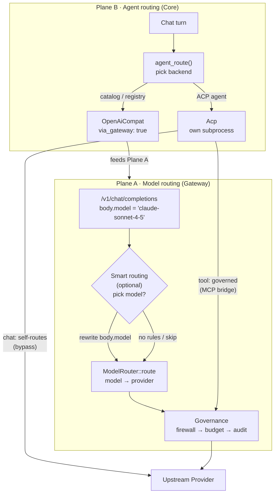
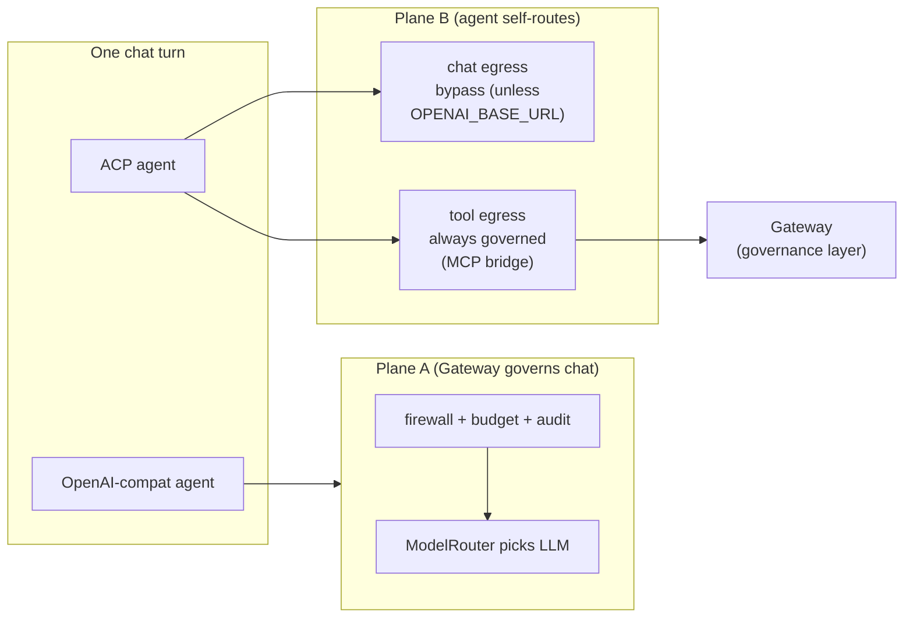

Ryu uses "routing" for two separate mechanisms that run at different layers. Only one of them
governs chat egress.

- **Plane A (model routing)** lives in the Gateway and picks *which LLM* an OpenAI-compatible
  completion uses.
- **Plane B (agent routing)** lives in Core and picks *which agent* serves a chat turn. The agent
  brings its own model and, for ACP subprocess agents, makes its own provider calls.

<Callout type="info">
  Core decides what runs. The Gateway decides what is allowed. Plane B (Core) chooses the agent;
  Plane A (Gateway) governs the LLM call - see
  [Core vs Gateway](/docs/start-here/architecture/core-vs-gateway).
</Callout>

## The two planes

| Plane | Owns | Surface | Model lifetime | Governed how |
|---|---|---|---|---|
| Plane A - Model routing | Gateway | Picks the LLM for one OpenAI-compatible `/v1/chat/completions` request | Model is fixed for the whole turn (and its tool loop) once routed | Full Gateway plane: allowlist + inbound firewall + budget + audit |
| Plane B - Agent routing | Core (ACP / catalog) | Picks the agent that serves the turn; the agent brings its own model | Model is owned by the agent/subprocess, not by a single Gateway route | Routable ACP chat egress is Gateway-governed by default; non-wirable agents bypass it. Tool egress is governed through the MCP bridge |

Plane A rewrites `body["model"]` inside one completion request. Plane B
chooses a backend (`AgentRoute`) and, for ACP agents, hands the whole turn to a subprocess that Ryu
cannot intercept at the chat-LLM level.

## Plane A: model routing

Plane A runs inside the Gateway pipeline on the OpenAI-compatible chat path. It is a two-stage
decision.

### Stage 1: optional smart routing

On the chat path, `apply_smart_routing` (`apps/gateway/src/pipeline/routing_smart.rs`) runs before
`pre_process` (`apps/gateway/src/pipeline/mod.rs`). It does nothing unless both are true:

- `SmartRouter::is_active()` is true (`apps/gateway/src/router/smart.rs`).
- No per-agent chat-model setting is pinned.

`SmartRouter::resolve` caches the decision per session (keyed by `x-ryu-session-id`) and
dispatches on the configured strategy: a cheap classifier model, an embedding nearest-match, or a
keyword match. The classifier strategy resolves its model through the normal `ModelRouter::route`
and then issues a plain `provider.complete` call.

**Model routing is not tool calling.** The classifier is a direct `provider.complete`, not a tool
call, so it bypasses the pipeline and cannot recurse into routing. The result is a single rule
index that rewrites `body["model"]` in place.

Every failure (inactive config, timeout, provider error, or an unparseable reply) keeps the
requested model. The full strategy vocabulary and per-agent overrides are documented in
[Smart model routing](/docs/gateway/smart-routing).

<Callout type="warn">
  Smart routing is off by default. `SmartRoutingConfig::enabled` is false, and `is_active` also needs
  at least one rule (and, for the `llm` strategy, a classifier model). Without those, Plane A stage 1
  is inert and the requested model is kept.
</Callout>

### Stage 2: deterministic model-to-provider routing

Once the model string is fixed, `ModelRouter::route` (`apps/gateway/src/router/mod.rs`) maps it to
a provider with no hardcoded lock. The full order, including Ryu model aliases, is on
[Routing](/docs/gateway/routing#resolution-order). In short:

1. An exact `model_map` hit.
2. The longest-prefix user map entry.
3. A Ryu model alias or credit-pool namespace.
4. The built-in prefix table (`crates/gateway/router/src/lib.rs`).
5. The configured `default_provider`.

The model is fixed for the whole turn. Tool calls in the loop re-enter the completion API with the
already-routed model and never re-trigger stage 1 or stage 2.

Only budget changes the model *after* routing. The lifetime token-budget block and
`enforce_budget`'s Downgrade action both rewrite `body["model"]` to a cheaper model and re-route.

## Plane B: agent routing

Plane B is the "bring-your-own-model agent" path and lives in Core. A chat turn resolves its backend
in `agent_route` (`apps/core/src/sidecar/adapters/adapter_core/route_reach.rs`), and
`chat_stream_inner.rs` in the same folder matches the resolved `AgentRoute`. That match is the
two-backend split:

- **Catalog / OpenAI-compatible registry agents** become `AgentRoute::OpenAiCompat { via_gateway: true }`
  and stream through the Gateway. These agents feed Plane A, so their chat is governed.
- **ACP subprocess agents** become `AgentRoute::Acp { spawn_cmd }` and stream via `route_acp_stream`.
  An ACP agent runs its own subprocess and makes its own provider calls, so Core cannot intercept its
  chat-LLM egress in general.

### Base-URL injection

For an ACP agent whose HTTP client honors the OpenAI base URL, there is one interception point.
`acp::openai_gateway_cmd` (`apps/core/src/sidecar/adapters/acp/gateway_cmds.rs`) gives the spawn
command two environment values, so the agent's chat calls flow through the Gateway:

- `OPENAI_BASE_URL` - the local Gateway `/v1`.
- `OPENAI_API_KEY` - the Gateway token.

The per-agent toggle `agent-gateway-routing` (`apps/core/src/agent_routing/mod.rs`) gates it. The
toggle defaults on for new and auto-installed routable ACP agents. A missing entry remains
Gateway-governed; an explicit `false` is the direct-egress opt-out.

The full mechanism, including the subscription-preserving passthrough proxy for Claude Code and
Codex and the bypass list, is on [Gateway for any agent](/docs/gateway/gateway-for-any-agent).

### Agents that bypass the Gateway

For registry ACP agents, chat egress is governable only when the CLI honors a base URL Core injects
and the Gateway speaks that wire format. Only the Codex and Pi registry agents meet both
(`registry_gateway_bypass` in `apps/core/src/sidecar/agents/acp_registry.rs`).

Every other registry agent bypasses the Gateway for chat, for example:

- Gemini CLI (Google wire format);
- OpenClaw (its own WebSocket gateway);
- Hermes (its own credentials);
- self-fetching agents such as Cline, Goose, and OpenCode.

Claude Code and Codex also have dedicated
[passthrough routing](/docs/gateway/gateway-for-any-agent#subscription-preserving-passthrough-claude-code-codex)
that preserves their subscription billing.

### Tool egress is always governed

The MCP bridge `build_ryu_mcp_server` (`apps/core/src/sidecar/adapters/mcp_bridge.rs`) is wired
into the live ACP session. Every tool call dispatches through the bridge into `McpRegistry`
allowlist enforcement, with no direct-egress bypass. The same governance is exposed over HTTP at
`POST /api/mcp/tools/call`, which requires a known agent id so the allowlist cannot fail open.

The same defaults apply when an ACP runtime is installed from the catalog or discovered during
onboarding. Its new agent configuration starts with the live MCP, plugin/app tool scope and enabled
skills, and routable model traffic starts through the Gateway.

Customize the configuration or turn off its routing switch when that agent needs a narrower tool
scope or direct provider egress. Existing explicit choices are preserved.

<Callout type="info">
  Plane B backend resolution (the `OpenAiCompat` / `Acp` split above) is separate from the
  **agent-auto picker**, a per-turn choice of which agent serves the turn by your own rules
  (`apps/core/src/agent_routing/auto.rs`). See
  [Agent auto routing](/docs/gateway/agent-auto).
</Callout>

## The ownership rule

A turn has one chat-egress plane:

- **OpenAI-compatible requests get Plane A model routing.** The Gateway picks and fixes the LLM, and the
  full policy plane (allowlist, firewall, budget, audit) applies to that chat.
- **ACP agents self-route (Plane B).** The agent owns its model. Only its *tool egress* is governed
  (via the MCP bridge); its chat egress reaches the Gateway *only* if it honors `OPENAI_BASE_URL`
  and the per-agent toggle is on.

Both planes feed **one** governance layer, the Gateway. It decides what is allowed, shared,
measured, and paid for:

- `pre_process` runs rate-limit, then inbound firewall, then routing on every request.
- `enforce_budget` applies budget decisions, and every model call is audited.
- The unified tool surface is deny-by-default and activates only on an explicit per-request signal.
- Tool-call guarding runs in the Gateway firewall and the command-scan `POST /v1/exec/scan` path.

## Where things live

| Concern | File |
|---|---|
| Smart routing classifier (Plane A stage 1) | `apps/gateway/src/router/smart.rs` |
| Model-to-provider resolution (Plane A stage 2) | `apps/gateway/src/router/mod.rs` |
| Smart routing config (opt-in, fail-open) | `apps/gateway/src/config.rs` |
| Chat pipeline: smart routing, route decision, budget, audit | `apps/gateway/src/pipeline/` (`mod.rs`, `routing_smart.rs`, `budget.rs`, `budget_charge.rs`, `audit.rs`) |
| Unified tool surface (deny-by-default, `tool_search`) | `apps/gateway/src/tools/mod.rs` |
| Backend resolution + dispatch (Plane B) | `apps/core/src/sidecar/adapters/adapter_core/` (`route_reach.rs`, `route_selection.rs`, `chat_stream_inner.rs`) |
| ACP spawn, session pool, `OPENAI_BASE_URL` injection | `apps/core/src/sidecar/adapters/acp.rs`, `acp/gateway_cmds.rs` |
| Registry agents' default Gateway bypass | `apps/core/src/sidecar/agents/acp_registry.rs` |
| Governed tool egress (MCP bridge) | `apps/core/src/sidecar/adapters/mcp_bridge.rs` |
| Per-agent Gateway-routing toggle | `apps/core/src/agent_routing/mod.rs` |

## Gotchas

- **Everything in Plane A fails open.** Inactive config, classifier timeout, provider error, or an
  unparseable reply all keep the originally requested model. A routing misconfig can never break chat.
  A provider safety refusal of the classifier call on the hosted Gateway is not a failure mode: it
  ends the request ([Provider safety refusals](/docs/gateway/account-standing#provider-safety-refusals)).
- **Explicit model pins beat the classifier.** A per-agent chat-model setting wins over smart
  routing in both `apply_smart_routing` and the `pre_process` route decision.
- **Budget can override the routed model after routing**, so the final model may differ from the
  classifier's pick (see [Stage 2](/docs/gateway/routing-planes#stage-2-deterministic-model-to-provider-routing)).
- **ACP chat egress bypasses the Gateway for agents that ignore the OpenAI base URL**, even with the
  per-agent toggle on. Their *tool* egress is still governed through the MCP bridge.
