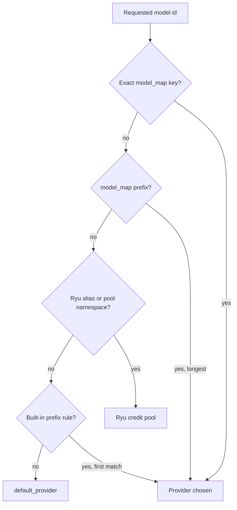

The router (`apps/gateway/src/router/`) decides which provider and model handles each request.
Routing is per-attribute: an agent's chat, image, and audio calls can each go to a different provider.

<Figure name="routing" />

## Provider selection

Routing values identify configured provider instances, including custom provider
IDs. Mobile settings preserve those IDs when saving the default provider and
fallback chain.

By default the router matches the model name against built-in prefix rules. The main chat rules
are:

| Model prefix | Provider |
|---|---|
| `gpt-`, `o1`, `o3`, `o4`, `text-davinci` | OpenAI |
| `claude-` | Anthropic |
| `gemini-` | GenAi (native Gemini protocol) |
| `openrouter/` | OpenRouter (its own routing runs after the Gateway's guardrails) |
| `modal/` | Modal (serverless GPU compute) |
| `/absolute/path/to/model.gguf` | Local engine (filesystem-backed llama.cpp model ids) |
| `llama`, `mistral`, `mixtral`, `gemma`, `phi`, `qwen`, `deepseek` | Local engine |
| `zeroclaw`, `openclaw` | Core agents |

The built-in table (`crates/gateway/router/src/lib.rs`) also routes embedding, speech, and image
model prefixes such as `voyage-`, `jina-`, `flux-`, and `eleven_`, Cloudflare Workers AI `@cf/`
ids, and Bedrock vendor namespaces. Within the built-in table, the first matching prefix wins.

### Resolution order

The router resolves each requested model id in this order (`RoutingTables::route_with_source` in
`crates/gateway/router/src/lib.rs`). The first step that matches decides the provider.

1. **Exact match** - an exact `routing.model_map` key.
2. **Longest prefix match** - `routing.model_map` prefix keys, longest match first.
3. **Ryu model alias or credit-pool namespace** - a Ryu model alias such as `ryu-code/max`, or a
   model id inside a credit-pool namespace (`ryu-code/`, `ryu-reasoning/`, `ryu-vision/`), routes
   to its billing-isolated Ryu pool. A namespace prefix is stripped before the call. A bare
   namespace with nothing after it falls through to the next step.
4. **Built-in prefix rules** - the table above, first matching row wins, top-down.
5. **Default provider** - `routing.default_provider`.



Because steps 1 and 2 outrank the whole built-in table, a broad `model_map` prefix (for example
`gpt-` or `gemma`) re-homes every built-in route beneath it. Map a model exactly when it must
survive a broader prefix entry.

### Ryu Router and free credit

With Ryu-managed inference, you pick models from one provider, **Ryu Router**, using their
usual names (for example `anthropic/claude-sonnet-4.5` or `openai/o3`). Ryu never reports which
provider served a request: responses, streamed chunks, and the `x-routed-model` header show
the model id you picked, and `x-provider` reads `ryu`.

When your organization has free credit and Ryu can serve the model you picked, the request is
paid from your free credit first. Those models carry a **Free** tag in the picker while you have
free credit. Model ids that route to your own provider keys are never affected.

- If free capacity is briefly unavailable before any output, the request continues through Ryu
  Router instead of failing.
- A request the provider or a policy refuses, including a provider payment-required reply, is
  returned as an error and is not retried through Ryu Router.

See [Free credit](/docs/billing/credits#free-credit).

## The strategies

On top of the prefix rules, several strategies layer in, all driven by `gateway.toml`.

- **Static model map** (`routing.model_map`) remaps an exact model name and can override the
  provider, for example rewriting a friendly name to a dated provider model.
- **Fallback chain** (`routing.fallback_chain`) tries alternative providers in order when the primary
  provider's circuit is open, emitting an `x-degraded` header when it does.
- **Eval-driven routing** (`routing.eval_routing`) splits traffic across candidate providers using
  their rolling eval scores: explore unscored candidates, then exploit the leader while reserving a
  slice for others. Selection is deterministic (a counter, not a random number).
- **Modality routing** (`routing.modality_map`) sends chat, image, speech, voice recognition, video,
  and generated music and sound effects (`audio`) to different providers and models.

Named provider/model pools have their own capability-advertised selection policies, including
cost, quota, context and cache signals. Fusion and pipeline add bounded multi-target text execution
and normal per-call charging.

These pool policies run after a model mapping selects a pool; they do not replace the strategies above or upstream provider routing. See
[chat provider pools](/docs/providers/provider-pools) for the strategy list, limits and judge
configuration.

### Edit routing in Desktop

Open **Gateway → Model routing** to choose the default provider, edit the fallback chain, and
add, edit, or remove model-map rows.

- The request name can be an exact model id or a prefix. A blank provider-model override forwards
  the requested name unchanged.
- Each row action reads the latest routing config before writing, so the other routing fields stay
  intact.
- These controls require `gateway.configure`. Without it, provider, mapping, and fallback-chain
  edits are read-only.
- When no providers are configured on the Gateway, default-provider selection and **Add mapping**
  stay disabled until a provider is available.

For requests sent to the managed fleet, **Gateway → Network → Managed request routing**
saves this node's preferred fallback providers and extra firewall rules. Business organizations
also have OpenRouter provider controls. The editor loads the selected node's saved policy before
allowing changes, and a refused save keeps your draft for retry.

### Credit and subscription fallback rules

The **Auto-retry on another plan** card in **Gateway → Model routing** controls
reactive retries after Core confirms a subscription cap:

1. Enable it.
2. Optionally choose **Just tell me** (notify without retrying).
3. Pick eligible installed plans in priority order.

The remaining-percent threshold applies both to detecting a spent window and to choosing a plan
with enough room. Changes save immediately.

**Gateway → Model routing** also has a **Fallback when you're running low** section. Add ordered
rules for remaining Ryu credit in USD or for a subscription window's remaining percentage, then
choose the fallback agent or model and whether to show a notice.

- Rules can be enabled, reordered, and removed. The first matching rule wins.
- Credit thresholds must be non-negative USD amounts. Subscription thresholds must be between 0%
  and 100%.
- Threshold edits commit when you press Enter or leave the field. Invalid values are not saved.

A subscription-window rule watches one of three things, picked in its **Subscription** field:

- **An agent's own login**, such as Claude Code or Codex.
- **A Ryu subscription provider's whole account pool** (*every account*). The rule fires only when
  every eligible saved account that has a usage reading is below the threshold. Accounts that need a
  new sign-in or are switched off in account routing are ignored, and when no eligible account has a
  reading yet the rule does not fire.
- **One saved account** of that provider, listed by its name.

Pool and account rules read the usage Ryu already has cached, so checking them never waits on the
provider.

- Per-account usage covers Claude Pro/Max, ChatGPT, OpenAI Codex and GitHub Copilot.
- ChatGPT Plan, Kiro, Kimi, Radius, Ant Ling and CLI logins report no per-account usage and are not
  offered as pool or account scopes.

The **Auto-retry on another plan** card shows each plan under Ryu's own name for it.

These rules handle balance or subscription usage. The [fallback chain](#the-strategies) above handles
an unhealthy provider and is configured separately.

## Smart routing and agent auto

The strategies above pick a provider for the model a request names. Two further routers pick the
model or the agent itself:

- [Smart model routing](/docs/gateway/smart-routing) rewrites the requested model before provider
  selection, from classifier rules, weighted splits, stage signals, or escalation. It also owns
  routing pools and per-agent `agent_routes` overrides.
- [Agent auto routing](/docs/gateway/agent-auto) picks the agent that serves a turn when you choose
  **Auto** in the agent picker.

## How the Gateway intercepts agent egress

The routers above decide *what* runs. *How* the Gateway gets in front of an agent's model calls is
a separate question, covered on [Gateway for any agent](/docs/gateway/gateway-for-any-agent):

- the base-URL swap (`OPENAI_BASE_URL` / `ANTHROPIC_BASE_URL` injection);
- the subscription-preserving passthrough proxy for Claude Code and Codex;
- the per-agent `agent-gateway-routing` toggle;
- the agents that ignore the base URL, such as Gemini CLI, OpenClaw, and Hermes.

Start there to point an existing agent at the Gateway. The model-versus-agent split is on
[Routing planes](/docs/gateway/routing-planes).

## The model list

```http
GET /v1/models
```

`GET /v1/models` returns the routable models. The built-in chat entries
(`builtin_model_list` in `apps/gateway/src/router/mod.rs`) are:

| Model ID | Provider |
|---|---|
| `gpt-4o`, `gpt-4o-mini`, `gpt-4-turbo`, `o1`, `o3-mini` | OpenAI |
| `claude-opus-4-5`, `claude-sonnet-4-5`, `claude-haiku-4-5` | Anthropic |
| `claude-3-5-sonnet-20241022`, `claude-3-5-haiku-20241022` | Anthropic |
| `qwen-plus` | Qwen |
| `zeroclaw`, `openclaw` | Core agents |
| `openrouter/auto`, `openrouter/pareto-code` | OpenRouter (upstream selection) |
| `llama3.2:latest`, `mistral:latest`, `phi4:latest`, `deepseek-r1:latest` | Local (Ollama) |

The built-in list also includes image, speech-to-text, and text-to-speech entries. Add your own
with `routing.model_map`.

## Providers and credentials

Provider credentials come from environment variables or the config file.

| Provider | Env vars | Notes |
|---|---|---|
| OpenAI | `OPENAI_API_KEY` | `base_url` defaults to `https://api.openai.com/v1` |
| Anthropic | `ANTHROPIC_API_KEY` | `base_url` defaults to `https://api.anthropic.com` |
| OpenRouter | `OPENROUTER_API_KEY` | |
| Local | `LOCAL_LLM_URL` | Core sets this to the active local engine on startup |
| Modal | `MODAL_API_KEY` + `MODAL_BASE_URL` | Both required; there is no default URL, because each Modal deployment has its own `*.modal.run` endpoint |
| SDK connections | `providers.genai.accounts.<kind>` | Independent credentials and policy per provider kind. Environment import requires `allow_env = true` |

Set or clear provider keys at runtime through Core's `PUT /api/gateway/providers`.
In the Desktop **Provider keys (BYOK)** panel, Ryu also keeps the local copy in the
operating system's native credential service: Windows Credential Manager, macOS
Keychain, or Linux Secret Service. The value is write-only in the UI and is not
stored in a plaintext Desktop preferences file.

### Modal

`modal/` routes to a Ryu Cloud GPU node's Modal inference app (serverless GPU). Use any `modal/<model-name>` form to offload heavy inference to Modal's GPUs (pay-per-second, scale-to-zero) while the always-on orchestration node stays on cheap CPU. The provider is OpenAI wire-compatible and is activated only when both `MODAL_BASE_URL` and `MODAL_API_KEY` are configured.

### GenAi

`gemini-` keeps the `genai` route and `gemini` account scope. Additional SDK connections
have independent route IDs, such as `genai-groq`, and use qualified model names such as
`groq::llama-3.3-70b-versatile`.

- An explicit mapping to `genai-groq` must use a Groq model namespace. A model belonging to another
  kind is rejected before an upstream call.
- Legacy mappings to `genai` are resolved to the configured kind before routing policy checks.
- Each kind has its own account pool, circuit state, and usage attribution.

See [provider connections](/docs/gateway/provider-connections) for credential and endpoint
configuration, and for how account rotation and fallback affect prompt and response caching.

## Related

<Cards>
  <DocCard href="/docs/gateway/smart-routing" />
  <DocCard href="/docs/gateway/agent-auto" />
  <DocCard href="/docs/gateway/routing-planes" />
  <DocCard href="/docs/gateway/provider-connections" />
</Cards>
