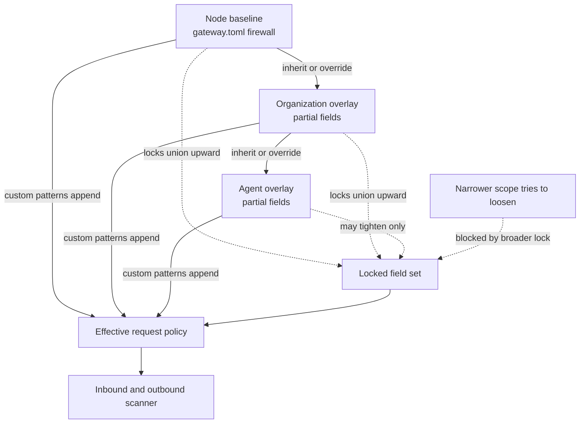

The firewall is the Gateway's data-loss-prevention (DLP) layer. It scans traffic in both
directions, applies a configurable policy on a detection, and can be enforced
as a locked baseline that a narrower override cannot weaken. It supplements authentication,
resource permissions and execution isolation; pattern matching is not a complete security boundary.

## Protected startup

Core and Gateway initialize authentication credentials automatically. Inference, trusted Core
forwarding and administration use separate authority. Invalid configuration or unavailable private
credential storage refuses startup instead of starting an open service. See
[Network binding and authentication](/docs/security/network-binding-auth).

The managed local Gateway is quarantined from the start of Core's process, including while local
engines initialize. Core releases it only after verifying Gateway readiness, so status polling
cannot send administrator credentials to an unverified listener during startup. Explicit external
and managed remote Gateway connections retain their configured routing behavior.

Gateway-routed agent commands keep the configured endpoint while startup is pending. Starting
one before readiness is verified returns a retryable startup error; retry after Gateway startup
finishes. The saved command does not retain a temporary unavailable address.

## What it detects

Patterns are compiled regexes, grouped one set per category.

| Category | Examples |
|---|---|
| PII | email, phone, SSN, credit card, passport, driver license, medical record |
| Secrets | API keys, JWTs, PEM keys, database connection strings, cloud credentials |
| Prompt injection | known injection patterns such as "ignore previous instructions" |

Inbound scans run on the prompt before the provider call (`scan_inbound`, injection takes
priority). Outbound scans run on the response (`scan_outbound`, secrets and PII).

An inbound scan reads every provider-bound prompt string in the request: message content (plain
strings and each text part, which is how `/v1/responses` input arrives), assistant tool-call
arguments, tool results, and predicted output are checked for prompt injection, secrets, and PII.
Tool and function definitions (descriptions and parameter schemas) are checked for secrets only:
they are written by the developer and routinely use wording such as "ignore case" or "override
defaults", and example data such as "e.g. jane@example.com", that the injection and PII patterns
would flag on every request.

Property names are screened as well, because the model reads them: a tool parameter name is
checked for secrets, and a property name in a `response_format` JSON schema is checked like the
rest of that schema. A model named by an `x-ryu-slot-<modality>-model` header replaces the body
`model` when the request is dispatched, so it is checked for secrets just like the body `model`.
A match in any of these is refused with a 403 under the Block and Sanitize policies, since there
is no field to redact.

A locked `pii` or `secrets` guardrail still checks definitions, and when the Sanitize policy runs it
redacts secrets and PII in definitions as well. The `/v1/chat/completions`, `/v1/messages`, and
`/v1/responses` front doors share this scan. Image URLs, IDs, and roles are not scanned as prompt
text.

The pattern sets above ship built in. You can add your own patterns with `custom_patterns`. Each
entry carries a `name`, `regex`, and `kind` (PII, secret, or prompt injection) and is added to the
built-in sets through the [policy cascade](#hierarchical-policy-resolution). Manage custom patterns
through Gateway settings, `gateway.toml`, or the authenticated configuration API.

In Desktop, open **Gateway → Safety filters** to edit the node baseline or an org/agent overlay.
For an agent overlay, choose an installed agent from the searchable **Agent** picker; the overlay
is stored under that agent's stable ID. The pattern editor's browser regex check is an early hint;
the Gateway's Rust regex parser is the final validator when you save. A rejected save keeps the
draft and shows the Gateway's reason.

## Policies

The action taken on a detection is `firewall.policy`.

| Policy | Wire value | Behavior |
|---|---|---|
| Warn and continue | `warn_and_continue` | Log the detection, let the request through |
| Block | `block` (default) | Reject the request with a 403 |
| Sanitize | `sanitize` | Replace matched PII and secret text with a redaction marker, then continue |

Sanitize redacts the same fields the inbound scan reads. Two cases behave differently:

- A prompt-injection match cannot be redacted. Under Sanitize the request continues with the
  injection text unchanged (any PII or secrets alongside it are still redacted). Use `block` to stop
  detected injections.
- A PII or secret match that survives redaction is blocked with a 403 instead of being forwarded.
  This happens when the match is obfuscated, for example split with zero-width characters, so the
  scanner detects it but cannot rewrite it. Categories you turned off with `redact_pii` or
  `redact_secrets` are not blocked this way.

Sanitize rewrites each string the same way on every request, whether or not that request tripped a
detection. The tools, system prompt, and earlier turns a client resends therefore reach the provider
unchanged from one turn to the next, so [provider prompt caching](/docs/gateway/prompt-caching) keeps
reusing the prefix. The same applies when the inspector or an inline evaluator uses the Sanitize
action: once one is configured, PII and secret spans are redacted on every request, not only on
flagged ones.

The master switch and each direction are independent toggles. All are hot-swappable through
`PUT /v1/config` (see [Configuration](/docs/gateway/configuration)).

| Field | Default | Controls |
|---|---|---|
| `firewall.enabled` | `true` | Master switch for inbound and outbound scanning |
| `scan_inbound` | `true` | Scan prompts before the provider call |
| `scan_outbound` | `true` | Scan responses after the provider call |
| `log_detections` | `true` | Emit a detection record per match |
| `redact_pii` | `true` | Redact PII spans when `policy = sanitize` |
| `redact_secrets` | `true` | Redact secret spans when `policy = sanitize` |

### Content the Gateway adds

Some Gateway features change a chat request after the inbound scan has run. The Gateway scans the
text each one adds before anything is sent:

- the skill snippets it adds to the system prompt, and the merged system prompt when the snippets
  are prepended to your own;
- the text a [compression](/docs/gateway/compression) service changes or adds, including a media
  URL it moves into message text;
- the handoff a context-relay [provider pool](/docs/gateway/routing) appends when a conversation
  moves to another member;
- the panel or stage answers a fusion or pipeline pool passes to the next model.

Only the text a feature added or replaced is scanned, and it is never rewritten, so the cached
request prefix keeps its exact bytes. Because nothing redacts it, a match is refused with a 403 under both `block` and
`sanitize`. `warn_and_continue` logs it and lets the request through. Locked guardrails apply under
every policy. A refused request is written to the audit log and is not retried on another provider
or pool member.

## Locked guardrails

When the Gateway is governed by a control plane, an organization can require a baseline set of
guardrails (for example `pii` and `secrets`). `scan_locked_guardrails` ignores the local
`enabled` / `scan_inbound` config and runs the required categories regardless, so a lower level
cannot bypass an admin-locked guardrail.

Locked `pii` and `secrets` guardrails also read tool and function definitions. The other locked
categories (`prompt_injection`, `code_injection`, `toxicity`, and `bias`) read message content,
tool calls, tool results, and predicted output, but not tool definitions, for the same reason the
inbound scan skips injection patterns there.

## Hierarchical policy resolution

The firewall config resolves as a three-level cascade per request, so a node administrator, an
organization, and an individual agent can each set policy.

```text
node  (base)    the box's gateway.toml firewall - the admin baseline
  ▼
org   (mid)     a control-plane bundle (hosted) or a gateway-local overlay (standalone)
  ▼
agent (leaf)    a per-agent overlay, keyed by the x-ryu-agent-id header
```



Resolution rules:

- **Most-specific set wins.** Start from the node base. Each overlay is a partial config where every scalar is optional - `Some` overrides the inherited value, `None` inherits it. So the agent leaf beats the org, which beats the node, for any field it sets.
- **Custom patterns union.** `custom_patterns` are appended across scopes, never replaced, so a narrower scope adds detectors without dropping the broader scope's.
- **Team overlays only tighten.** A server bound to a team also receives that team's overlay, set
  under **Organization → Teams → Policies → Team firewall** (or
  `PUT /api/control-plane/orgs/{orgId}/teams/{teamId}/firewall`). Reading or changing it needs
  Gateway configure for the organization or through a role scoped to the team, the same as the
  organization overlay, so other members don't see the team's detection rules. Saving or clearing
  it is a security-policy change, so, like the organization and agent overlays, it first asks you
  to **Confirm it's you** with a second factor. The page only offers switches that turn
  protections on, because turning one off at the team layer would have no effect. The Gateway
  applies it after the organization overlay as if every field were locked: it can turn protections on, raise severity,
  add patterns, and add locks that bind agent overlays, but it can never loosen the node or
  organization settings.
- **No-loosen `locked_fields`.** Any field a broader scope locks cannot be weakened by a narrower one. Locks union upward, and on a conflict the **stricter** value wins (for example a locked `Sanitize` policy can be tightened to `Block` but never downgraded to `Warn`). A narrower scope may still tighten a locked field.

When `locked_fields` is omitted, the node locks `enabled`, `policy`, `scan_inbound`,
`scan_outbound`, `redact_pii`, and `redact_secrets`. Organization and agent overlays can
strengthen these settings, but cannot turn off the node's inherited inbound scanning,
response scanning, or redaction. This also applies to partial configuration files.

The node administrator still controls the baseline values and can intentionally provide a
custom `locked_fields` list, including an empty list. An explicit list replaces the default
lock set; it is not silently expanded. Removing a protection from that list allows narrower
organization or agent configuration to weaken it.

One field is node-only. `wrap_untrusted_tool_results` is a process-global flag set by the node
base, so `normalize_overlay` strips it (value and lock) from any org or agent overlay and logs a
warning.

Hosted org and agent overlays arrive already cascaded on the control plane's resolve response (see [Managed data plane](/docs/gateway/managed-data-plane)); the Gateway adds only the node base and the agent leaf. A standalone Gateway reads overlays from its own local store instead.

Evaluator bindings (`FirewallConfig.evaluators`) cascade by the same union-plus-per-binding-lock semantics; the binding shape and the evaluators themselves are in the [evaluator catalog](/docs/gateway/evaluators).

### Scanner cache

`FirewallResolver::scanner_for` caches a compiled `FirewallScanner` keyed by a stable hash of the resolved config. Identical resolved policies share one scanner. Because a 64-bit hash can collide, the cache stores the config alongside the scanner and re-verifies equality on every hit, so a collision costs at most a rebuild, never a wrong-scanner hit. Any config or overlay write invalidates the whole cache.

## Model-based screens

Two opt-in screens add a model's judgement on top of the pattern scanner: the LLM traffic inspector
(prompt injection and leaks) and the hazard screener (MLCommons hazard categories and prompt
attacks). Both resolve through the same cascade. See
[LLM inspector and hazard screener](/docs/gateway/model-screening).

## Governed auxiliary requests

Classification, escalation, inspection and semantic-cache model work uses the same input-policy,
rate, model-permission and spending controls as other inference. Embedding and rerank requests
are inspected before dispatch. A private routing override requires trusted forwarding authority;
an ordinary API key cannot enable it or choose an auxiliary classifier.

Routing configuration and session caches are bounded. Provider work already performed is metered
even if its output is subsequently blocked or a stream is interrupted. Actual reported usage is
preserved before output transformations; when terminal usage is unavailable, the record identifies
its estimate. These controls do not claim independent reconciliation with a provider's invoice.

## Outbound DLP

Beyond the inbound firewall, the Gateway applies outbound data-loss-prevention on every response:

| Feature | What it redacts | When |
|---|---|---|
| **Outbound secret redaction** | GitHub PATs, OpenAI keys, AWS keys, bearer tokens, `token`/`secret` params | All outbound responses (firewall must be enabled) |
| **Companion egress redaction** | Unconditional PII + secrets | Requests with `x-ryu-companion-source` header (screen-captured content) |
| **Streaming response DLP** | PII/secrets in SSE text deltas, one contiguous pass | Passthrough proxy responses (Claude Code, Codex) |

The outbound marker list and the per-policy streaming behavior are on
[Outbound DLP](/docs/security/outbound-dlp). The outbound scanner reuses the same compiled regex patterns as the inbound scanner, so a single
config governs both directions. The `redact_pii` and `redact_secrets` flags control each direction
independently.

Buffered and streaming chat responses are scanned with the same per-request policy: the node
baseline plus the organization, team and agent overlays. So an overlay that turns on
`scan_outbound`, sets a stricter `policy` or adds `custom_patterns` also applies to
`stream: true` responses. With only the built-in patterns, a streamed reply is scanned and
released incrementally. If any scope adds a custom pattern, the stream is buffered and scanned in
one pass before it is returned. When `Block` ends a stream, the client receives the block notice
in place of the rest of the reply and the Gateway writes a `firewall` audit row for the request.
That includes a match that only completes in the final chunks of the reply.

Outbound scanning reads every string in the response and every object key, so a value placed in a
key of object-typed tool arguments is scanned and redacted like any other text. A streamed frame
whose choice carries `logprobs` is held until the reply ends and scanned as a whole, because each
logprob token mirrors part of the text. When `Sanitize` rewrites a response, buffered or streamed,
the Gateway sets `logprobs` to `null` on the rewritten choices so the tokens cannot rebuild the
redacted value.

## Companion egress redaction

Requests that originate from the context companion (a screen-capture source) are forwarded by Core
with the `x-ryu-companion-source` header, surfaced as `companion_source` on the pipeline request.
When set, `redact_companion_egress` unconditionally redacts both PII and secrets before egress,
ignoring `enabled`, `redact_pii`, and `redact_secrets`. Companion text is screen-captured rather
than typed by the user, so it is always sanitized. This is a locked guardrail: capture sources are
sanitized even when the firewall is fully disabled.

## Passthrough response DLP

The subscription-preserving passthrough for Claude Code and Codex forwards the caller's own
credentials, so the OpenAI-compatible firewall path above never sees that traffic. The passthrough
applies its own request-side redaction and a streaming response redactor that uses this firewall's
configuration. See
[What the proxy redacts](/docs/gateway/gateway-for-any-agent#what-the-proxy-redacts).

## Scan a string directly

`POST /v1/firewall/check` runs the scanner over an arbitrary `text` for the requested guardrails,
without making a model call. It uses the same per-request scanner as the request path, including
organization and agent overlays and their custom patterns, exposed for testing patterns or
validating content out of band.

Authenticate with a valid Gateway credential before scanning. Rejected credentials never
reach the scanner or write audit rows. Guardrail blocks use the verified caller identity
for their audit record; arbitrary bearer strings cannot impersonate another caller.

```http
POST /v1/firewall/check
Content-Type: application/json
```

## Protective prompt instructions

The instruction-override screen distinguishes a bounded protective clause from a request to
discard higher-priority rules. For example, advice to ignore conflicting instructions from
project configuration files while retaining a read-only role is protective. This does not exempt
the rest of the message: separate override attempts are still screened, including when the
organization locks prompt-injection checks on.

## Related

<Cards>
  <DocCard href="/docs/gateway/model-screening" />
  <DocCard href="/docs/security/outbound-dlp" />
  <DocCard href="/docs/gateway/guardrail-policies" />
  <DocCard href="/docs/gateway/evaluators" />
  <DocCard href="/docs/gateway/governance" />
</Cards>
