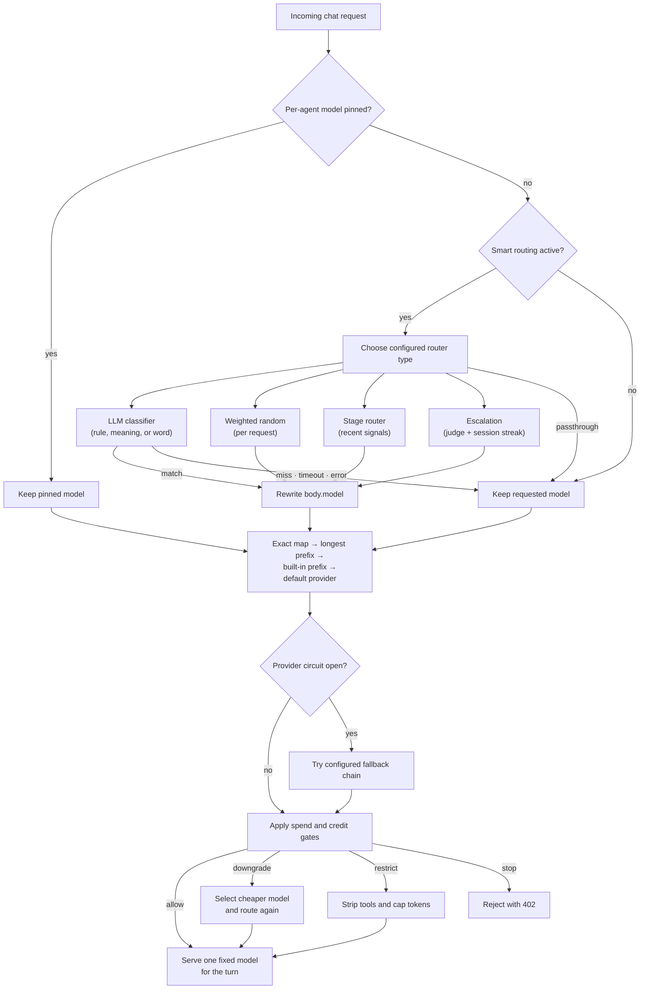

The [routing strategies](/docs/gateway/routing#the-strategies) pick a provider from the *requested* model. Smart routing picks the
model itself before normal provider routing. The default **LLM classifier** uses plain-language
rules like *"coding or debugging → claude-sonnet-4-5"*, while the other router types split,
stage, escalate, or explicitly preserve the requested model.

It runs before the normal routing in `apply_smart_routing` (`apps/gateway/src/pipeline/routing_smart.rs`):
`SmartRouter::resolve` (`apps/gateway/src/router/smart.rs`) chooses a target according to the
configured `router_type`. The chosen model rewrites `body["model"]` *before* `pre_process` runs,
so it then resolves its provider through the ordinary `ModelRouter`. Nothing about providers is
hardcoded: the target is any routable model id, including local models and `openrouter/…` slugs.

This is **Plane A** model routing: it rewrites the model inside one completion request. It is one of
two routing planes; the model-vs-agent split and the ownership rule are on the
[Routing planes](/docs/gateway/routing-planes) page.

## Router types

`router_type` selects the top-level model-selection algorithm. The existing classifier remains the
backward-compatible default; `strategy` only applies to `llm_classifier`.

The router families are informed by the provider-agnostic patterns in [NVIDIA NeMo
Switchyard](https://developer.nvidia.com/blog/route-ai-agent-workloads-across-models-with-nvidia-nemo-switchyard);
Ryu keeps each decision inside Gateway's existing fail-open and model-to-provider boundaries.

| Router type | What it does | Configuration |
|---|---|---|
| `llm_classifier` | Matches the request to a natural-language rule using `llm`, `embedding`, or `keyword`. | `rules`, `strategy`, and the matching strategy's model settings |
| `passthrough` | Keeps the model requested by the caller. Useful when the routing section is enabled but a deployment wants an explicit no-op. | No target settings |
| `random` | Chooses a target independently for each request using relative rule weights. | At least two targets with a model and a positive weight (defaults to 1); `random_seed` is optional |
| `stage_router` | Chooses a capable or efficient tier from recent tool/result and progress signals. | `stage_capable_model`, `stage_efficient_model`, picker, and confidence settings |
| `escalation` | Asks a judge about the current trajectory and latches a session to the strong tier after consecutive escalation verdicts. | Weak, strong, and judge models plus confirmation/window settings |

`random` is not session-sticky: the same conversation can move between weighted targets.
An optional seed makes the process-local sequence reproducible for tests and benchmarks, but it is
not a rollout or experiment assignment key. `stage_router` is a bounded local signal heuristic in
Ryu, so treat it as a pilot until its signals match your workload.

## Strategies

The `strategy` field (serialized `"llm" | "embedding" | "keyword"`, `RouteStrategy` in
`apps/gateway/src/config.rs`) chooses *how* a rule is matched. All three are opt-in and fail open
(any miss, timeout, or error keeps the originally requested model), and all resolve the classifier or
embedder *directly*, never as a governed chat turn, so routing cannot recurse into routing.

| Strategy | How it matches | Cost | Notes |
|---|---|---|---|
| `llm` (default) | A cheap classifier model reads the message, enumerates the rules, and replies with the matching rule number (one LLM round-trip per uncached decision). | One extra completion | Requires a non-empty `classifier_model`. The classifier is itself resolved through the router, so it can be local, hosted, or an `openrouter/…` slug. |
| `embedding` | RAG: embed each rule's description once + the query, then route to the cosine-nearest rule above `similarity_threshold`. **No LLM call.** | One embedding per turn (cheap/local) | Reuses the semantic-cache embedder (`embed_text` / `cosine_similarity`) against the local `nomic-embed` sidecar. Rule embeddings are cached. |
| `keyword` | Case-insensitive significant-word match of a rule's description terms against the message. | Zero cost, zero network | Fully local. |

## Configuration

Smart routing is configured under `routing.smart_routing` in `gateway.toml`
(`SmartRoutingConfig` in `apps/gateway/src/config.rs`):

| Field | Meaning | Default |
|---|---|---|
| `enabled` | Master switch | off |
| `router_type` | `llm_classifier` \| `passthrough` \| `random` \| `stage_router` \| `escalation` | `llm_classifier` |
| `strategy` | How a rule is matched under `llm_classifier` - `llm` \| `embedding` \| `keyword` | `llm` |
| `classifier_model` | The cheap model that sorts requests (**`llm` strategy only**) | local classify tier |
| `embedding_model` | Embedder for the `embedding` strategy; empty → `nomic-embed-text-v1.5` on the local sidecar | empty (falls back to the semantic-cache embedder) |
| `similarity_threshold` | Min cosine similarity for `embedding` to accept a rule | 0.35 |
| `random_seed` | Optional seed for a reproducible process-local `random` sequence | unset |
| `rules` | Ordered list of `{ description, model, weight }` entries; `description` and `weight` are used by `llm_classifier` and `weight` by `random` | empty (inert) |
| `default_model` | Model to use when `llm_classifier` matches no rule | none (keep requested model) |
| `stage_capable_model` / `stage_efficient_model` | The two targets for `stage_router` | empty |
| `stage_picker` | `capable_first` or `efficient_first` when signals are ambiguous | `capable_first` |
| `stage_confidence_threshold` | Signal confidence required to override the ambiguous-turn picker | 0.5 |
| `stage_recent_message_window` | Recent request messages considered by `stage_router` | 3 |
| `escalation_weak_model` / `escalation_strong_model` / `escalation_judge_model` | The routine, escalated, and judge targets for `escalation` | empty |
| `escalation_confirmations` | Consecutive `ESCALATE` verdicts before a session latches to strong | 2 |
| `escalation_recent_message_window` / `escalation_message_chars` | Transcript window and per-message cap shown to the judge | 28 / 500 |
| `cache_by_session` | Cache `llm_classifier` decisions by `x-ryu-session-id`; other router types have their own per-request or escalation state | on |
| `timeout_ms` | Classifier or escalation-judge timeout | 4000 |
| `allowed_models` | Routing pool: model-id patterns a routed target must match (see [Routing pools](#routing-pools)) | empty (any model) |
| `allowed_providers` | Routing pool: provider ids a routed target may resolve to | empty (any provider) |
| `agent_pools` | Per-agent routing pools, keyed by agent id; each narrows the node pool for that agent | empty |
| `agent_routes` | Per-agent overrides, keyed by agent id; each replaces this config for that agent (see [Per-agent override](#per-agent-override-agent_routes)) | empty |

Smart routing only runs when `enabled` is set and the selected type has the targets it needs
(`is_active` in `apps/gateway/src/config.rs`). `llm_classifier` needs rules and, for `llm`, a
classifier model; `random` needs at least two weighted targets; `stage_router` needs both tiers;
`escalation` needs weak, strong, and judge models. `passthrough` needs no targets.

Edit rules in Desktop under **Gateway → Model routing → Smart routing**, or configure them directly
in `gateway.toml`. The Desktop editor requires `gateway.configure`; without that permission, its
controls, including rule removal and saving, remain read-only. Confirmation counts below 1 are
saved as the default 2, and the editor reflects that saved value.

Before saving, the editor requires each classifier rule to have both a description and target
model. Weighted random requires at least two targets, each with a model and positive weight. Remove
an unfinished row or complete it before retrying Save. A saved `smart_routing` change is swapped into
the running Gateway through `PUT /v1/config` with no restart. The rest of the routing section
(`model_map`, `fallback_chain`, and provider tiers) is read at startup and takes effect on the next
Gateway restart.

For example, a reproducible 3:1 traffic split is:

```toml
[routing.smart_routing]
enabled = true
router_type = "random"
random_seed = 42
rules = [
  { description = "primary", model = "claude-sonnet-4-5", weight = 3.0 },
  { description = "candidate", model = "gpt-4o-mini", weight = 1.0 },
]
```

## Routing pools

A routing pool limits which targets smart routing may choose. It has two lists, and a target must
match both:

- `allowed_models` - model-id patterns. Matching is case-insensitive, and `*` matches any run of
  characters. `*claude*` matches `claude-sonnet-4-5` and `openrouter/anthropic/claude-opus-4`;
  `gpt-*` matches `gpt-4o` but not `openrouter/openai/gpt-4o`.
- `allowed_providers` - provider ids that the target model resolves to through normal provider
  routing. Examples include `anthropic`, `openai`, `openrouter`, `managed-openrouter`, a
  `[providers.compatible.<id>]` endpoint's id, and `core` for agent models that Core serves.

An empty list does not limit its dimension, so the default pool allows everything.

The node pool (`allowed_models` and `allowed_providers`) applies to every request. Each entry in
`agent_pools` applies only to requests attributed to that agent, and it can only narrow the node
pool. For example, this node routes between Claude and GPT models, and one agent stays on Claude
models served through OpenRouter:

```toml
[routing.smart_routing]
enabled = true
strategy = "keyword"
allowed_models = ["*claude*", "gpt-*"]
rules = [
  { description = "coding or debugging", model = "openrouter/anthropic/claude-sonnet-4.5" },
  { description = "quick questions", model = "gpt-4o-mini" },
]

[routing.smart_routing.agent_pools.research-bot]
allowed_models = ["*claude*"]
allowed_providers = ["openrouter"]
```

The router only considers targets inside the pool:

- Classifier and weighted-random rules outside the pool are skipped, so the classifier never sees
  them and the remaining weights are renormalized.
- A `default_model` outside the pool is ignored.
- If one `stage_router` or `escalation` tier is outside the pool, both tiers use the allowed tier. If
  both tiers are outside the pool, the router does not run.
- The classifier, embedder, and escalation judge are helper calls, not routing targets, so the pool
  does not apply to them.

When nothing in the pool can serve a request, smart routing does not run and the requested model is
kept. Pools limit routing decisions only. A model that the caller requests directly is governed by
the organization's `approved_models` allowlist and other model policy, not by the routing pool.

The Gateway identifies the agent from the same identity it uses for per-agent budgets. That is
`x-ryu-agent-id` from a trusted forwarder, such as Core forwarding an OpenAI-compatible agent's
chat, or the Core-proven `/v1/agents/<id>` route that ACP agents use when their provider traffic is
routed through the Gateway. A caller cannot select a different agent's pool. An ACP agent with
direct provider egress does not send its model calls through the Gateway, so its pool has no effect
until Gateway routing is turned back on.

In Desktop, edit the node pool under **Gateway → Model routing → Smart routing → Routing pool**. Edit an
agent's pool in that agent's settings under **Routing pool**. Both editors need the
`gateway.configure` permission and save to the Gateway config. Changes apply to new requests without
a Gateway restart.

## Routing decision map

The router has several layers, but only one model should reach the provider for a turn. An explicit
per-agent pin wins first; smart routing can rewrite an unpinned request; deterministic provider
mapping and circuit fallback then resolve the destination. Budget `downgrade` is the one
exception that can select a cheaper model after the initial decision.



## Per-agent override (`agent_routes`)

Global `smart_routing` is the *default*. An individual agent can override it: the global config is
the fallback, and the per-agent entry is the override. Each override is a full
`SmartRoutingConfig` stored in the global config under `agent_routes`, keyed by agent id:

```toml
[routing.smart_routing.agent_routes.research-bot]
enabled = true
strategy = "keyword"
rules = [
  { description = "coding or debugging", model = "openrouter/anthropic/claude-sonnet-4.5" },
]
```

The Gateway applies the override to every request attributed to that agent, using the same agent
identity as [routing pools](#routing-pools) and per-agent budgets: `x-ryu-agent-id` from a trusted
forwarder, or the Core-proven `/v1/agents/<id>` route. That covers OpenAI-compatible agents and ACP
agents whose model calls go through the Gateway. An ACP agent with direct provider egress bypasses
the Gateway, so its override has no effect until Gateway routing is turned back on.

`configured_agent_router` in `apps/gateway/src/pipeline/routing_smart.rs` builds or reuses one `SmartRouter` per
distinct override (hashed JSON, cached in `AppState.per_agent_routers`). An override's own
`agent_pools` and `agent_routes` are ignored. An override can define its own `allowed_models` and
`allowed_providers`; the node pool and that agent's `agent_pools` entry still apply, so an override
cannot leave the node's [routing pool](#routing-pools).

Core can also send a request-scoped override as the private `ryu_smart_route` body field, which the
Gateway accepts only from a trusted forwarder and strips before the provider call. When present, it
wins over the stored `agent_routes` entry. Older Desktop builds stored overrides in the
`agent-smart-route` Core preference, which Core sends this way only for OpenAI-compatible chat. The
agent editor loads such an entry as its starting draft, and saving moves it to `agent_routes` and
removes the Core copy.

In Desktop, open an agent's settings and use **Override model routing for this agent**. Saving
requires the `gateway.configure` permission. The editor keeps the draft if a read or save fails. Turning the override off removes only that agent's entry. Changes apply to new requests
without a Gateway restart.

The **Smart routing** card in **Gateway → Model routing** reads and writes the routing config
through the same config endpoint as the rest of the dialog. If the Gateway config read fails while
the node is reachable, select **Retry** on the card to reload it.
An older Gateway that does not report `routing.smart_routing` keeps the editor disabled; this avoids
writing a fabricated default into the full routing section.

## Behavior and guarantees

- **Fails open everywhere.** An inactive config, an unparseable classifier reply, a classifier
  or judge error, an unusable target, or a timeout all keep the originally requested model, so a
  misconfiguration can never break chat. The one exception is a provider safety refusal of the
  classifier or judge call on the hosted Gateway: it ends the request, as described in
  [Provider safety refusals](/docs/gateway/account-standing#provider-safety-refusals).
- **Explicit pinning wins.** When Core forwards an agent with a pinned chat-model setting, that model
  is an explicit user choice and smart routing never overrides it.
- **Eval routing is skipped** for a smart-routed request, so eval/A-B routing does not reassign
  the classifier's chosen provider.
- **Per-request versus per-session state.** `random` and `stage_router` decide independently for
  each request. With `cache_by_session` on (the default), `llm_classifier` caches against
  `x-ryu-session-id`; `escalation` uses that id only for its consecutive-verdict streak.
- **Observability.** The model that actually handled the request is returned in the
  `x-routed-model` response header (`apps/gateway/src/api/chat.rs`).

<Callout type="info">
  Ryu's `escalation` type is a trajectory-aware preflight: the judge reads the accumulated
  transcript before the current model call. It does not buffer a completed weak response and
  replay that response through the strong model, because the current Gateway routing hook chooses
  the model before provider execution. A post-response replay loop is not available.
</Callout>

The NVIDIA Switchyard **prefill** router is not exposed as a Ryu type yet. It requires access to
provider residual-stream activations, which the provider-neutral Gateway contract does not receive.

## Related

<Cards>
  <DocCard href="/docs/gateway/routing" />
  <DocCard href="/docs/gateway/agent-auto" />
  <DocCard href="/docs/gateway/routing-planes" />
  <DocCard href="/docs/providers/provider-pools" />
</Cards>
