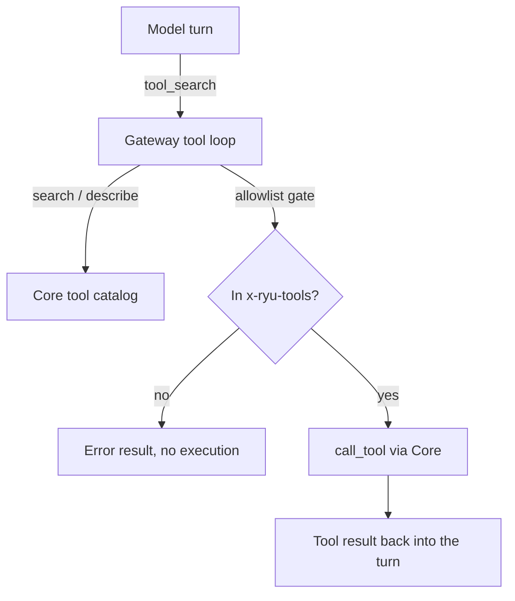

The Gateway is the governance front for tool use. It decides *what is allowed, measured, and audited*; Core decides *what runs* (search ranking and the actual tool execution). The Gateway-side surfaces are the `tool_search` meta-tool injected into chat requests, the buffered tool-call loop, and `POST /v1/exec/tool` for direct programmatic execution.

The Core-side catalog it queries and the programmatic-tool-calling sandbox it forwards to have
their own pages:

<Cards>
  <DocCard href="/docs/core/unified-tool-catalog" />
  <DocCard href="/docs/core/programmatic-tool-calling" />
</Cards>

## Automatic turn suggestions

Gateway-routed Core turns can run a local capability preflight before the model call. Core ranks
the latest user request with the local Needle 3/BM25 catalog selector, caches the small descriptor
result briefly, and sends only the current turn's suggested tool and Skill IDs. The Gateway
re-checks the allowlist, injects matching tool schemas, and never records the suggestions as chat
messages.

The hint is placed after the reusable prompt prefix, so it does not rewrite the long-lived system
prompt on every message. Tool-active turns bypass the semantic response cache and include the hint
and tool schema in the exact-cache material. A [provider prompt cache](/docs/gateway/prompt-caching) can
therefore keep the stable prefix warm without treating discovery metadata as conversation history.

If the local selector is unavailable, Core falls back to the deterministic catalog ranker. The
existing `tool_search` meta-tool remains the recovery path for capabilities that were not suggested.

## Two planes, one governance front

Both chat planes route tool execution through the Gateway, so the allowlist and audit apply uniformly:

- **OpenAI-compat plane** - the Gateway injects `tool_search` and drives a buffered search-describe-call loop (`apps/gateway/src/tools/mod.rs`).
- **ACP plane** - Core's MCP bridge offers the same `tool_search`/`describe`/`execute`/`resume` meta-tools to ACP sessions (`apps/core/src/sidecar/adapters/mcp_bridge.rs`), and routes execution through the same governed path.

Every privileged operation crosses from the Gateway to Core over HTTP via the `providers.core` client, which is configured by `CORE_URL` and `CORE_TOKEN` (set by Core when it spawns the Gateway as a managed sidecar).



## The `tool_search` meta-tool

Instead of handing the model every tool, the Gateway injects a single discovery tool. The model calls `tool_search` first to find a capability, then calls the returned function by the name in its injected definition.

- The name is `tool_search` (`TOOL_SEARCH_NAME`, `apps/gateway/src/tools/mod.rs`).
- It is **always permitted** and never allowlist-gated. Search is not a grant: discovering a tool does not authorize executing it.
- Its definition is byte-identical to the one the ACP bridge offers, so both planes expose the same contract.

The parameters the model sees:

| Field | Type | Default | Meaning |
|---|---|---|---|
| `query` | string | required | Natural-language description of the capability needed |
| `kind` | enum `mcp` `builtin` `composio` `app` `any` | `any` | Filter by tool source plane |
| `limit` | integer (1-25) | `8` | Max results |

When the model calls `tool_search`, Core's unified catalog uses the default Needle 3 selector to
put relevant tools and Agent Skills first, then the Gateway describes the top hits and injects
their full tool definitions into the request so the model can call them on the next round. The
result the model receives is a compact descriptor list (`id`, `name`, `description`). Needle 3 is
only a discovery/ranking aid: the model still makes the final tool choice, while the Gateway and
Core enforce authorization and execution.

Catalog ids remain canonical dotted ids for search results, allowlists, audit, and Core dispatch. At the OpenAI-compatible function boundary, Composio action ids use legal `composio__<action>` aliases because dots are not valid function-name characters; the Gateway reverses that alias before authorization, billing, and dispatch. The catalog id and the function alias therefore describe the same action without changing the governance key.

### Query provider usage from an agent

The Core catalog includes three read-only tools for quota-aware agents and monitors:

- `usage.current` reads the provider and model currently selected in Ryu.
- `usage.query` reads a requested provider and optional model, for example
  `{ "provider": "claude-pro-max", "model": "claude-sonnet-4" }`.
- `usage.providers` lists the provider IDs that have a supported normalized usage reader.

Their results include account-wide and matching model-scoped windows with `usedPercent`,
`remainingPercent`, the reported `window` (`5h`, `7d`, or another provider period), and
`resetsAt` in RFC 3339 UTC. BYOK providers that expose a prepaid balance return it in the
read-only meter rows. Window and meter values include stable `targetId` selectors. An unavailable
or unsupported provider is returned as `available: false` with a structured `reason`; it is never represented as a guessed zero.

The Gateway still gates these tools by the normal fully-qualified allowlist and audits the call.
Core resolves the active account or API key server-side; credentials never enter the tool
arguments or result.

## The buffered tool-call loop

On the OpenAI-compat plane the tool loop (`run_tool_loop`) runs against a non-streaming provider, then synthesizes the final SSE stream from the buffered turn (`value_to_sse_stream`). Each round:

1. The provider produces an assistant turn. If it has no `tool_calls`, the loop returns it (terminal).
2. The assistant turn is appended, then each tool call is handled:
   - `tool_search` queries Core and injects described defs.
   - Any other id passes the allowlist gate. A denial returns an error *result* (the model sees it as a tool message), never an execution.
   - Allowed ids execute via Core `call_tool`.
3. The loop repeats until there are no tool calls or `max_rounds` is reached.

### Independent reads run together

When the model asks for several tool calls in one step, the Gateway runs adjacent read-only calls at the same time, up to four at once by default. Results are always added to the conversation in the order the model asked for them, so the transcript is the same as running them one after another.

A call counts as read-only only when Core describes the tool that way. Today that means an MCP tool that declares `readOnlyHint: true` and does not declare `destructiveHint: true`. Everything else runs on its own, in order:

- `tool_search`
- calls refused by the allowlist or the firewall
- tools that change something or have no annotations
- Composio actions, Agent Skills, and tools derived from an app's OpenAPI document
- tools supplied by the caller or by `always_on`

A write between two reads therefore waits for the reads before it to finish, and the reads after it wait for the write. A tool found by `tool_search` can join a concurrent batch from the next step onwards.

The hint comes from the tool's own MCP server. A server that labels a write as read-only lets that write overlap neighbouring reads, so only install servers you trust. Approvals are unchanged: a gated call is queued for approval and answered right away, so it never holds a slot while waiting for a person.

Set `tools.parallel_reads` to `1` to run every call one at a time (see [Configuration: Tools](/docs/gateway/configuration-access#tools)).

If the loop exhausts `max_rounds` while the model is still emitting tool calls, the final turn is marked with `finish_reason: "length"` so the client can tell the turn was truncated rather than a clean stop.

### When the loop runs

The unified loop is gated so plain chat keeps its fast streaming path with no added latency. Two header signals are involved (parsed in `apps/gateway/src/pipeline/mod.rs`):

| Header | Field | Role |
|---|---|---|
| `x-ryu-tools` | `tool_actions` / `tools_header_present` | CSV of fully-qualified tool ids = the egress allowlist. Its literal presence is the trigger for the unified loop |
| `x-ryu-tool-search: on` | `tool_search_requested` | Explicit opt-in to the buffered search loop |

A bare Composio agent that carries only the legacy `x-ryu-composio-actions` header keeps its fast streaming path and the legacy Composio loop, never the unified loop. Core's ACP forwarder never sets `x-ryu-tool-search`, so there is no double surface on ACP egress.
In that legacy loop, a request's action header may only narrow the operator-configured Composio
actions. Naming an unconfigured action or `*` in a header cannot grant it.

When the Gateway is connected to Core, the legacy Composio loop executes through Core's governed
tool dispatcher. The owner's connection access level and the agent's approvals still apply when
a request omits tool-discovery headers. Core refusal or unavailability does not fall back to direct
provider execution, and Core settles the execution receipt once. On a shared node, a legacy request
without a verified owning conversation is denied; an account selector does not establish caller
authority. Use Core's native chat and tool flow for connected-account actions. A standalone Gateway
without a Core catalog continues to use its configured Composio action allowlist and provider account.

## The allowlist: fully-qualified ids only

The allowlist key is the fully-qualified tool id (`<server>.<tool>`, for example `spider.crawl`) end to end. A request's allowlist comes from `x-ryu-tools`; an empty allowlist denies all non-`tool_search` execution (search still works, execution is gated).

Matching is exact on the FQ id. Bare-name and bare-server entries are rejected: an entry like `search` must not authorize `exa.search` or `composio.search` across planes. To grant a whole server, use the explicit `<server>.*` id form upstream, never a bare-server equality.

```http
x-ryu-tools: spider.crawl,exa.search
```

## `POST /v1/exec/tool` - the direct exec front

For programmatic execution outside the chat loop (the PTC path and direct tool calls), the Gateway
exposes one governed endpoint (`apps/gateway/src/tools/exec.rs`). PTC uses the same Needle 3-backed
`tool_search` discovery step before the model writes an `execute` program; `execute` and `resume`
remain fixed meta-tools and never bypass their sandbox, budget, scan, approval, or audit gates.

```http
POST /v1/exec/tool
```

The `kind` field selects the operation:

| `kind` | Forwards to Core | Purpose |
|---|---|---|
| `tool` (default) | `POST /api/mcp/tools/call` | Run a single tool by `tool_id` |
| `execute` | `POST /api/tools/exec` | Run model-authored code (PTC) |
| `resume` | `POST /api/tools/exec/resume` | Resume a paused PTC run (HITL) |

Key request fields:

| Field | Used by | Notes |
|---|---|---|
| `kind` | all | Defaults to `tool` |
| `tool_id` | `tool` | Required when `kind=tool` |
| `arguments` | `tool` | Tool arguments object |
| `code` | `execute` | The PTC code to run |
| `execution_id` | `resume` | The paused run to resume |
| `agent_id` | all | Logically required; Core is fail-closed and agent-scoped |
| `user_id`, `session_id` | all | Identity and budget attribution |

The response is `{ ok, result?, error? }`, with `result` and `error` omitted when absent.

### Governance gate

The exec front is locked down. The caller must be a trusted forwarder or the master key, and the trust is neutralized when the mesh is on:

```rust
(trusted_forwarder || master_key) && !mesh_enabled()
```

A non-trusted, non-master caller is rejected with `401 Unauthorized`. The mesh neutralization exists because userspace networking makes mesh peers appear as `127.0.0.1`, so loopback-trust gates would otherwise fail open (`RYU_MESH_ENABLED`, `apps/gateway/src/tools/mod.rs`).

## Connections layer

Some tool and account operations run through a managed connection provider that holds the
third-party account: Treg for metered tool APIs, and Composio for OAuth connected accounts and
toolkit actions. The Gateway owns their credentials and the wallet debit. Provider selection,
screening, and pricing are on [Connection provider calls](/docs/gateway/connection-calls).

## Budget and audit

Tool and code execution carry their own governance, separate from model-call spend budgets:

- **Exec budget** - the `ExecBudgetEnforcer` enforces count and wall-clock limits per rolling window, checked pre-run via `POST /v1/exec/budget/check` (`apps/gateway/src/state.rs`). The check and `POST /v1/exec/audit` both fail closed and accept only a trusted forwarder.
- **Exec audit** - every governed execution emits an audit event, so tool/PTC egress is recorded the same way model calls are.

Tool execution on both planes is therefore allowlist-gated and emits exec-budget and exec-audit records.

<Callout type="warn">
  This page governs *tool* egress. An ACP agent's own in-subprocess LLM provider calls (for agents that expose no base-URL hook) still bypass the Gateway. This surface does not govern that chat egress; see [Routing planes](/docs/gateway/routing-planes). The `execute`/`resume` exec kinds forward to Core's PTC endpoints; see [Programmatic tool calling](/docs/core/programmatic-tool-calling) for that side.
</Callout>

## Related

<Cards>
  <DocCard href="/docs/core/unified-tool-catalog" />
  <DocCard href="/docs/core/programmatic-tool-calling" />
  <DocCard href="/docs/gateway/connection-calls" />
  <DocCard href="/docs/gateway/governance" />
  <DocCard href="/docs/gateway/configuration" />
</Cards>
