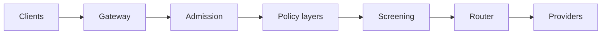

The **traffic map** draws every layer a request passes on its way to a model: where it came from,
the gateway's admission checks, the policy layers, the screeners, the router and the provider that
served it. Select any part of the map to see its numbers and change its settings in place.

## Where to find it

### Desktop app

Open Gateway settings, then **Limits & safety > Traffic map**. It shows this node's gateway with
live requests. Use the expand button for a larger view.

### Web console

Open your organization, then **Governance > Safety map**. The console lists it for members who
can configure the organization's gateway. It shows the layers that requests through your
organization's Ryu keys pass, with:

- how many policies are assigned at each layer;
- how many requests each layer saw and blocked, for the last 15 minutes, hour or 6 hours (pick
  the window from the map's toolbar).

The counts are per-minute totals for your organization only, and they refresh every few seconds.
They cover requests through Ryu's hosted gateways. Requests through your own self-hosted gateway
are not in them.

### Permissions

| Action | Permission needed |
|---|---|
| Watch live requests on the desktop | View the audit log on that node. Without it, the map still shows how requests are routed. |
| See traffic counts on the web console | View your organization's audit log. Without it, the map says so and still shows its layers. |
| Change settings from the map | The same permission as changing them anywhere else. |

## Reading the map

The map reads from left to right, in the order a request meets each layer:

| Column | What it shows |
|---|---|
| Clients | The API family a request arrived on: OpenAI-compatible, Anthropic Messages, subscription passthrough, or other routes. |
| Gateway | The gateway that received the request. |
| Admission | Rate limits, spending limits and account standing. |
| Policy layers | The Ryu platform floor, then your organization, teams, members, keys and agents. Each layer can only tighten the ones above it. |
| Screening | This node's own filters, the inspector and inline evaluators. |
| Router | Model routing and the response cache. |
| Providers | The provider that served the request, with its health. |

### Nodes and marks

Each node shows:

- how many requests passed through it;
- how many it blocked;
- the median latency of requests that ended there.

A map whose counts have not loaded, or could not be loaded, shows no numbers rather than zeros.
A lock marks a layer that Ryu or the pipeline fixes, such as the platform floor. A colored dot
marks a provider's health: a provider that keeps failing is paused and retried. **Legend**
explains every mark.

The map names layers and category codes only. It never shows request or response text.

### Live requests on the desktop

On the desktop, a moving dot is one request. Its color shows what happened to it: allowed,
sanitized, blocked, served from cache, screened in a reduced mode, or failed upstream.

**A blocked request stops at the layer that refused it** and leaves a short ring there, so you can
see which layer is doing the refusing.

When many requests arrive at once, the map draws at most 30 dots a second, keeping room for blocked
ones. The counts always include every request. If you have asked your system for reduced motion,
the map shows counts without moving dots.

### Counts on the web console

The web console's Safety map counts requests per minute and does not draw individual requests.
Select a layer to also see how many verdicts it reached in the chosen window and their category
codes.

- The median latency is rounded up to the nearest latency band.
- Requests are not yet split by the client they came from.

## Changing settings from the map

Select a node to open its panel:

- **Organization, teams, members, keys and agents** open the same named policy editor as
  [Guardrail policies](/docs/gateway/guardrail-policies). Saving here saves the same policy, and a
  newer saved version is handled the same way.
- **This node's filters, the inspector and evaluators** open this node's **Safety filters**.
- **Ryu platform floor** is managed by Ryu and read only. It screens requests that spend a
  Ryu-held credential, such as Ryu credits. Requests through your own provider keys or
  subscriptions are not screened by it.
- **Account standing** explains how Ryu can warn, slow down, restrict or suspend Ryu-managed traffic
  for an account that breaks the usage policy. Banning a person is always a human decision. See
  [Account standing](/docs/gateway/account-standing).
- **Rate limits, spending limits, the router and providers** link to the settings that control them.

The order of the fixed pipeline stages cannot be changed from the map.

## Assigning a policy by dragging

If you can configure your organization's gateway, the map shows a **Policies** palette with your
organization's named policies.

1. Drag a policy onto the organization, teams, members or keys layer. On the web console the
   agents layer takes a drop too. In the desktop app, assign agent policies from the policy editor.
2. Choose the exact team, member or key in the confirmation.
3. Confirm. Nothing is assigned until you do.

To assign without dragging, select a policy in the palette, then choose the layer and scope in the
confirmation.

A scope holds one policy. Dropping a policy on a scope that already has one does not replace it.
The confirmation says so, and you can replace it from the policy editor instead. A change that
needs you to confirm it's you asks the same way it does in the policy editor.

## Keyboard and screen readers

Switch to **Table** for every node and link as a table, with the same counts and an **Open** button
for each node's settings. On narrow windows the table is the default.

On the map, each node is a button:

| Key | Action |
|---|---|
| Tab or arrow keys | Move between nodes. |
| Enter | Open a node's panel. |
| Escape | Close the panel. In the desktop app, press it again to close Gateway settings. Escape also closes the larger view and puts focus back on the expand button. |

## Related

- [Named guardrail policies](/docs/gateway/guardrail-policies): the policies the layers apply.
- [Audit logs](/docs/gateway/audit): the full record of each request.
