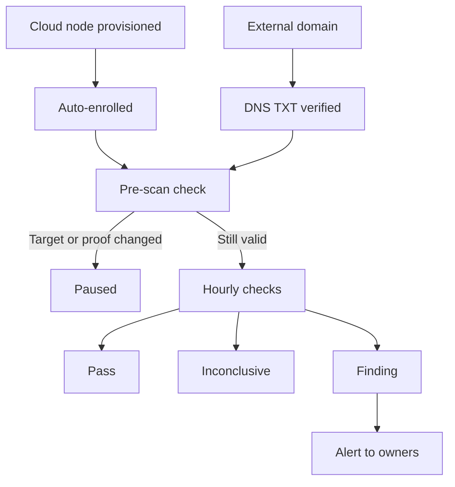

Ryu Watch is an exposure monitor for Gateway owners. It checks transport and management
authentication without reading private response bodies or running commands on a node.

- Ryu-managed cloud nodes are enrolled automatically after live provisioning succeeds.
- External self-hosted domains must be enrolled by their owners.

<Callout type="warn">
  Ryu Watch runs only when the service operator enables the Watch monitoring worker. Enrollment
  alone does not start checks.
</Callout>



## Cloud nodes are enrolled automatically

New and recovered cloud nodes appear as **Auto-enrolled cloud**. No DNS record or separate
signup is needed. Ryu uses its provisioned-server record to establish the target and owning
organization.

Who can view findings and pause or resume monitoring:

- current organization members with the `nodes.manage` permission (owners and admins by default,
  or a custom role that grants it);
- only from a session that meets the organization's sign-in policy (IP allowlist, required
  two-factor, and session lifetime). A session that does not meet it sees no organization
  findings and cannot pause them.

Reconciliation also covers existing active cloud nodes and missed enrollment after a restart. It
never re-enables a paused record. Simulated provisioning does not enroll a public target.

Before each managed scan, Ryu checks that the server is still active in the same organization
at the recorded address. An inactive, removed, or changed target is paused without probing it.
A cloud enrollment does not enable exploitation or publish an account email.

## Enroll an external self-hosted Gateway

Open **Ryu Watch** from Console on the web. A verified account email is required.

1. Enter a private display name and your Gateway's HTTP or HTTPS domain origin.
2. Confirm that you control the domain and authorize recurring exposure checks.
3. Publish the generated DNS TXT record.
4. Choose **Verify ownership**. Keep the DNS record in place while monitoring.

External enrollment supports domain origins on standard HTTP and HTTPS ports with public IPv4
addresses. It does not accept:

- IP literals or custom ports;
- private destinations;
- credentials in URLs;
- URL paths.

IPv6-only destinations are currently inconclusive. DNS ownership is checked again before every
scan; losing the proof pauses monitoring.

### Schedule, pause and removal

- Checks are scheduled hourly.
- **Pause monitoring** stops future checks. A running request may finish after pause, but it
  cannot replace the paused asset's findings.
- Removing an external asset through the account API also removes its stored monitoring record.
- Managed cloud records use pause rather than deletion, so reconciliation respects the owner's
  choice.

## Interpret results

| Result | Meaning |
| --- | --- |
| Pass | The specific check passed at the displayed observation time. |
| Finding | Evidence needs review; it is not a claim that an attacker accessed your node. |
| Inconclusive | The check could not establish the result. Previous findings remain unresolved. |

What a result does and does not establish:

- An open port alone does not establish a vulnerability.
- An unauthenticated successful response from a management path is a **potential exposure**. A
  proxy or fallback page may produce the same response, and the scanner does not read its body to
  establish access to private configuration.
- A transport pass establishes TLS certificate validation for that origin, not the security of
  every route or encryption at rest.

## Notifications and repair

### Who sees findings

| Findings | Visible to |
| --- | --- |
| External findings | The enrolled owner and authorized platform administrators. |
| Cloud findings and an organization's exposed-credential reports | The same people, plus the organization's current members with `nodes.manage`, because they manage and rotate Gateway credentials. |

The organization's sign-in policy applies here too. A session it refuses does not see that
organization's findings, and a pause or verify request returns the same refusal without changing
monitoring.

### Alerts

Alerts go to the organization's owners. Ryu uses verified account contacts rather than guessing
emails from IP addresses.

**Ryu Watch alerts** in notification settings controls email and inbox delivery separately, and
saving one switch keeps the others. A processed notification is not the same as a delivered email.

### Prepare a repair

**Prepare repair in Ryu** opens a prefilled chat.

1. Select and confirm the matching node before sending it. The link does not connect to a new
   node or execute a command.
2. Review the proposed change and its rollback before approving disruptive work.
3. Wait for a later successful check. Only that establishes that the exposure is no longer
   observed.

Analysis reports can prepare a review prompt, and open credential reports can prepare a
credential-rotation prompt. Both use the same review-before-send chat behavior.

Managed hosting is available separately through Ryu Cloud. Reviewing findings and preparing a
manual repair does not require buying managed hosting.

## Public security contacts

A Gateway can optionally publish an operator-selected public name and contact at
`/.well-known/security.txt`, using [RFC 9116](https://www.rfc-editor.org/rfc/rfc9116.html).
Publication is disabled by default and never copies your account email automatically.

Add an explicit section to `gateway.toml` (see [Gateway configuration](/docs/gateway/configuration)), then restart the Gateway:

```toml
[public_contact]
enabled = true
name = "Example research gateway"
contact = "mailto:security@example.com"
canonical = "https://node.example.com/.well-known/security.txt"
expires = "2027-03-01T00:00:00Z"
```

Rules for the record:

- Use a dedicated security alias, or an HTTPS contact-form URL in `contact`. Anyone can read a
  published address, including spammers.
- Serve the record over HTTPS at its canonical URL.
- Set `expires` in the future and within 366 days. Expired or invalid records return not found.
- To withdraw it, set `enabled = false` and restart. Third parties may retain a copy after
  publication.

This is an operator-declared contact, not proof that Ryu verified the mailbox or the person's
legal identity. A public contact is **not authorization for testing**. Monitoring enrollment and
any later red-team authorization are separate.

## Credential and analysis coverage

GitHub partner intake verifies GitHub's signature before processing a report. It matches a hash
of the reported token against Ryu-issued Gateway credentials.

- Raw tokens, source URLs, and source content are not stored in findings.
- Unmatched reports do not identify an owner and do not trigger guessed-email outreach.

<Callout type="warn">
  GitHub partner registration and live report delivery require separate setup with GitHub. An
  enabled intake endpoint alone does not mean the partnership is active.
</Callout>

Platform administrators can review repository and node analysis reports separately:

| Report | What it checks |
| --- | --- |
| Repository analysis | Leaked secrets, selected static-analysis rules, and JavaScript dependency advisories. |
| Node analysis | Local file metadata and Core's existing encryption-posture report. It does not download or decrypt vaults. |

Reports show their source, subject, revision, and observation time. Stale, failed, or missing
checks must not be interpreted as secure.

Automated analysis is bounded coverage, not a certification that all vulnerabilities have been
found. Active exploitation and internet-wide red teaming are not enabled by these checks.
