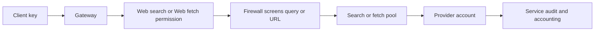
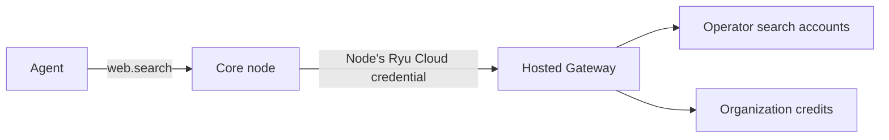

The Gateway can run web searches and fetch pages for clients through direct provider connections.
Its `/v1/web/*` routes are Ryu extensions, separate from OpenAI chat completions and model
discovery. Check `GET /v1/web/capabilities` with your client key before using them.



## Providers

| Provider | Search | Fetch formats |
| --- | --- | --- |
| Tavily | Yes | Markdown, text |
| Brave Search | Yes | No |
| Serper | Yes | No |
| Exa | Yes | Text |
| Linkup | Yes | No |
| Parallel | Yes | No |
| Perplexity Search | Yes | No |
| Google Custom Search | Yes | No |
| SearchAPI | Yes | No |
| Firecrawl | No | Markdown |
| Jina Reader | No | Markdown |

### Accounts

Each keyed connection can have multiple accounts with names, enabled state, and priorities.

- Credentials are write-only.
- Replacing an account uses its identity and preserves the other accounts.

### Provider notes

- **Google Custom Search** accounts include their engine ID; the same key with two engines
  creates two distinct connections. Google requires an existing-customer acknowledgment and
  becomes unavailable when its supported API is discontinued.
- **SearchAPI** currently supports its Google engine.
- **Parallel** searches use its `fast` mode and return up to 10 results, each with the excerpts
  Parallel selected for the query.
- **Jina Reader** can use a stored key or explicit anonymous mode. Anonymous mode has no
  credential account. It does not grant unauthenticated access to your Gateway or establish a
  free pricing policy.

## Grant client access

Create a local client key with **Web search** or **Web fetch** selected under
**Gateway → API keys** (the **Gateway client API keys** card). Existing inference keys and scoped
inference tokens do not gain these permissions automatically.

```toml
[[auth.api_keys]]
name = "web-tools"
key = "YOUR_GATEWAY_CLIENT_KEY"
allowed_operations = ["web_search", "web_fetch"]
trusted_forwarder = false

[providers.web.tavily]
mode = "accounts"

[[providers.web.tavily.accounts]]
api_key = "YOUR_TAVILY_KEY"
context = { kind = "default" }

[routing.web.search]
kind = "provider"
provider = "tavily"

[routing.web.fetch]
kind = "provider"
provider = "tavily"
```

You add web credentials yourself. These connections do not import environment, fleet, or
app-plugin credentials. See [Provider connections](/docs/gateway/provider-connections) for
revision checks, live application, and client-key version requirements.

## Requests

Send your Gateway client key in `Authorization: Bearer …`.

```http
POST /v1/web/search
Content-Type: application/json

{"query":"Ryu provider routing","limit":5,"provider":"tavily"}
```

```http
POST /v1/web/fetch
Content-Type: application/json

{"url":"https://example.com/","format":"markdown","provider":"tavily"}
```

Omit `provider` to use the configured binding.

| Rule | Limit |
| --- | --- |
| Search `limit` | 1 to 10 |
| Search query | At most 400 characters and 50 words |
| Fetch target | Public HTTP(S) only. Private destinations are rejected. |
| Fetch `format` | Must be supported by the selected provider, or the request is rejected before it is sent |

### Firewall screening

The firewall screens the search query and the fetch URL before any provider is called.

A fetch URL is screened as written and again with its percent escapes decoded, since the target
site reads it decoded. A secret or blocked pattern spelled with escapes such as `%41` is handled
like the plain text: the Block and Sanitize policies refuse the fetch.

## Routing and accounting

### Provider pools

Search and fetch have separate provider pools.

- Priority, round robin, weighted selection, and session affinity operate within each service.
- A stable `x-ryu-session-id` keeps eligible sessions on their selected connection.
- Provider and region restrictions apply to every candidate.
- An uncertain delivery is not replayed against another connection.

The Gateway advertises supported policies through `GET /v1/config` → `strategyCapabilities.web`.
Web pools use the shared selection vocabulary where applicable, including quota, reset and cost
signals. Missing or stale observations remain unknown and use the supported fallback; they are not
reported as unused quota or free calls.

Fusion, pipeline, context relay, context optimization and cache optimization are chat-only and are
rejected for web pools. See [chat provider pools](/docs/providers/provider-pools#selection-strategies)
for the selection vocabulary and its conversation-specific execution limits.

### Usage and audit

Web calls use request and document units, never chat-token usage. Service activity appears
separately in audit and traffic views. Query text, target URLs, extracted content, and account
contexts are omitted from service audit records.

### Cost

- BYOK calls do not debit the organization wallet. Without configured pricing, their cost is
  unknown.
- Managed execution requires an explicit price and available credit reservation.
- Reported costs must stay within the configured ceiling. Missing prices or invalid financial
  metadata cannot be treated as a free successful charge.

## Hosted web search

With a managed organization key, the Gateway can serve web search from search
accounts the deployment operator owns. You do not add a search provider key.

### Billing

- Each successful search is billed to the organization's credit balance at the deployment's
  configured per-search price.
- It counts toward organization and key spending limits, and toward member limits when the
  request carries a verified member identity.
- Searches a Core node makes through Ryu Cloud Search are attributed to the organization and the
  node's key, not to an individual member.
- Usage and the ledger list it as **Web search**, separately from model usage. Fetches stay with
  the rest of Gateway usage.

### Use it from a Core node

Agents can use it through the **Ryu Cloud Search** provider of the `web.search` layer. Every Core
node ships with it. Pick it in the node's **Toolkits → Search** menu, and agents keep calling
`web.search` as before.



- Until you pick it, agents do not see it as a separate tool and it sends no billed searches,
  even if your current provider is unavailable.
- Core sends each query to Ryu Cloud with the node's own Ryu Cloud credential, which is never
  exposed to agents or plugins.
- Without a Ryu Cloud connection, or when hosted search is off or credits run out, the tool
  answers with the reason instead of failing the turn.

New node keys include hosted web search, and most existing node keys were updated to include it.
If a node's credential still cannot use it, an organization admin can issue a new node key.

### Turn it off

Organization owners and admins can turn this off under **Organization → Features → Hosted web
search**. The setting applies to the whole organization.

When it is off, managed search requests are refused before any provider is called. Calls that use
your own provider accounts are never billed to the wallet and are not affected.

### Price a search route

Operators price a search route per provider and operation. Configure the price before you route
managed traffic to it, because unpriced routes are not eligible for managed requests:

```toml
[providers.web.parallel]
mode = "accounts"

[[providers.web.parallel.accounts]]
api_key = "YOUR_PARALLEL_KEY"
context = { kind = "default" }

[routing.web.search]
kind = "provider"
provider = "parallel"

# Micro-USD per call. The reservation must be at least the maximum reported
# cost, which must be at least the fallback price.
[credits.web_service_prices.parallel.search]
reservation_micro_usd_per_call = 1000
max_reported_micro_usd_per_call = 1000
fallback_micro_usd_per_call = 1000
```

Parallel does not report a per-request cost, so the fallback price is the amount
charged before the deployment's credit markup.
