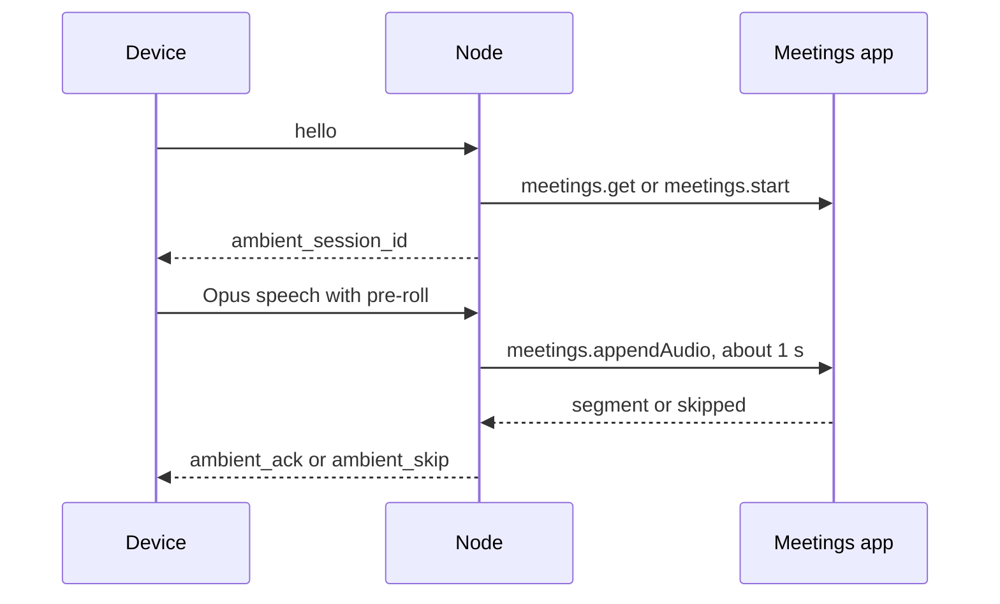

Ambient capture is the always-on listening mode. When someone speaks, the device streams that speech to the node, where it joins the meetings pipeline that powers transcription, summary, and recall. There is no separate ambient backend.

The node opens ambient sessions for the necklace and the desk hub, when they have a microphone. A watch relayed through a phone also rests in `ambient` and sends speech, but the node answers its chunks with `ambient_skip` (see [Hardware Devices](/docs/hardware/devices)).

## How it works

A device in `mode: ambient` does not stream a constant audio feed. It runs on-device VAD (voice-activity detection) and only transmits when speech is present.

<Steps>
  <Step>
    On `hello`, an ambient-capable device gets an `ambient_session_id` from the node. It names a long-running meeting that the device's speech accumulates into.
  </Step>
  <Step>
    The device's VAD watches the mic. When speech starts, it streams Opus, including an 800 ms pre-roll ring buffer so the first words are not clipped. When speech stops, it stops streaming. Silence is never sent.
  </Step>
  <Step>
    The node buffers about 1 s of decoded 16 kHz audio and appends it to the device's ambient meeting through the Meetings app's `meetings.*` capabilities, the same ingest that backs `POST /api/meetings/:id/chunk`.

    The chunk is transcribed, stored as a segment, and indexed for recall. The node replies with `ambient_ack`, or with `ambient_skip` when the chunk turned out to be silence, no ambient meeting is bound, or the append failed.
  </Step>
  <Step>
    The Meetings app summarizes the accumulating session, and the transcript becomes searchable in recall. To show ambient output on the desk e-ink panel, add it as a widget to the device's [dashboard](/docs/hardware/dashboard).
  </Step>
</Steps>

This is the [meeting notes](/docs/core/meeting-notes) pipeline doing the work. An ambient session is a meeting that never finalizes on a fixed boundary. It rolls.

- Everything downstream of the chunk ingest (transcribe, segment, summarize, recall) is unchanged.
- The device row remembers its ambient meeting, so a reconnecting device resumes the same meeting unless it was deleted.

<Callout type="warn">
  Ambient capture needs an enabled app that provides the `meetings.*` capabilities, normally the [Meetings](/docs/apps/meetings) app. Meetings is experimental and not pre-installed, so install and enable it first. Without it the node cannot open an ambient meeting for the device.
</Callout>

## Why on-device VAD is required

- **Battery.** Radio transmit time dominates a wearable's power budget, so a device that streams
  continuously drains fast. VAD limits transmission to detected speech.
- **ASR load.** Transcription work scales with audio minutes. VAD sends only speech, so the node
  transcribes less audio.

The firmware VAD (`apps/hardware/firmware/shared/vad/`, `vad_default_config`) uses these defaults:

| Setting | Default |
|---|---|
| Input sample rate | 16 kHz |
| Analysis frame | 20 ms |
| Pre-roll | 800 ms |
| Trailing silence before a segment ends | 600 ms |
| RMS energy gate | 500, tune per microphone |

Transcription runs on the node with whisper.cpp, the same engine the meetings pipeline uses, so
audio stays on hardware you control.

<Callout type="warn">
  Always-on capture records bystanders, which carries real consent and retention obligations. Read [Ambient data and privacy](/docs/hardware/security#ambient-data-and-privacy) before you turn it on.
</Callout>

## Related

<Cards>
  <DocCard href="/docs/hardware/devices" />
  <DocCard href="/docs/hardware/protocol" />
  <DocCard href="/docs/hardware/security" />
</Cards>

