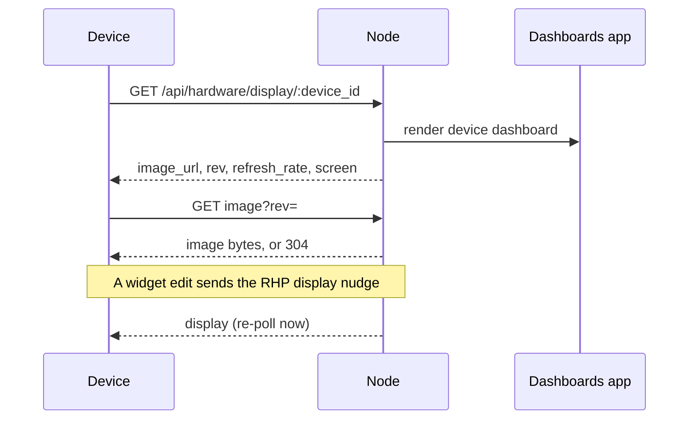

The desk hub (e-ink) and the watch (LCD) both show a customizable widget dashboard. It follows the [TRMNL](https://docs.trmnl.com/go/how-it-works) model: the **node renders the dashboard to an image**, and the device polls and displays it. Hardware reuses the [Dashboards](/docs/apps/dashboards) widget engine and the `dashboard_builder` tools instead of a separate widget system.

<Callout type="warn">
  Device dashboards need an enabled app that provides the `dashboards.*` capabilities, normally the [Dashboards](/docs/apps/dashboards) app. Dashboards is experimental and not pre-installed, so install and enable it first.
</Callout>

## Server renders, device displays

The device never composes widgets. It fetches a finished image at its own resolution and depth and blits it.



<Steps>
  <Step>
    The device polls the node on an interval with `GET /api/hardware/display/:device_id`, sending its own device token as the Bearer.
  </Step>
  <Step>
    The node renders that device's dashboard to an image and returns a small JSON envelope:

    - `image_url`;
    - a content `rev` hash, so the device skips re-download when nothing changed;
    - a `refresh_rate` in seconds;
    - a `screen` descriptor with width, height, bit depth, a palette of `mono`, `rgba`, or `rgb565`, and rotation.
  </Step>
  <Step>
    The device downloads the image (1-bit packed for e-ink, a color raster for LCD) and displays it. The image route returns `304 Not Modified` when the device's `rev` still matches. E-ink uses partial refresh with a periodic full clear.
  </Step>
</Steps>

The envelope looks like this:

```jsonc
{ "image_url": "/api/hardware/display/:device_id/image?rev=<hash>",
  "rev": "<content-hash>",
  "refresh_rate": 300,
  "screen": { "w": 800, "h": 480, "bit_depth": 1, "palette": "mono", "rotation": 0 } }
```

## Device-scoped dashboards

The dashboard a device shows is a **device-scoped dashboard** with its own layout, widget selection, and refresh rate, stored alongside your other dashboards.

The same `dashboard_builder` chat and tools that build your desktop dashboard target a device by `device_id`, for example "add a clock and calendar widget to my desk." The watch can share a dashboard or use a compact variant.

### How the node renders

The Dashboards app renderer (`apps-store/dashboards/backend/src/render.rs`) takes a dashboard (layout plus current widget data) and a device profile (resolution, bit depth, palette) and produces an image. It builds an SVG layout and rasterizes it with `resvg` and `tiny-skia`, so the node needs no headless browser.

| Target | Output |
|---|---|
| E-ink | Dithered to 1-bit and packed to the panel format. |
| Watch LCD | A 240x240 color raster, PNG by default or big-endian RGB565. |

The renderer pre-rotates the image, so the device does not rotate it.

## Poll, nudge, and refresh rate

The device refreshes on its `refresh_rate`. The default is 300 s, and the server clamps anything lower than 30 s up to 30 s (`apps-store/dashboards/backend/src/device.rs`).

The node can also send the RHP `display` control message over the live WebSocket. It tells a device its dashboard changed and to re-poll now, so a widget edit on the desktop shows on the device without waiting for the next scheduled poll.

The dashboard adds these routes to the [protocol's REST surface](/docs/hardware/protocol#rest-surface). The two `display` routes authenticate the device token. The two `devices` routes need the node token.

```text
GET  /api/hardware/display/:device_id            -> { image_url, rev, refresh_rate, screen }
GET  /api/hardware/display/:device_id/image?rev= -> image bytes (1-bit packed, RGB565, or PNG), or 304
GET  /api/hardware/devices/:id/dashboard         -> device dashboard config
PUT  /api/hardware/devices/:id/dashboard         -> set layout, widget selection, refresh_rate
```

For the generated route reference, see [Core hardware API](/docs/extend/develop/api-reference/core/hardware).

## Per-device behavior

- **Desk** - primary surface is the e-ink dashboard via the TRMNL poll-bitmap path. An optional secondary LCD can run the live island face and chat over the WebSocket.
- **Watch** - gains a dashboard view mode alongside face and chat: a compact color raster on the round LCD, switched with the button. Smaller widget set. See the RGB565 setting below.
- **Necklace** - no display, so no dashboard surface. Its captured data still flows into the dashboards that other devices view.

The watch's default screen profile renders PNG, but the firmware's `dash_client` blits only raw 1-bit or 16-bit RGB565 frames. Set the watch's `prefs.screen` to `{ "bit_depth": 16, "palette": "rgb565" }` with `PATCH /api/hardware/devices/:id`. That call replaces all prefs, so send back the ones you read.

<Callout type="warn">
  The dashboard **image path is Mode B (WiFi) only**. `dash_client` fetches the image over HTTP (or HTTPS for a `wss://` node URL) from the node origin. The BLE relay carries the WebSocket session, not the image.

  A relay-only (Mode A) device still receives the re-poll nudge but cannot fetch the image. The always-plugged desk is always Mode B, so this is fine for it. The watch dashboard view requires known WiFi.
</Callout>

<Callout type="warn">
  **RGB565 is big-endian on the wire.** The node emits big-endian, and the watch firmware swaps to little-endian before the LCD decode. Do not "correct" either side to little-endian.
</Callout>

<Callout type="info">
  Server-side text rendering needs system fonts installed on the node host. Without them `resvg` draws the shapes but the text comes out blank.
</Callout>

## Related

<Cards>
  <DocCard href="/docs/hardware/devices" />
  <DocCard href="/docs/hardware/protocol" />
  <DocCard href="/docs/hardware/firmware" />
</Cards>
