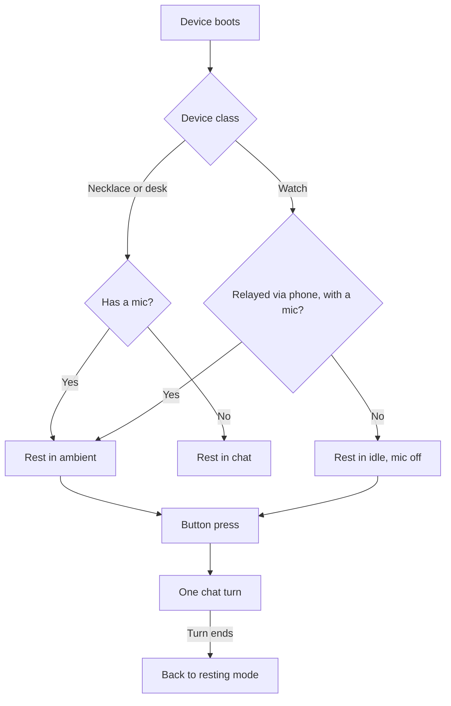

The Ryu hardware line has three devices. All three are ESP32-S3 thin clients. They differ in display, sensors, and role. The watch is chat-first with a round screen, the necklace is ambient-first with no screen, and the desk hub is an always-on dashboard panel.

## Watch

A wrist device with a small round color display for on-demand chat.

- **Chip** - ESP32-S3. Reference board: the LILYGO T-Watch S3 (8 MB octal PSRAM, GC9A01 240x240 SPI round LCD, ES8311 codec, AXP2101 power management). Pins are in `apps/hardware/firmware/watch/main/board.h`.
- **Display** - the round LCD runs an LVGL UI: a simplified island face driven by the `emotion` message, the live transcript from `stt`, and the streamed chat reply. It is the small-screen analog of the desktop island eyes.
- **Dashboard view** - a long press of the button switches between the face and a dashboard view. On the dashboard view, a short press re-polls it.
- **Audio** - the ES8311 codec (mic and speaker) on the reference board.
- **Role** - on-demand voice chat. The watch rests in `idle` with the mic off, and a short press of the side button starts one chat turn.
- **Relayed through a phone (Mode A)** - the firmware rests in `ambient` instead and sends speech. The node opens ambient sessions only for the necklace and desk, so it answers the watch's ambient chunks with `ambient_skip`.

## Necklace

An audio-first pendant with no display, designed to be the primary 24/7 ambient memory device.

- **Chip** - ESP32-S3. Reference board: the Seeed XIAO ESP32-S3 Sense (8 MB PSRAM, I2S mic, optional MAX98357A amplifier, OV2640 camera). Pins are in `apps/hardware/firmware/necklace/main/board.h`.
- **No display** - its output surfaces elsewhere: a phone, a paired watch, or the desk hub. The necklace itself is a sensor plus optional voice in and out.
- **Camera (optional, off by default)** - a camera build (`CONFIG_RYU_NECKLACE_CAMERA`) captures a JPEG still and sends it to a vision-capable agent. It does not stream video, and it shortens battery life.
  - A long button press takes a still.
  - A non-zero `CONFIG_RYU_NECKLACE_CAMERA_INTERVAL_S` also takes one on that interval.
- **Role** - the always-on ambient device. It boots into `ambient`, streams Opus over BLE to the relay, and feeds the meetings chunk pipeline. A short button press requests one chat turn.
- **VAD** - on-device voice activity detection is required for battery life and ASR load.

## Desk hub

An always-on, always-plugged desk panel built around e-ink for glanceable information.

- **Chip** - ESP32-S3 (8 MB PSRAM), with a Waveshare 7.5-inch V2 e-ink panel (UC8179, 800x480), an ES8311 codec, and an optional ST7789 320x240 LCD. Pins are in `apps/hardware/firmware/desk/main/desk_board.h`.
- **E-ink primary surface** - a TRMNL-style dashboard of the widgets you choose, such as a clock or an agenda. The node renders it to an image, and the panel updates on a poll interval. E-ink cannot animate or stream tokens, so it shows finished output and holds it. See [Device Dashboard](/docs/hardware/dashboard).
- **Optional LCD** - a secondary ST7789 can run the live island face and chat over the WebSocket.
- **Role** - always-on ambient display and interactive hub. Because it is plugged in, it uses Mode B whenever WiFi is provisioned and the node is reachable.

<Callout type="info">
  A Raspberry Pi 5 is **not** the desk device. The desk device is an ESP32-S3 thin client like the others. A Pi 5 can optionally be the *node host* that the desk (and every other device) connects to, giving local inference at the desk. See [Hardware Deployment](/docs/hardware/deployment).
</Callout>

## Comparison

| | Watch | Necklace | Desk hub |
|---|---|---|---|
| Chip | ESP32-S3 | ESP32-S3 | ESP32-S3 |
| Display | Round LCD (GC9A01) | None | E-ink (UC8179) + optional LCD |
| Camera | No | Optional (OV2640) | No |
| Primary role | On-demand chat | 24/7 ambient | Ambient dashboard |
| Power | Battery | Battery | Wall-powered |
| Typical mode | Mode B or A | Mode A (relay) | Mode B (WiFi) |
| Dashboard surface | Yes (view mode) | No | Yes (primary) |

## Resting mode

Between chat turns each device falls back to a resting mode. The firmware chooses it at startup from the device class, its mic, and its transport (`apps/hardware/firmware/shared/app_core/app_core.c`). A finished chat turn returns to it.

## Power constraints

- WiFi transmit is the largest battery cost on a wearable, so the battery devices use the BLE relay
  (Mode A) for continuous ambient capture.
- On-device VAD is required on the necklace and any ambient path. See [Ambient Capture](/docs/hardware/ambient-capture#why-on-device-vad-is-required).
- The firmware streams Opus at a low bitrate (about 16 kbit/s, 60 ms frames).

<Callout type="warn">
  Battery life has not been measured on hardware. The boards have not completed hardware-in-the-loop
  testing.
</Callout>

The device picks its transport at runtime. [Hardware Architecture](/docs/hardware/architecture#two-transport-modes-one-protocol) owns the selection order.

## Related

<Cards>
  <DocCard href="/docs/hardware/architecture" />
  <DocCard href="/docs/hardware/ambient-capture" />
  <DocCard href="/docs/hardware/dashboard" />
</Cards>

