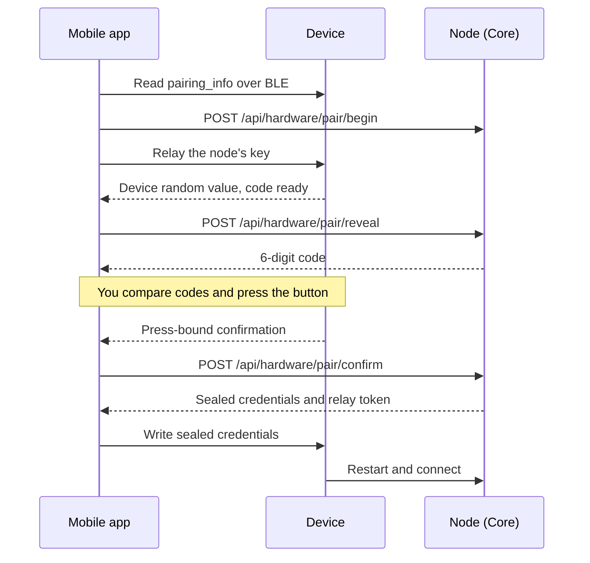

Pairing binds an unprovisioned device to your node. It hands the device everything it needs to connect: its device token, the node URL, the node's key, and (optionally) WiFi credentials.

The Ryu mobile app drives pairing over BLE. With RHP v1.1, pairing is **press to confirm**. You compare a short code between the app and the device, then press the device button. Only then does your node issue credentials, encrypted so that only that device can read them.

## The pairing flow

<Steps>
  <Step>
    **Find the device.** An unprovisioned device advertises over BLE as `Ryu-<type>-<last 4 characters of its id>`. The watch and desk also show a QR code.

    - In the Ryu mobile app, signed in to your node, open **Devices**, tap **Pair a device**, and scan the QR.
    - For the necklace, or any device without a QR, choose **Pair without a QR code** and pick the device from the list.
    - Allow camera access to scan. If you deny it, use **Cancel** to leave pairing, enable camera access in your device settings, then start pairing again.
  </Step>
  <Step>
    **WiFi (optional).** Enter the WiFi network the device should use for direct (Mode B) connections, or skip it to use the phone relay only. Filling it in first lets the device finish as soon as you press its button.

    The device stores a network name of up to 32 bytes and a password of 8 to 63 bytes. Accented and non-Latin characters take 2 to 4 bytes each, so the app tells you before pairing starts if a password is too long.
  </Step>
  <Step>
    **Compare the code.** The app connects to the device and starts the pairing with your node. The watch and desk show a 6-digit code such as `394 867`. The necklace beeps it. The app shows the code your node computed. Tap **Codes match** only if they are the same, otherwise tap **Codes don't match**.
  </Step>
  <Step>
    **Press the device button.** After the code appears, press the device's button once to confirm. The device only accepts the press after it has shown or beeped the code.
  </Step>
  <Step>
    **Done.** Your node checks the device's confirmation, then sends back the device's credentials encrypted to that device, plus a relay token for the phone. The app writes the encrypted credentials to the device, which saves them and restarts. The app shows **Paired** once the device connects, or **Paired - waiting for the device** if it has not checked in within a minute.
  </Step>
</Steps>

After pairing, the device and your node pin each other's keys and talk over an [end-to-end encrypted session](/docs/hardware/protocol#the-encrypted-device-session), whether the device connects directly over WiFi or through the phone.

### The necklace beeps

The necklace has no screen, so it plays its code:

- two rising tones to start;
- each of the six digits in turn, where a digit is that many short beeps and zero is one long beep;
- a longer pause after the third digit.

Tap **Replay** in the app to hear it again. If you cannot hear or compare the beeps, you can choose **I can't verify**. The device still pairs but is permanently marked **Unverified**. See [Hardware Security](/docs/hardware/security#the-necklace-and-i-cant-verify).

### Timeouts

- The pairing on your node expires after **3 minutes** if it is not completed.
- After the code appears, the device accepts the button press for **60 seconds**.
- After the press, the app has **2 minutes** to deliver the encrypted credentials.

If any step times out or is cancelled, the device starts a fresh attempt with a new code. The QR code stays the same, so you can just try again.

## Troubleshooting

| Message | What it means |
|---|---|
| **Update the Ryu app** | The device runs v1.1 firmware, which refuses the old pairing method. Update the mobile app and pair again. |
| **Update your Ryu node to pair this device** | Your node predates v1.1 pairing. Update Ryu on the node, then pair again. |
| **Possible interference** | The device that answered over BLE does not match the one you chose: its id, type, protocol version, or key differs from the QR code or the device you picked. Pairing stops. Move away from other Ryu devices and try again. |
| **Codes don't match** | You saw different codes. Nothing was issued; pair again. If it keeps happening, something nearby may be interfering. |
| **Node identity changed** (on the device) | Your node's key is no longer the one the device paired with. Remove the device in the app, hold its button for 10 seconds to reset it, and pair again. |
| **Legacy** badge | The device was paired with older firmware (a QR code without a key in it) or an older app, and uses the v1 protocol. Update the firmware, remove the device, hold its button for 10 seconds, and pair again. |

## GATT services

Pairing and the Mode A relay each have their own BLE GATT service. The phone is the BLE central, and the device is the peripheral. v1.1 adds no new services or characteristics.

### Provisioning service (`RHP_PROV`)

Used only while pairing.

- `pairing_info` (read / notify) - the device id, nonce, type, and the device's public key.
- `provision` (write, chunked) - pairing steps from the app, including the encrypted credentials.
- `status` (notify) - pairing progress from the device, including its confirmation after the button press.

### Relay service (`RHP_RELAY`)

Used at runtime in Mode A. For a v1.1 device the phone forwards encrypted packets over the control characteristics and cannot read them. For a legacy device it bridges the JSON and Opus characteristics to the node WebSocket one to one.

- `ctrl_up` (notify) - device to node.
- `ctrl_down` (write) - node to device.
- `audio_up` (notify) - Opus, device to node (legacy only).
- `audio_down` (write) - Opus, node to device (legacy only).

Every `*_up` characteristic is a notify (the phone subscribes), and every `*_down` is a write (the phone writes).

## Canonical UUID table

These 128-bit UUIDs are the single source of truth. The firmware and the mobile app both use them verbatim. A divergence here breaks discovery, so never edit one side only.

| Service / characteristic | Direction (firmware) | UUID |
|---|---|---|
| `RHP_PROV` (service) | - | `7e1a0001-9b34-4d21-8f5a-2c6b1d3e0001` |
| `RHP_PROV` pairing_info | read / notify | `7e1a0001-9b34-4d21-8f5a-2c6b1d3e0002` |
| `RHP_PROV` provision | write (chunked) | `7e1a0001-9b34-4d21-8f5a-2c6b1d3e0003` |
| `RHP_PROV` status | notify | `7e1a0001-9b34-4d21-8f5a-2c6b1d3e0004` |
| `RHP_RELAY` (service) | - | `7e1a0002-9b34-4d21-8f5a-2c6b1d3e0001` |
| `RHP_RELAY` ctrl_up | notify | `7e1a0002-9b34-4d21-8f5a-2c6b1d3e0002` |
| `RHP_RELAY` ctrl_down | write | `7e1a0002-9b34-4d21-8f5a-2c6b1d3e0003` |
| `RHP_RELAY` audio_up | notify | `7e1a0002-9b34-4d21-8f5a-2c6b1d3e0004` |
| `RHP_RELAY` audio_down | write | `7e1a0002-9b34-4d21-8f5a-2c6b1d3e0005` |

<Callout type="info">
  Pairing needs an app that is already signed in to your node, a matching code, and a press on the device itself. For a v1.1 device, someone who can reach your node but is not holding the device cannot complete a pairing, and the phone never learns the device's own token.

  Legacy pairing for older firmware has no code or press check, so keep your node off the open internet while you still use it. See [Hardware Security](/docs/hardware/security#pairing-press-to-confirm) for the full model.
</Callout>

## Related

<Cards>
  <DocCard href="/docs/hardware/protocol" />
  <DocCard href="/docs/hardware/deployment" />
  <DocCard href="/docs/hardware/security" />
</Cards>
