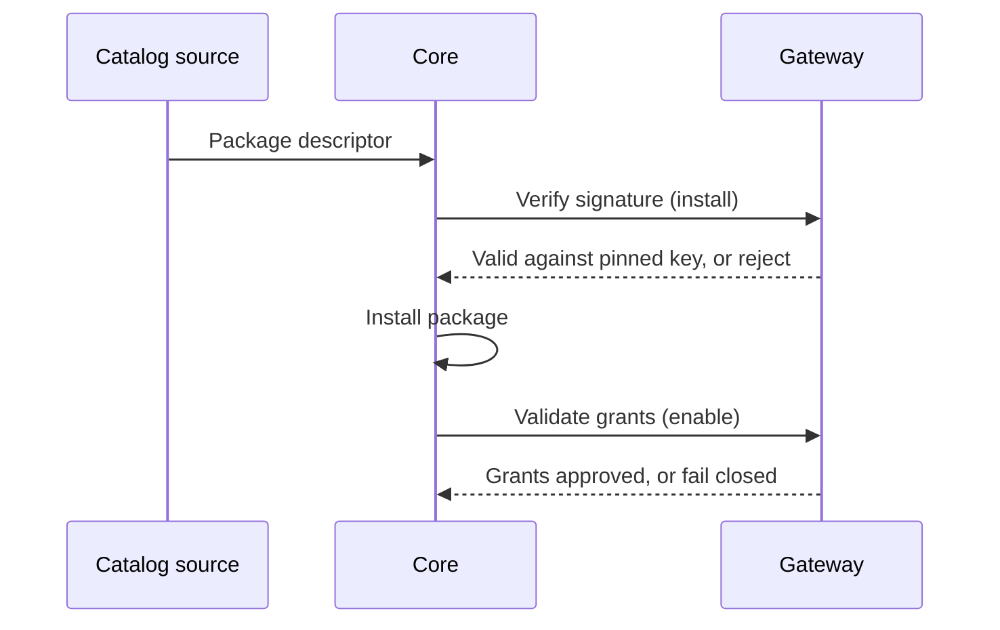

This lesson shows how to list your app or plugin in the Ryu **Marketplace** so other people can find
and install it, and how Ryu checks a package before it runs.

Before you create the release, use [Extension schemas & folder layouts](/docs/extend/develop/extensions/schemas-and-layouts)
to check that `manifest.json`, `ryu.package.json`, generated Agent Plugins files, Skills, MCP
declarations, UI, and sidecar artifacts are in the right layer.

## Publish from GitHub

The package and its release bytes live in your own GitHub repository.

1. Add the `ryu-app` or `ryu-plugin` topic to the repository.
2. Attach the immutable `.ryupack` file to a GitHub Release. See
   [Portable packages](/docs/extend/develop/extensions/portable-packages) for how to build it.
3. Submit the repository or package URL to the Marketplace bridge:

```bash
export RYU_AUTH_TOKEN="your-ryu-session-token"
bunx ryu github-publish https://github.com/your-org/your-package
```

`RYU_AUTH_TOKEN` must be a signed-in Ryu account session token. An API key is rejected with a 401.

A collection repository uses the `ryu-marketplace` topic instead. Ryu discovers every folder in it
that contains a `ryu.package.json`. A private repository asks you, the seller, for a one-time GitHub
App installation. Buyers never need GitHub credentials.

For the full seller flow, see [Marketplace](/docs/extend/develop/extensions/marketplace).

## What the Gateway enforces

Publishing and installing rely on three Gateway checks:

- **Grant validation.** When an app is enabled, Core asks the Gateway to validate its requested
  grants. The check fails closed: no valid grant, no activation.
- **ed25519 signing.** Marketplace manifests carry an ed25519 signature issued by a Gateway.
- **Verification.** At install, Core asks the Gateway to verify that signature against a pinned
  public key, not a key carried in the manifest.



<Callout type="warn">
  Verification fails closed. A missing or invalid signature, or an unreachable Gateway, rejects the
  install before any install work starts. Because the public key is pinned, a tampered manifest
  cannot vouch for itself.
</Callout>

## The federated Marketplace

<TryInRyu page="marketplace" />

The Marketplace is federated. Every catalog (models, skills, MCP, and plugins) routes through one
catalog-source layer. It has built-in sources, user-added sources, and a saved active-source
selector.

Sources return **descriptors only**. Core keeps the privileged install step. A source can describe
what is available, but it cannot run the install.

On the Ryu-hosted first-party Marketplace, a listing's status moves from **pending** (shown as
**Submitted**) to **live** (shown as **Published**) before it is broadly listed.

## Safe fetching

Untrusted fetches have SSRF (server-side request forgery) guards. They are HTTPS-only, IP-pinned,
and size-capped, so a malicious source cannot redirect Core to an internal address or send it an
oversized payload.

## Knowledge check

First, the reflection prompts. Answer them in your own words.

- What three checks does the Gateway enforce for a published package?
- What is the difference between what a source does and what Core does at install time?
- What does an app's status move from and to on the first-party marketplace?
- Which repository topic and release asset make a package discoverable?

Then confirm the details with a quick self-test.

<Quiz
  questions={[
    {
      q: "What three things does the Gateway enforce when you publish?",
      options: [
        "Grant validation, ed25519 signing, and verification against a pinned public key",
        "Payment, listing, and moderation",
        "Compression, caching, and rate-limiting",
      ],
      answer: 0,
      explain:
        "Publishing routes through the Gateway, which enforces grant validation (fail-closed), ed25519 signing of the manifest, and verification against a pinned public key.",
    },
    {
      q: "What is the difference between what a source does and what Core does at install time?",
      options: [
        "Sources install apps, and Core only lists them",
        "Sources return descriptors only, while Core keeps the privileged install",
        "They both run the install step together",
      ],
      answer: 1,
      explain:
        "A source can describe what is available, but it never runs the install step. Core keeps the privileged install.",
    },
    {
      q: "What does an app's status move from and to on the first-party marketplace?",
      options: [
        "From draft to published",
        "From pending to live",
        "From installed to enabled",
      ],
      answer: 1,
      explain:
        "When you publish to the Ryu-hosted first-party marketplace, your app's status moves from pending to live before it is broadly listed.",
    },
    {
      q: "How are untrusted fetches protected?",
      options: [
        "They are SSRF-guarded: https-only, IP-pinned, and size-capped",
        "They are allowed only from a single hardcoded domain",
        "They run inside a Docker sandbox",
      ],
      answer: 0,
      explain:
        "Untrusted fetches are SSRF-guarded, so a malicious source cannot redirect Core to an internal address or hand it an oversized payload.",
    },
    {
      q: "What does a GitHub repository need before Ryu can discover and install its release?",
      options: [
        "The ryu-app or ryu-plugin topic and an immutable .ryupack Release asset",
        "A Docker image and a public database",
        "An npm publish with no manifest",
      ],
      answer: 0,
      explain:
        "Ryu discovers repositories by topic and installs the immutable .ryupack asset attached to a GitHub Release.",
    },
    {
      q: "How does Ryu access a seller's private GitHub repository?",
      options: [
        "The seller completes a one-time GitHub App installation; buyers need no GitHub credentials",
        "Every buyer pastes a personal access token",
        "Private repositories cannot be published",
      ],
      answer: 0,
      explain:
        "A private seller repository uses a one-time GitHub App installation. Buyers install the package without receiving or supplying repository credentials.",
    },
    {
      q: "What does fail-closed grant validation mean during publishing?",
      options: [
        "A package without a valid grant is rejected",
        "Missing grants are added automatically",
        "Grant checks happen only after the package is live",
      ],
      answer: 0,
      explain:
        "Publishing refuses unverified permissions by default. No valid grant means no publish.",
    },
    {
      q: "What makes the Marketplace catalog federated?",
      options: [
        "Models, skills, MCP, and plugins share a catalog-source seam with built-in and user-added sources",
        "Every package must be hosted by one fixed registry",
        "Sources receive permission to run the install step themselves",
      ],
      answer: 0,
      explain:
        "Catalog types use the same source seam with built-in and user-added sources, while Core retains the privileged install step.",
    },
  ]}
/>

Finished? [Mark this lesson complete on the path view](https://ryuhq.com/academy/builder#lesson-publishing) to save your progress.

Next: if you run agents for a business rather than build them, continue with [Ryu for Business](/docs/learn/academy/cloud).
