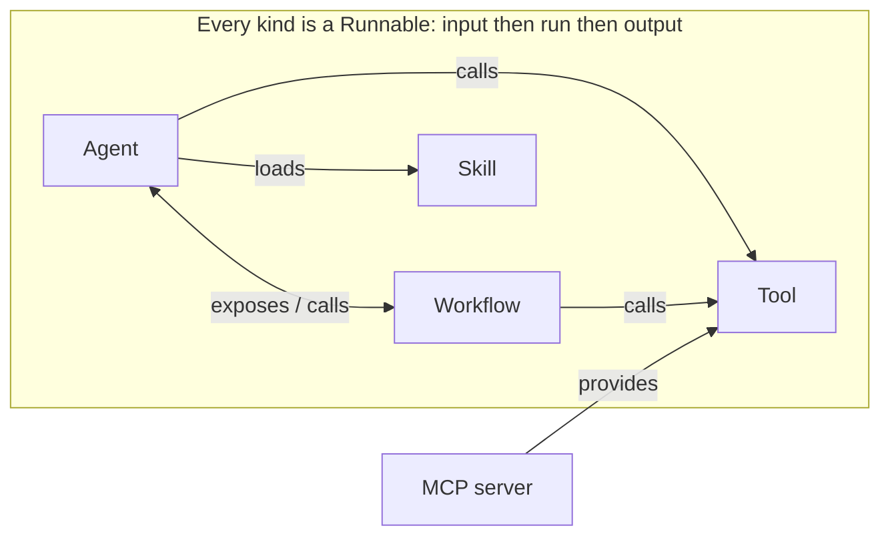

Ryu uses one contract, the **Runnable**, for agents, tools, workflows, and skills. A Runnable takes input, runs, and returns output. This lesson explains how the kinds fit together, so the rest of the course can build on them.

## Four kinds, one shape

The Runnable contract unifies four kinds you will use directly:

- **Agent** - a model with a persona, tools, and memory.
- **Workflow** - a graph of steps run in order.
- **Tool** - a single typed function the model can call.
- **Skill** - a packaged instruction set the agent can load.

An **MCP server** exposes tools over the Model Context Protocol. It is not a Runnable kind itself; each tool it exposes becomes a `tool` Runnable.

The `RunnableKind` enum (`crates/core/kernel-contracts/src/runnable.rs`) has eight variants: `agent`, `workflow`, `tool`, `skill`, `companion`, `channel`, `engine`, and `policy`. The last four cover overlay surfaces, channel bot adapters, inference engine bindings, and Gateway policy fragments. This course does not teach them. An MCP server has no variant of its own.

## Peers, not a hierarchy

The kinds are peers. None sits above another, so they compose in both directions:

- An **agent** can invoke a **workflow** by exposing it as a named tool.
- A **workflow** can orchestrate **agents** by calling them as steps.



```ts
import { defineWorkflow } from "@ryuhq/sdk";

// spiderTool and writerAgent are Runnables defined elsewhere.
// The workflow calls a tool, then passes the result to an agent.
const research = defineWorkflow({
  id: "workflow-research",
  name: "Research",
  steps: [spiderTool, writerAgent],
  async run({ topic }, ctx) {
    const gathered = await spiderTool.run({ url: topic }, ctx);
    return await writerAgent.run({ query: gathered }, ctx);
  },
});
```

<Callout type="info">
  If you can build a tool, you already know the shape of a workflow, skill, or agent.
</Callout>

## Why this matters

Because every kind has the same shape, one registry can list every kind, model calls from any kind can route through the Gateway, and you can swap one Runnable for another with a matching input and output without rewriting the caller.

## Knowledge check

First, the reflection prompts. Answer them in your own words.

- What are the three parts of the Runnable shape?
- Which four kinds do you author directly as a developer?
- Where does an MCP server fit in the Runnable contract?
- How can an agent and a workflow each call the other?

Then confirm the details with a quick self-test.

<Quiz
  questions={[
    {
      q: "What is the shape of a Runnable?",
      options: [
        "Input, then run, then output",
        "Request, response, and callback",
        "Setup, loop, and teardown",
      ],
      answer: 0,
      explain:
        "A Runnable is input, then run, then output. That is the whole shape.",
    },
    {
      q: "Which four kinds do you author directly as a developer?",
      options: [
        "Agent, Companion, Channel, and Engine",
        "Agent, Workflow, Tool, and Skill",
        "Agent, Session, App, and Gateway",
      ],
      answer: 1,
      explain:
        "Agent, Workflow, Tool, and Skill are the four you author. Companion, Channel, Engine, and Policy exist internally.",
    },
    {
      q: "How can an agent and a workflow each call the other?",
      options: [
        "An agent exposes a workflow as a named tool, and a workflow calls an agent as a step",
        "Only an agent can call a workflow, never the reverse",
        "They communicate through a shared database table",
      ],
      answer: 0,
      explain:
        "The kinds are peers. An agent invokes a workflow by exposing it as a named tool, and a workflow orchestrates agents by calling them as steps.",
    },
    {
      q: "Why does the identical shape matter across every kind?",
      options: [
        "It makes the code shorter to write",
        "The same plumbing applies everywhere, so the Gateway governs every call, the registry lists every kind, and Runnables swap without rewriting the caller",
        "It forces every kind to use the same model",
      ],
      answer: 1,
      explain:
        "Because the shape is identical, the same plumbing applies everywhere and there is nothing special-cased.",
    },
    {
      q: "Which Runnable should model a multi-step execution flow?",
      options: ["Workflow", "Pipeline", "Channel"],
      answer: 0,
      explain:
        "Workflow is the authored Runnable for multi-step execution. Pipeline is not one of the authored kinds.",
    },
    {
      q: "Where does an MCP server fit in the Runnable contract?",
      options: [
        "It is a ninth RunnableKind variant",
        "It has no kind of its own and contributes tool Runnables",
        "It replaces the Workflow kind",
      ],
      answer: 1,
      explain:
        "The RunnableKind enum has no MCP variant. An MCP server exposes tools, and each one runs as a tool Runnable.",
    },
    {
      q: "Which kinds exist internally but are not among the four developer-authored kinds in this lesson?",
      options: [
        "Companion, Channel, Engine, and Policy",
        "Model, Provider, Session, and Message",
        "Project, Package, Release, and Registry",
      ],
      answer: 0,
      explain:
        "Companion, Channel, Engine, and Policy are additional internal Runnable kinds. Developers directly author Agent, Workflow, Tool, and Skill.",
    },
  ]}
/>

Finished? [Mark this lesson complete on the path view](https://ryuhq.com/academy/builder#lesson-runnables) to save your progress.

Next: scaffold a project and define your first Runnables in the [SDK quickstart](/docs/learn/academy/builder/sdk-quickstart).
