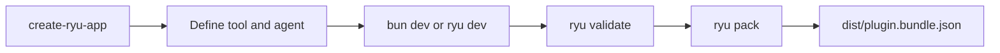

This lesson scaffolds a project and defines your first tool and agent with the Ryu developer SDK, `@ryuhq/sdk`. The SDK provides:

- Runnable factory functions;
- a Gateway-mandatory model client;
- an MCP (Model Context Protocol) server and client.

It borrows patterns from Mastra, the AI SDK, and ACP but does not depend on them.



## Scaffold a project

Create a starter project with the `create-ryu-app` scaffolder.

```bash
bunx create-ryu-app my-app
```

The default template is `agent`. It generates `manifest.json`, `src/agent.ts`, and `package.json`. The `manifest.json` already validates against the plugin manifest schema.

Pass `--template <name>` to pick another starter, for example:

```bash
bunx create-ryu-app my-app --template hook-plugin
```

See [SDK tooling](/docs/extend/develop/sdk/tooling) for every template and flag.

## Define a tool

A tool is a single typed function the model can call. The `defineTool` factory builds one.

```ts
import { defineTool } from "@ryuhq/sdk";

const getWeather = defineTool({
  id: "tool-get-weather",
  name: "get_weather",
  schema: {
    type: "object",
    required: ["city"],
    properties: { city: { type: "string", description: "City name" } },
  },
  async run({ city }, _ctx) {
    const res = await fetch(`https://api.example.com/weather?city=${encodeURIComponent(city)}`);
    return await res.json();
  },
});
```

## Define an agent

An agent wires a persona, a model, and tools together. The `defineAgent` factory builds one.

```ts
import { defineAgent } from "@ryuhq/sdk";

const assistant = defineAgent({
  id: "agent-weather",
  name: "Weather Helper",
  tools: [getWeather],
  async run({ query }, ctx) {
    const res = await ctx.gateway.chat([{ role: "user", content: query }]);
    return { answer: res.content };
  },
});
```

The model client is **Gateway-mandatory**. Every model call goes through `ctx.gateway` to the Gateway. Your code holds no provider URL or API key. The Gateway decides what is allowed, routed, and measured.

<Callout type="info">
  The SDK also exposes `defineWorkflow` and `defineSkill`. They follow the same factory shape, because each one is another Runnable.
</Callout>

## Run it

Run the scaffold with its own dev script. The default `agent` template runs `src/agent.ts` against a
running Ryu node or Gateway (`RYU_GATEWAY_URL`, default `http://127.0.0.1:7981`):

```bash
cd my-app
bun install
bun dev
```

For a module that exports a Runnable as `default` or `runnable`, `bunx ryu dev <entry>` probes the
Gateway, imports that Runnable, and starts a terminal REPL so you can chat with what you built before
packaging it:

```bash
bunx ryu dev ./src/runnable.ts
```

The command reads the Gateway URL from `RYU_GATEWAY_URL`, then falls back to `http://127.0.0.1:7981`. If the Gateway is unreachable, it prints an error and exits. It does not fall back to a provider.

When you are ready to package, check and bundle the project:

```bash
bunx ryu validate .
bunx ryu pack .
```

`ryu validate` checks your `manifest.json` against the SDK schema. `ryu pack` writes the plugin
bundle to `dist/plugin.bundle.json`.

For the full surface, including every factory and the MCP client and server, see the [SDK reference](/docs/extend/develop/sdk).

## Knowledge check

First, the reflection prompts. Answer them in your own words.

- Which command scaffolds a new Ryu project?
- What does "gateway-mandatory model client" mean for your code?
- What does `bunx ryu dev <entry>` do before it opens the REPL?
- What does a tool definition need before its run function can be called?

Then confirm the details with a quick self-test.

<Quiz
  questions={[
    {
      q: "Which command scaffolds a new Ryu project?",
      options: [
        "bunx ryu init my-app",
        "bunx create-ryu-app my-app",
        "bunx ryu dev my-app",
      ],
      answer: 1,
      explain:
        "bunx create-ryu-app my-app generates a starter project from the default agent template, with a manifest.json manifest that already passes the schema rules.",
    },
    {
      q: "What does the gateway-mandatory model client mean for your code?",
      options: [
        "You paste a provider URL and API key into your code",
        "Every model call routes through the Gateway, so you never pick a provider URL or paste a key",
        "You must run the Gateway as a separate paid service",
      ],
      answer: 1,
      explain:
        "The model client is gateway-mandatory. The Gateway decides what is allowed, routed, and measured, so your code never carries a provider URL or key.",
    },
    {
      q: "What does bunx ryu dev <entry> do before it opens the REPL?",
      options: [
        "It publishes your app to the marketplace",
        "It probes the Gateway and imports the Runnable your entry module exports",
        "It compiles your code into a signed manifest",
      ],
      answer: 1,
      explain:
        "bunx ryu dev <entry> probes the Gateway, imports the Runnable your entry module exports as default or runnable, and then starts a terminal REPL so you can chat with what you built.",
    },
    {
      q: "Which factories does the SDK expose alongside defineTool and defineAgent?",
      options: [
        "defineWorkflow and defineSkill, following the same factory shape",
        "defineModel and defineProvider",
        "defineGateway and definePolicy",
      ],
      answer: 0,
      explain:
        "The SDK also exposes defineWorkflow and defineSkill, which follow the same factory shape because each one is just another Runnable.",
    },
    {
      q: "What does defineTool pair with the tool's run function?",
      options: [
        "A typed input schema plus the tool id and name",
        "A provider API key stored in source code",
        "A mandatory browser interface",
      ],
      answer: 0,
      explain:
        "A tool definition names the tool and validates its input with a schema before its run function handles the typed values.",
    },
    {
      q: "What useful guarantee does the create-ryu-app starter provide?",
      options: [
        "Its manifest.json is already validated against the plugin manifest schema",
        "It publishes the project automatically",
        "It bypasses Gateway policy during development",
      ],
      answer: 0,
      explain:
        "The scaffold starts with a native manifest.json that passes the plugin manifest schema, reducing setup mistakes.",
    },
    {
      q: "What does defineAgent wire together in the quickstart?",
      options: [
        "A persona, a model path through ctx.gateway, and tools",
        "A marketplace listing and billing plan",
        "A desktop window and operating-system service",
      ],
      answer: 0,
      explain:
        "An agent definition combines its identity and behavior with model access through the Gateway and the tools it may use.",
    },
    {
      q: "Which protocol helpers are included alongside the SDK's Runnable factories?",
      options: [
        "An MCP server and client",
        "A proprietary replacement for MCP",
        "Only an HTTP file server",
      ],
      answer: 0,
      explain:
        "The SDK includes an MCP server and client in addition to the Runnable factory functions and Gateway model client.",
    },
  ]}
/>

Finished? [Mark this lesson complete on the path view](https://ryuhq.com/academy/builder#lesson-sdk-quickstart) to save your progress.

Next: bundle your Runnables into an installable app in [Plugins and apps](/docs/learn/academy/builder/plugins-and-apps).
