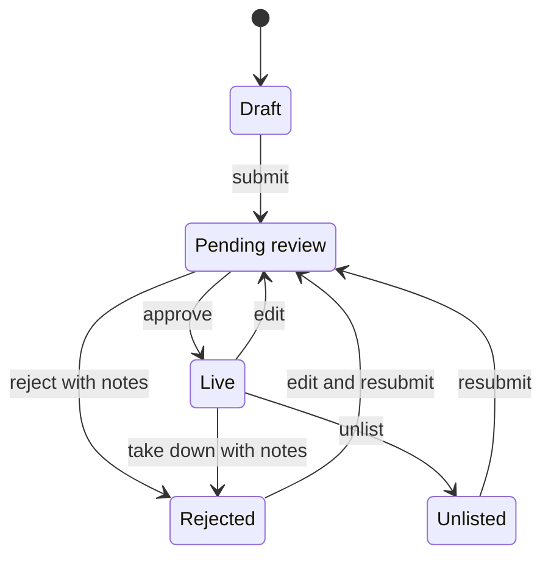

If you publish an app or plugin on Ryu, you can create a community certification for it. The
certification is a course plus a server-scored exam. Ryu reviews it, but it is community-issued and
is not an official Ryu Academy credential.

<Cards>
  <Card title="Open certification authoring" href="https://ryuhq.com/console/certifications/author" description="Create, edit, and submit a course and exam after signing in." />
  <Card title="Build on Ryu" href="/docs/learn/academy/builder" description="Learn the Runnable, SDK, app, plugin, and Marketplace contracts first." />
  <Card title="Browse certifications" href="https://ryuhq.com/certifications" description="See official and reviewed community credentials in one catalog." />
</Cards>

## Before you start

- Publish the app or plugin through the Ryu Marketplace. The listing must belong to the organization
  you are currently using.
- Use an account with Marketplace publishing access in that organization. This keeps a credential
  from claiming another publisher's package.
- Decide what a candidate should be able to do with the package, not only what they should be able
  to repeat from the documentation.

You can also create a **standalone community certification** without selecting a Marketplace item,
for example for a practice course or a skill broader than one package.

## Create the certification

Open [Author a certification](https://ryuhq.com/console/certifications/author), or choose
**Create certification** next to one of your app or plugin listings in the organization Marketplace
view.

The authoring page has four parts:

1. **Listing** - title, public URL slug, credential name, description, category, tags, and the
   skills the credential proves.
2. **Certification target** - choose one of your Marketplace apps or plugins. Ryu records the
   package name, version, package checksum when available, and publisher organization for the
   certification snapshot. Leave it standalone when no package should be attached.
3. **Course content** - add modules and lessons with Markdown, reading time, and optional resource
   links.
4. **Question bank and policy** - add single-choice, multiple-choice, true/false, or short-answer
   questions, explanations, the passing score, the number drawn per attempt, and the retake delay.

Save at any time as a draft.

A badge image is optional and can be uploaded after the first save. The badge must use the
canonical uploaded URL for that certification. Ryu rejects URLs with path traversal, encoded path
changes, query parameters, or fragments, so a badge cannot point at another certification's image.

Public certification pages show the linked package's name, version, kind, and Marketplace link.
The publisher organization identifier and package checksum remain in the private authoring snapshot.

## What publication checks

Ryu checks the target again when you submit the certification and when a reviewer approves it.
The linked app or plugin must still:

- be owned by the publisher organization;
- be public and live in the Marketplace;
- have the saved version and package integrity information.

If the package changes, select the current listing and save again before resubmitting.

### Exam integrity floor

- the question bank must contain at least three times as many questions as one exam draw;
- the retake delay must be at least 24 hours;
- every question must have a valid answer for its type.

These checks stop a public credential from becoming a one-paper answer-key exercise. With a bank
three times the draw size, one attempt shows at most a third of the pool.

### What candidates see

- Ryu never sends the answer key to candidates before submission.
- After a failed attempt, candidates see only their score and the pass mark, not which questions
  they got wrong.
- Your explanations are shown only after a pass, and only for questions the candidate answered.

### Editing questions during open attempts

Each attempt keeps the questions it started with. If you remove a question, or change its prompt,
options, answer, or points, while a candidate is mid-attempt, their submission is refused and the
exam refreshes.

- Only the affected questions are replaced, each by a question that was not already on their paper.
- The refresh does not count as a failed attempt.
- Rewording only an explanation does not affect open attempts.

A completed attempt's review leaves out any question you have since removed or changed, so a
candidate never sees your new answer next to a verdict scored against the old one.

You cannot sit, or earn a certificate from, a certification you authored.

## Review and lifecycle

The lifecycle is **Draft → Pending review → Live**.

- Ryu may reject a submission with reviewer notes. You can then edit and submit it again.
- Editing a live certification sends it back through review.
- If you edit a certification while it is under review, the reviewer has to reload it before
  approving, so a decision always applies to the version that was reviewed.
- Ryu can take down a live certification, with notes explaining why. A taken-down certification
  shows as rejected.
- You can unlist your own live certification to withdraw it from the public catalog, and submit it
  for review again later.
- Rejecting or taking down a featured certification removes it from Featured. Approving it again
  does not restore that placement.

While a certification is under review, unlisted, or rejected, it accepts no new exam attempts.
Candidates who already started an attempt keep it, but cannot resume or submit it until the
certification is approved and live again. Unlisting or rejecting never revokes certificates that
were already issued.

The public certification page names the community issuer and links back to the targeted Marketplace
app or plugin, including the version the certification was written for. A certificate earned from
that exam keeps the same target snapshot, even if the certification or listing later changes.

## Official versus community credentials

Official Ryu Academy credentials are issued by Ryu Academy and prepare for the four Ryu platform
tracks. Community credentials are issued by their named authors and are marked as community
certifications on the catalog, exam, and verification pages. Ryu reviews the listing and hosts the
verification page; it does not turn a community credential into an official Ryu credential.

Continue with [Publishing](/docs/learn/academy/builder/publishing) to ship the package itself, then
return here to create the credential that teaches it.
