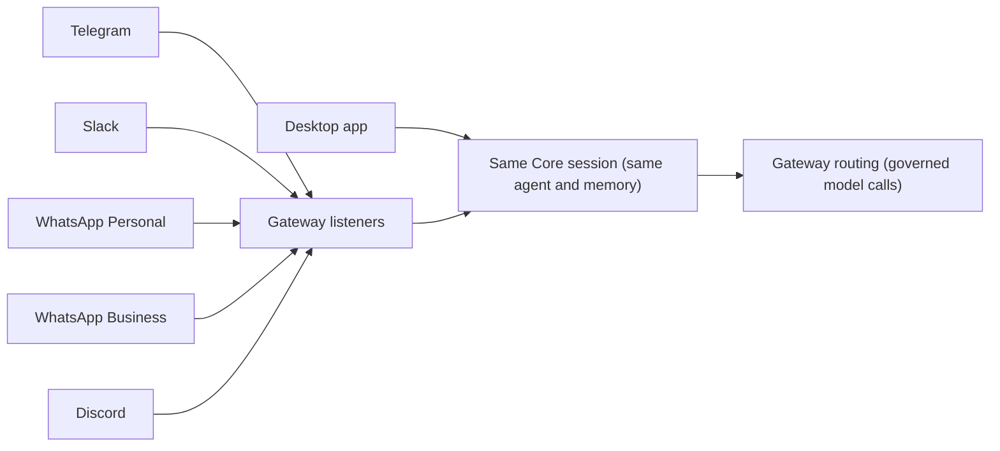

This lesson explains how channel bots put your agents into chat platforms (Telegram, Slack, WhatsApp Personal, WhatsApp Business, and Discord) and how you set them up. A bot is not a separate agent. It is another surface onto the same agent the desktop app talks to.

## A bot is another surface

Inbound bot messages route through Core sessions. They use the same agent path, the same memory, and the same Gateway routing as the desktop app. A question asked in a Telegram group gets the same agent, context, and governed model calls as a question asked in the desktop app.

- The agent path is shared, so behavior is consistent across surfaces.
- Memory is shared, so a bot conversation is not cut off from the rest of your history.
- Gateway routing applies, so a bot's model calls are governed like any other.

## How you set them up

<TryInRyu page="channels" />

Open **Channels** from the desktop sidebar. There you create, edit, and delete bot configs.

- Each bot routes to one agent or one team.
- The page talks to the control-plane server with your signed-in account, not to a Core server
  directly.
- Saved tokens are write-only. The page never shows them again, and leaving a credential field
  blank on edit keeps the stored value.

The Gateway runs the platform listeners. Once a config exists, the Gateway connects to Telegram,
Slack, and the other platforms.

<Callout type="info">
  The Channels page describes a bot. The Gateway listens and responds on the platform.
</Callout>

For Telegram, the desktop app may show **Create a bot for me**. This managed path opens a QR code or
deep link in Telegram, waits for a bot owned by your Telegram account, and asks you to verify its
`@username` before connecting it. Use **Paste a token** when the managed option is unavailable or
when you want to reuse an existing BotFather bot.

## Hosted bot grants

- Creating or changing a grant requires organization administrator access.
- Each grant accepts at most 1,024 agent IDs and 1,024 team IDs. Oversized lists are rejected before their entries are processed.
- A grant accepts public HTTPS node addresses without credentials, query strings, or fragments. Loopback and private destinations are rejected.
- Requests validate DNS at connection time, have a two-minute deadline, and accept at most 1 MiB of response data.
- An unavailable or invalid node returns a visible delivery error.

## Organization-aware channel records

The Channels page resolves the active organization when it creates a record.

- The Gateway's enabled-channel view uses that same organization, so an enabled bot created while
  an organization is active is served by that organization's Gateway.
- A team binding must belong to the same organization.
- In a personal context, the record stays personal and is not attached to a team.

<Callout type="info">
  If a bot is not receiving messages, check that it is enabled, that the Gateway is running for
  the organization that owns the record, and that its platform credential is valid.
</Callout>

## Knowledge check

First, the reflection prompts. Answer them in your own words.

- What does it mean that a bot is "another surface onto the same agent"?
- Which component runs the actual platform listeners?
- How does the active organization affect a channel bot created in the desktop?

Then confirm the details with a quick self-test.

<Quiz
  questions={[
    {
      q: "What does it mean that a channel bot is 'another surface onto the same agent'?",
      options: [
        "Each platform gets its own separate, simpler agent",
        "Inbound bot messages route through Core sessions using the same agent path, memory, and Gateway routing as the desktop",
        "Bots run a stripped-down model to save cost",
      ],
      answer: 1,
      explain:
        "A bot is not a separate, dumber agent. It is just another surface onto the same agent your desktop talks to, sharing the agent path, memory, and Gateway routing.",
    },
    {
      q: "Which component runs the actual platform listeners that connect to Telegram, Slack, and the rest?",
      options: [
        "The desktop Channels page",
        "The Gateway",
        "Each platform's own webhook",
      ],
      answer: 1,
      explain:
        "The Channels page describes a bot, but the Gateway is what actually listens and responds on the platform.",
    },
    {
      q: "What does the desktop Channels page talk to when it creates, edits, or deletes bot configs?",
      options: [
        "A Core server directly",
        "The control-plane server, using your signed-in account",
        "The platform APIs directly",
      ],
      answer: 1,
      explain:
        "The Channels page talks to the control-plane server using your signed-in account, not a Core server directly.",
    },
    {
      q: "How does the active organization affect a channel bot created in the desktop?",
      options: [
        "The record is associated with the active organization and served by that organization's Gateway",
        "The record is always personal and cannot be served by a Gateway",
        "The platform chooses an organization from the bot username",
      ],
      answer: 0,
      explain:
        "The Channels page resolves the active organization for the record, and the Gateway filters enabled records by that organization.",
    },
  ]}
/>

Finished? [Mark this lesson complete on the path view](https://ryuhq.com/academy/cloud#lesson-channel-bots) to save your progress.

Next: spread work across machines in [multiple servers](/docs/learn/academy/cloud/multi-node).
