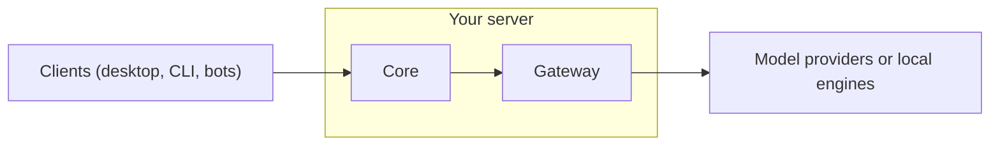

This lesson explains what a team deployment of Ryu includes and how managed Ryu Cloud differs from self-hosting.

## What gets deployed

A Ryu deployment runs two open-source, self-hostable Rust services.

| Service | Job | License |
|---|---|---|
| **Core** | Orchestrates what runs: agents, sessions, tools, workflows | Apache-2.0 |
| **Gateway** | Governs model requests routed through its endpoint: routing, firewall, budgets, audit | AGPL-3.0-or-later |

These properties matter for a server:

- **Headless.** Core runs with no UI and no cloud requirement.
- **Privacy defaults.** Data is encrypted by default, and diagnostics export is off by default.
  Product analytics, crash reports, and anonymous community stats are on by default and can be
  turned off in **Settings → Privacy**. See [Privacy and Telemetry](/docs/surfaces/desktop/transparency).
- **Governed from the start.** The Gateway sits on the default chat path, so a hosted server is governed as soon as it serves traffic.

You point your clients (desktop, CLI, bots) at the server, and they use it like any other Ryu server.

## Why self-host

Self-hosting gives you control over cost, infrastructure, and the code that orchestrates open-source
engines. You can read the Core and Gateway source, audit how model calls are routed and governed, and
run both services on your own hardware.

<Callout type="info">
  Because the Gateway is on the default path, a self-hosted server keeps the firewall, routing, and audit.
</Callout>

## Managed Cloud and provisioning

Ryu Cloud provisions hosted servers on Hetzner, with Hetzner's automated daily backups as an option.

Much of managed Ryu Cloud is a service, not a single button. A Major audits your needs, builds the agents, deploys them, and hosts them for you. Provisioning is automated. Running the server for you is people and process.

<Callout type="warn">
  Do not expect the full managed Cloud experience from a provisioning script alone. The script stands up infrastructure; the audit, build, and ongoing operation are the service layer on top.
</Callout>

## One-click deploy

If you do not want to manage a VPS, deploy to a container platform in one click.
Each button builds the repository's `Dockerfile`, which runs Core. Core spawns and
manages the Gateway on loopback.

&nbsp;

&nbsp;

To try Ryu before deploying anything, open a GitHub Codespace on your own quota. It
starts Core and opens the Ryu web app in a browser tab; see
[Try it in GitHub Codespaces](/docs/start-here/getting-started/self-host#try-it-in-github-codespaces).

Before you deploy, check two things:

- Core downloads a local model stack on first boot, so choose a plan with at least 2 GB of RAM.
  Or set a provider key (such as `OPENAI_API_KEY`) to skip the local download.
- The Gateway is AGPL v3. Hosting a modified Gateway carries the AGPL section 13 obligation to offer
  your changes to its users.

See [Deploy & self-host](/docs/start-here/getting-started/self-host) for the full walkthrough
(Docker, Fly, and the Vercel-for-docs caveat).

## Knowledge check

First, the reflection prompts. Answer them in your own words.

- Which two open-source Rust services make up a Ryu deployment?
- Why does a hosted server stay governed without extra setup?
- What part of managed Cloud is a service offering rather than a single button?

Then confirm the details with a quick self-test.

<Quiz
  questions={[
    {
      q: "Which two open-source Rust services make up a Ryu deployment?",
      options: [
        "The desktop and the web app",
        "The Core and the Gateway",
        "The Core and the control-plane backend",
      ],
      answer: 1,
      explain:
        "A Ryu deployment is the Core, which orchestrates what runs, plus the Gateway, which governs model requests routed through its endpoint. The Core is Apache-2.0 and the Gateway is AGPL v3; both are open-source and self-hostable.",
    },
    {
      q: "Why does a hosted server stay governed without extra setup?",
      options: [
        "The Gateway sits on the default chat path, so a server is governed the moment it serves traffic",
        "Every client enables governance manually after connecting",
        "Governance is handled by the closed-source desktop app",
      ],
      answer: 0,
      explain:
        "The Gateway being on the default path means self-hosting does not trade away governance. The firewall, routing, and audit travel with the deployment.",
    },
    {
      q: "What part of managed Ryu Cloud is a service offering rather than a single button?",
      options: [
        "The one-command provisioning script",
        "The audit, build, and ongoing operation done by A Major",
        "The Core and Gateway binaries",
      ],
      answer: 1,
      explain:
        "The provisioning command stands up infrastructure, but the audit, build, and ongoing operation are the service layer of people plus process on top.",
    },
  ]}
/>

Finished? [Mark this lesson complete on the path view](https://ryuhq.com/academy/cloud#lesson-deployment) to save your progress.

Next: put your deployed agents into chat platforms in [channel bots](/docs/learn/academy/cloud/channel-bots).
