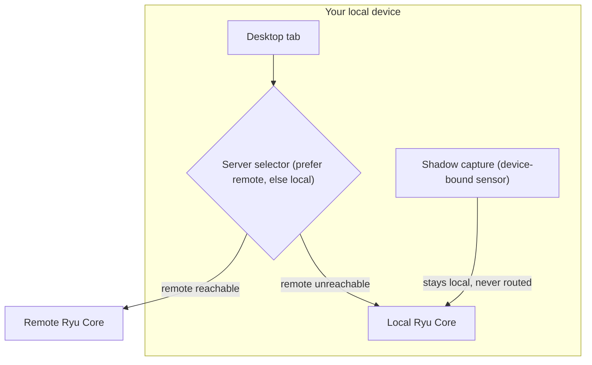

This lesson shows how Ryu works across several servers. A server is any Ryu Core you can reach, on your local machine or on a remote host. Teams often run several. Ryu spreads work across them and keeps device-bound sensors local.

## The server selector

<TryInRyu page="fleet" />

The desktop app has a server selector, and each tab can target a different server. A client can prefer a reachable remote server and fall back to local compute, so you can still work when the remote is offline.

- Each tab picks its own server, so one window can mix local and remote work.
- Prefer-remote-else-local keeps work going when the remote is unreachable.
- The selector shows CPU, RAM, disk, and GPU for each server, so you can pick the right machine for a job.

### Startup server

On desktop startup, the server step can choose which device or cloud workspace to connect to
before the shell opens. Set it with **Account and node selection** in **Settings → General → On
startup**:

- **Always ask** shows the choice on every launch.
- **Use defaults** connects to the saved **Default account** and **Default node** when they are
  available.
- **Never show** skips this screen.

Set **Default node** to **Ask at startup** to choose a node on the next launch.

This startup choice sets the window's default. Individual tabs can still use the server selector to
target a different server.

## Mesh and webhook ingress

For servers that are not on the same network, Ryu has private connectivity.

| Backend | What it provides |
|---|---|
| Tailscale or Headscale | A persistent tailnet |
| Tailcat | A short-lived point-to-point address for a specific connection |

Private networking is opt-in through an environment flag and uses userspace networking. Public
webhook ingress receives external triggers.

<Callout type="warn">
  Private networking and webhook ingress are opt-in and fail closed. Core refuses to start without a
  token when a network listener could expose it, so you cannot expose an unauthenticated server by
  accident. If Core will not start after you enable a network backend, check that a token is set.
</Callout>

## Sync across servers

Cross-device sync mirrors conversations and editable Spaces documents through your Ryu account
service, so the servers you use stay consistent. For setup steps, see
[Cross-device sync](/docs/surfaces/desktop/user-guide/cross-device-sync).

<Callout type="warn">
  Sync is off by default. Turn it on per node in **Gateway settings → Connect → Connections**. The node must be
  signed in for sync to run. While signed out, Desktop shows the preference but disables the switch.
  A node's `RYU_SYNC_ENABLED` environment setting takes precedence over the Desktop preference, so an
  off switch alone does not prove that sync is off on that node.
</Callout>

### Sync pull protocol

This detail matters only if you build a sync client.

| Data | Pull route | Stream route |
|---|---|---|
| Conversations | `/api/conversations-sync/pull` | `/api/conversations-sync/stream` |
| Spaces documents | `/api/documents-sync/pull` | `/api/documents-sync/stream` |

- A pull returns up to 1,000 records, an opaque `nextCursor`, and a server snapshot boundary in
  `snapshotAt`.
- A page can end early when its content reaches the 32 MiB response limit.
- Keep requesting `nextCursor` until it is `null`, then record `snapshotAt` as the boundary for the
  next pull.
- The cursor keeps equal-time records in stable order. Rows added after the snapshot arrive on the
  next pull.
- A single-conversation pull has the same response cap and returns 413 for an oversized legacy row.
  Use the paginated pull to sync the remaining records.
- A stream sends the bounded snapshot, then live changes. Reconcile with the paginated pull before
  you record a new watermark.
- A stream close or snapshot header alone does not prove that every page, frame, or local apply
  completed. Keep the old watermark when an apply fails, so the next pull retries it.

## The sensor rule

Compute can move between servers. Sensors cannot. Device-bound sensors, such as Shadow screen
capture, stay local and are never routed to a remote server. Model calls and orchestration can run
on any server. Screen and input capture stay on the device that has them.

## Knowledge check

First, the reflection prompts. Answer them in your own words.

- What happens when a client's preferred remote server is unreachable?
- Why does Core refuse to start tokenless under mesh?
- Which kinds of capability stay local and are never routed to a remote server?

Then confirm the details with a quick self-test.

<Quiz
  questions={[
    {
      q: "What is a server in Ryu?",
      options: [
        "Any Ryu Core you can reach, whether your local machine or a remote server",
        "A single dedicated cloud server that all clients must share",
        "A model running inside the Gateway",
      ],
      answer: 0,
      explain:
        "A server is any Ryu Core you can reach: your local machine, or a remote server. Teams run several.",
    },
    {
      q: "What happens when a client's preferred remote server is unreachable?",
      options: [
        "The client stops working until the remote returns",
        "It falls back to local compute, so you can keep working offline",
        "It automatically provisions a new remote server",
      ],
      answer: 1,
      explain:
        "Prefer-remote-else-local keeps things working when the remote is unreachable, falling back to local compute.",
    },
    {
      q: "Why does Core refuse to start tokenless under mesh?",
      options: [
        "Mesh requires a paid subscription",
        "It is fail-closed for safety, so you cannot accidentally expose an unauthenticated server",
        "Tailscale does not support anonymous servers",
      ],
      answer: 1,
      explain:
        "Mesh and webhook ingress are opt-in and fail-closed by design, so tokenless mesh start is refused on purpose.",
    },
    {
      q: "Which kind of capability stays local and is never routed to a remote server?",
      options: [
        "Model calls and orchestration",
        "Cross-device conversation sync",
        "Device-bound sensors, like the Shadow screen capture",
      ],
      answer: 2,
      explain:
        "Compute is swappable and can move to any server, but device-bound sensors like Shadow screen capture always stay on the device that has them.",
    },
  ]}
/>

Finished? [Mark this lesson complete on the path view](https://ryuhq.com/academy/cloud#lesson-multi-node) to save your progress.

Next: this path has no official credential. Choose the role-based credential that fits your work in the [certifications guide](/docs/learn/academy/certifications).
