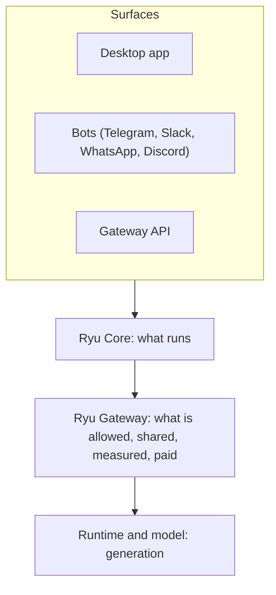

Many engines can run agents, including OpenAI, Claude Code, Gemma, and other OpenAI-compatible
runtimes (services that use the OpenAI API format). Ryu is not another engine. Ryu adds controls
around the engine. It decides what an agent can reach, which tools it can use, what data is safe to
send, what it costs, and how good its output is.

## Why a control layer?

An engine on its own generates text. It does not decide what an agent may reach, use, send, or
spend. Ryu makes those decisions with three parts.

- **Core** decides **what runs**, including which agent, session, workflow, and tool.
- **Gateway** decides **what is allowed, shared, measured, and paid for**, including routing,
  firewall, budgets, evals, and audit.
- The **selected runtime and model** do the actual generation; supported replacements need their own setup.

On the default compatible route, Core selects the agent and the Gateway checks the model request
before forwarding it. Provider-native runtimes and direct integrations can have separate paths;
check [runtime routing](/docs/surfaces/desktop/engines/agent-runtimes).

Later courses cover Core and the Gateway in detail. For now, remember that Ryu sits around supported
runtimes. Switching runtimes can require different credentials, tools, and configuration.

## Surfaces and layers, one Ryu system

Ryu shows up differently depending on the job you need to do.

- **Bot** - the fully managed consumer surface for everyday work. You sign in, give it a task, and get the result back.
- **Agent** - the desktop surface for power users and admins who configure and run a Ryu node.
- **Ryu Platform** - the developer layer: SDKs, Core, Gateway, orchestration, routing, and governance.
- **Ryu Apps** - extensions that add packaged features and interactive surfaces.
- **Ryu Infra** - where Ryu runs: managed Ryu Cloud, or self-hosted in your own environment.

This course follows the **Agent** path, because it is the surface that exposes the runtime and
its configuration. Bot hides those controls for people who only need to give AI work.

## Nothing hardcoded

Supported models, providers, runtimes, retrieval strategies, and tools are configurable. Local
inference still needs downloaded model files and a ready runtime.

<Callout type="info">
  Changing a default requires a supported replacement and its own setup. Installing a replacement
  does not migrate existing workflows, so check runtime, credential, tool, and state compatibility
  first.
</Callout>

## Knowledge check

First, the reflection prompts. Say the answers out loud or jot them down, in your own words.

- In one sentence, what does Ryu add on top of a raw engine?
- Which Ryu surface are you about to use in this course?
- What does "nothing hardcoded" mean for the model an agent uses?
- Which component decides what runs, and which component decides what is allowed?

Then confirm the details with a quick self-test.

<Quiz
  questions={[
    {
      q: "What is Ryu in relation to the engines that run agents?",
      options: [
        "Another engine that competes with OpenAI and Claude Code",
        "The orchestration and control layer around supported runtimes",
        "A faster local model you swap your engine for",
      ],
      answer: 1,
      explain:
        "Ryu is not an engine. It is the whole car built around them, the control layer that decides what an agent can reach, use, send, and cost.",
    },
    {
      q: "In Ryu, what does the Gateway decide?",
      options: [
        "Which agent, session, workflow, and tool runs",
        "What is allowed, shared, measured, and paid for",
        "How the engine generates each token",
      ],
      answer: 1,
      explain:
        "Core decides what runs; the Gateway decides what is allowed, shared, measured, and paid for, including routing, firewall, budgets, evals, and audit.",
    },
    {
      q: "Which Ryu surface is this course about?",
      options: [
        "Bot",
        "Agent",
        "Ryu Platform",
      ],
      answer: 1,
      explain:
        "This course follows Agent because it is the surface that exposes the runtime and its configuration.",
    },
    {
      q: "What does \"nothing hardcoded\" mean for the model an agent uses?",
      options: [
        "The default model can never be changed once installed",
        "The chat model can be changed to a supported replacement with its required setup",
        "Ryu picks the model for you based on the cloud",
      ],
      answer: 1,
      explain:
        "Supported defaults can be changed. A replacement needs compatible files, runtime, credentials, and task configuration.",
    },
    {
      q: "How is responsibility split between Core and the Gateway?",
      options: [
        "Core decides what runs; the Gateway decides what is allowed, shared, measured, and paid for",
        "The Gateway runs agents and Core only stores settings",
        "Both components perform the same work from a shared config file",
      ],
      answer: 0,
      explain:
        "Core owns sessions, agents, workflows, and tools. The Gateway owns policy around their model and tool calls.",
    },
    {
      q: "What path does a default Gateway-routed model call follow?",
      options: [
        "A surface sends it directly to an engine, which reports back to Core",
        "A surface hands it to Core, Core hands it to the Gateway, and the Gateway governs it before an engine",
        "The Gateway chooses a surface, then Core downloads an engine",
      ],
      answer: 1,
      explain:
        "The default routed call passes through Core and Gateway. Direct provider paths need separate checks.",
    },
    {
      q: "Which Ryu layer is the developer entry point for building products?",
      options: ["Bot", "Agent", "Ryu Platform"],
      answer: 2,
      explain:
        "Ryu Platform is the developer layer. SDKs connect products to Core and Gateway, while Infra determines where the node runs.",
    },
    {
      q: "What job belongs to the engine in Ryu's three-part model?",
      options: [
        "Deciding which workflow runs",
        "Enforcing budgets and audit policy",
        "Performing the actual generation",
      ],
      answer: 2,
      explain:
        "Core decides what runs, the Gateway governs the call, and the engine performs the actual generation.",
    },
  ]}
/>

Finished? [Mark this lesson complete on the path view](https://ryuhq.com/academy/essentials#lesson-what-is-ryu) to save your progress.

Ready to install? Continue to [Install and first run](/docs/learn/academy/essentials/install-and-setup).
