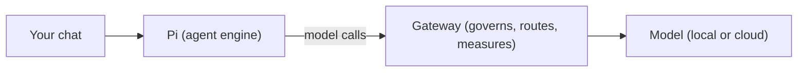

Ryu starts with one agent named **Ryu**. It is ready to chat, so you can try it before you make your
own agent.

## What is an agent in Ryu?

An agent is a saved assistant with its own setup. You can configure:

- a **chat model** that generates text
- optional **voice** and **image** models
- **tools** it can call, including extra tools from MCP servers
- **memory** and **Spaces** for what it can recall
- a **persona** and instructions
- a **safety profile** and slice of **Gateway policy** that govern its calls

Each agent keeps its own settings. You can set up one agent for coding with one model and toolset,
and another agent for support with a different setup, then choose one per chat.

## The default Ryu agent

The default **Ryu** agent is Pi with the Gateway in front of it. Pi is an agent engine. The Gateway
is Ryu's control layer. With the Gateway in front, Pi's model calls are governed, routed, and
measured.

The Ryu agent manages its own engine binary, so it works without extra setup.

## Where to find agents

<TryInRyu page="agents" />

Open the **Agents** page from the sidebar or the command palette. You will see the installed set,
which starts as just the Ryu agent. From here you can later:

- browse the **agents catalog** and add other agents such as Claude Code, Codex, Gemini CLI, or bare
  Pi, if you have their tools installed
- create your own agent on a single page
- edit an agent's configuration

The [Operating Ryu](/docs/learn/academy/operator) course covers these tasks. For now, the Ryu agent is
all you need.

<Callout type="info">
  The Ryu agent is a locked built-in. You can still change its model and provider in its own config
  panel, which the next course covers.
</Callout>

## Knowledge check

First, the reflection prompts. Say the answers out loud or jot them down, in your own words.

- What are three settings you can configure on an agent?
- What two things make up the default Ryu agent?
- Where in the app do you browse and add more agents?
- What can you still change on the locked built-in Ryu agent?

Then confirm the details with a quick self-test.

<Quiz
  questions={[
    {
      q: "What does an agent's setup include in Ryu?",
      options: [
        "A single fixed model you cannot change",
        "Independent settings for its instructions, model, tools, memory, voice, and safety",
        "A cloud service you rent per request",
      ],
      answer: 1,
      explain:
        "An agent is a saved assistant with independent settings for its instructions, model, tools, memory, voice, persona, and safety.",
    },
    {
      q: "What two things make up the default Ryu agent?",
      options: [
        "Pi with the Gateway on top",
        "Claude Code with a local model",
        "Gemma with a cloud key",
      ],
      answer: 0,
      explain:
        "The default Ryu agent is Pi with the Gateway on top, the headline demo of the car around the engine.",
    },
    {
      q: "Why does the Ryu agent work without extra setup?",
      options: [
        "It requires you to install Pi separately first",
        "It is self-sufficient and manages its own engine binary",
        "It only runs after you sign in",
      ],
      answer: 1,
      explain:
        "The Ryu agent is self-sufficient. It manages its own engine binary, so it works without any extra setup.",
    },
    {
      q: "Where do you browse and add more agents?",
      options: [
        "The Models page",
        "The Agents page, from the sidebar or command palette",
        "The Gateway settings dialog",
      ],
      answer: 1,
      explain:
        "Open the Agents page from the sidebar or the command palette to see the installed set and browse the agents catalog.",
    },
    {
      q: "What can you change on the locked built-in Ryu agent?",
      options: [
        "Nothing at all",
        "Its model and provider through the dedicated config panel",
        "Its built-in identity and installation id",
      ],
      answer: 1,
      explain:
        "The built-in stays locked as the default agent, but its model and provider remain configurable.",
    },
    {
      q: "Which pair names two independent parts of an agent's configuration?",
      options: [
        "Tools and memory",
        "Billing invoice and release channel",
        "Window size and operating-system theme",
      ],
      answer: 0,
      explain:
        "Tools and MCP servers control what the agent can call, while memory and Spaces control what it can recall.",
    },
    {
      q: "Why can two Ryu agents behave very differently?",
      options: [
        "Each agent can use a different combination of model, tools, memory, persona, and policy",
        "Every agent receives a random hidden prompt on each launch",
        "Agents are permanently tied to different cloud accounts",
      ],
      answer: 0,
      explain:
        "Each agent has its own independent configuration, so two agents can be set up for entirely different jobs.",
    },
  ]}
/>

Finished? [Mark this lesson complete on the path view](https://ryuhq.com/academy/essentials#lesson-your-first-agent) to save your progress.

Now put the agent to work in [Your first chat](/docs/learn/academy/essentials/your-first-chat).
