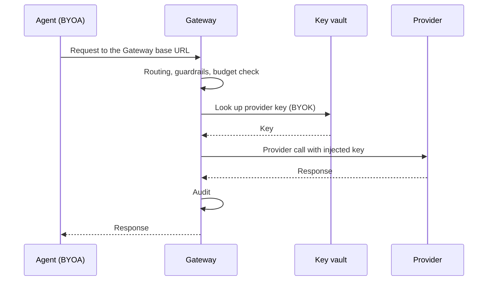

This lesson covers how the Gateway caps spend, holds provider keys, and governs agents you already run. What is paid for is a Gateway concern, so budgets, keys, and agent connections live in the Gateway, not in Core.

## Budgets

Budgets cap spend. The Gateway measures model spend, and it tracks and enforces an exec-budget for tool and programmatic execution.

When an agent runs tools, the Gateway checks each run against count and wall-clock limits for a rolling window before it starts. See [Gateway tools](/docs/gateway/tools) for the exec-budget reference.

## BYOK: bring your own key

With BYOK, you store provider keys in a key vault instead of in code. The Gateway injects the key when it makes the provider call. Keys live in one governed place, and an agent does not hold a raw provider key. See [Provider connections](/docs/gateway/provider-connections).

## BYOA: bring your own agent

With BYOA, you point an OpenAI-compatible agent at the Gateway by changing its base URL. You govern an agent you already run without replacing it. Its calls then go through routing, guardrails, budgets, and audit. See [Gateway for any OpenAI-compatible agent](/docs/gateway/gateway-for-any-agent).

<Callout type="info">
  BYOA uses the Gateway's OpenAI-compatible interface. An agent that can point at OpenAI can point at the Gateway by changing its base URL.
</Callout>

## Why all of this is a Gateway concern

Keys and budgets are about what is paid for, which is the Gateway's job under the [Core vs Gateway](/docs/learn/academy/governing/core-vs-gateway) rule. Core decides what runs; the Gateway decides what it costs and which credentials it may use.

<Callout type="warn">
  BYOA governs an agent's calls only when they route through the Gateway. This is the ACP limit from
  the Core vs Gateway lesson. An ACP subprocess agent that makes its own internal provider calls
  cannot have those chat calls intercepted, though its tool execution is still budgeted and audited.
</Callout>

## Knowledge check

First, the reflection prompts. Answer them in your own words.

- What kind of execution does the Gateway track and enforce a budget for?
- Where are provider keys stored under BYOK, and who injects them?
- What single change points an existing OpenAI-compatible agent at the Gateway?

Then confirm the details with a quick self-test.

<Quiz
  questions={[
    {
      q: "Beyond model spend, what execution does the Gateway track and enforce a budget for?",
      options: [
        "Tool and programmatic execution",
        "Disk usage on the local machine",
        "Network bandwidth between nodes",
      ],
      answer: 0,
      explain:
        "The Gateway tracks and enforces an exec-budget for tool and programmatic execution, counting and bounding their cost at the control layer.",
    },
    {
      q: "Under BYOK, where do provider keys live and who injects them?",
      options: [
        "Hardcoded in each agent, which injects its own key",
        "In a key vault, and the Gateway injects the key on the provider call",
        "In Core, which forwards them to the provider",
      ],
      answer: 1,
      explain:
        "BYOK stores keys in a vault rather than hardcoding them, and the Gateway injects the key when it makes the provider call.",
    },
    {
      q: "What single change points an existing OpenAI-compatible agent at the Gateway?",
      options: [
        "Rewriting the agent to use Ryu's SDK",
        "Swapping its base URL to the Gateway",
        "Installing the agent as an ACP subprocess",
      ],
      answer: 1,
      explain:
        "BYOA means pointing an OpenAI-compatible agent at the Gateway by swapping its base URL, without replacing the agent.",
    },
    {
      q: "Why do keys and budgets belong to the Gateway rather than Core?",
      options: [
        "They are about what is paid for and which credentials may be used",
        "They are about which agent runs next",
        "They are too slow to live in Core",
      ],
      answer: 0,
      explain:
        "Keys and budgets are about what is paid for, which is the Gateway's job per the Core-vs-Gateway rule.",
    },
    {
      q: "What stays unchanged when you adopt BYOA through a base-URL swap?",
      options: [
        "The existing compatible agent keeps working while its calls gain Gateway policy",
        "The agent is replaced by the built-in Ryu agent",
        "Every provider key is copied into the agent's source code",
      ],
      answer: 0,
      explain:
        "BYOA keeps the agent you already run. Its compatible calls simply flow through routing, guardrails, budgets, and audit.",
    },
    {
      q: "Which calls from an ACP subprocess remain outside Gateway interception?",
      options: [
        "Its internally made chat provider calls",
        "Its governed tool executions",
        "Its audit records",
      ],
      answer: 0,
      explain:
        "An ACP subprocess may make chat provider calls internally, outside the Gateway path. Its Ryu tool execution remains budgeted and audited.",
    },
  ]}
/>

Finished? [Mark this lesson complete on the path view](https://ryuhq.com/academy/governing#lesson-budgets-and-keys) to save your progress.

Next: measure quality and prove what happened in [Evals and audit](/docs/learn/academy/governing/evals-and-audit).
