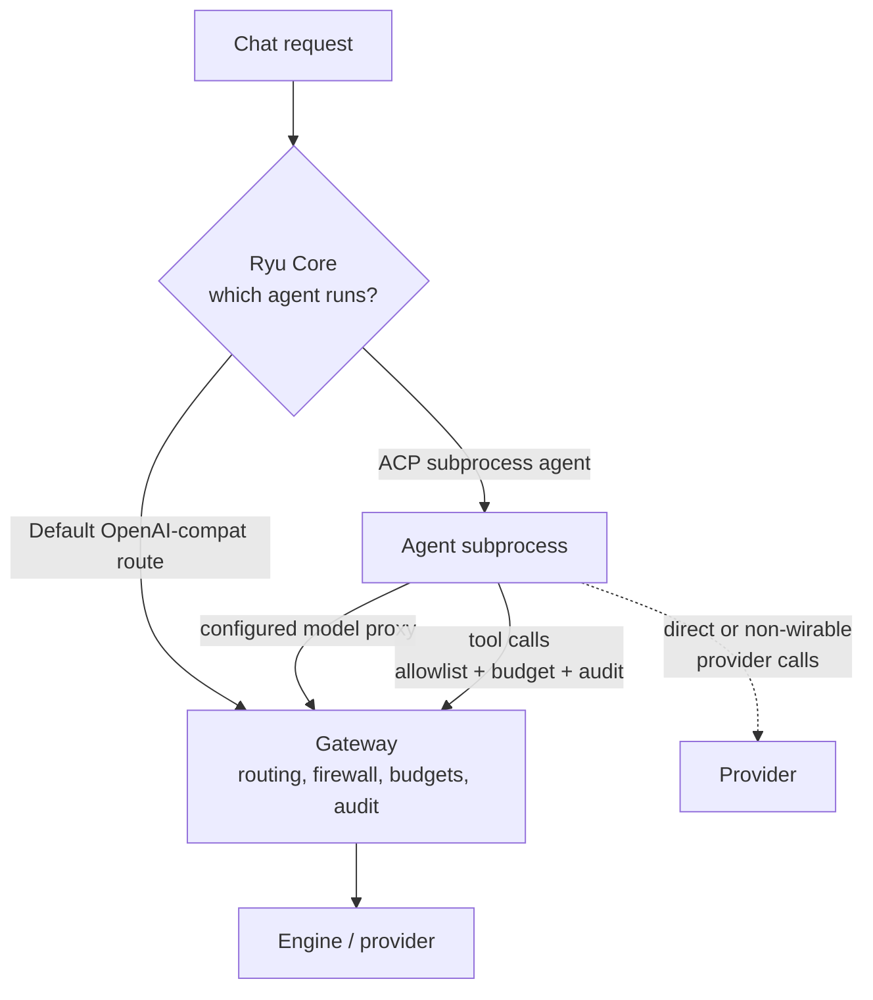

Every part of Ryu belongs to one of two layers.

- **Core decides what runs**: which agent, which session, which workflow, which tool.
- **Gateway decides what is allowed, shared, measured, and paid for**: security, routing, the registry, budgets, evals, organization policy, and audit.

Gateway owns model-request policy for traffic routed through its endpoint. Core owns orchestration and also checks execution permissions. A runtime that calls a provider directly has a separate model path; check its routing before relying on Gateway firewall, budget, or audit controls.

## Why the split matters

The Gateway is the shared part. It gives a team one control point over many agents, and it is where governance, spend, and audit live. If policy moved into Core, each agent path would implement it differently and there would be no single source of truth.

## What the Gateway is

The Gateway is an OpenAI-compatible LLM gateway. It exposes a `/v1/chat/completions` endpoint and adds the control surfaces on top:

- Routing and fallback between providers and models.
- Rate limiting and a circuit breaker.
- Exact and semantic caching.
- A firewall and data-protection guardrails.
- Evals and audit.

It is on the default chat path, so the default route is governed with no extra wiring. To reach these surfaces, open the **Gateway** dialog in the desktop app from the command palette (Ctrl+K or Cmd+K).

<Callout type="info">
  Because the Gateway speaks the OpenAI format, a compatible OpenAI client can use the Gateway after configuring its base URL, credentials, and supported request features. That is the foundation for BYOA, covered later in this course.
</Callout>

## The limit for ACP runtimes

ACP (Agent Client Protocol) runtimes run as subprocesses. Supported runtimes such as Claude Code and Codex can route model traffic through configured Gateway passthrough paths; provider-native runtimes and direct-egress configurations can bypass them. Ryu-bridged tools use the agent allowlist and governed execution path. A subprocess's own tools and external services need separate permission and destination checks. See [runtime routing](/docs/surfaces/desktop/engines/agent-runtimes).

## Reference

[Core vs Gateway](/docs/start-here/architecture/core-vs-gateway) is the canonical architecture page for the split, including which code belongs on each side.

## Knowledge check

First, the reflection prompts. Answer them in your own words.

- If code decides which workflow to run, is that Core or Gateway?
- How do the Gateway and Core divide policy and access checks, and why is model-request policy centralized in the Gateway?
- For an ACP subprocess agent, which calls does the Gateway govern and which can it not intercept?

Then confirm the details with a quick self-test.

<Quiz
  questions={[
    {
      q: "Code that decides which agent, session, or workflow runs belongs to which layer?",
      options: ["Core", "Gateway", "Neither, it is shared equally"],
      answer: 0,
      explain:
        "Core decides what runs: which agent, which session, which workflow, which tool.",
    },
    {
      q: "What is the strict rule about Core and policy?",
      options: [
        "Core enforces policy inline so it is fast",
        "Gateway owns policy for requests routed through it; Core owns execution and access checks",
        "Core and the Gateway both enforce policy redundantly",
      ],
      answer: 1,
      explain:
        "Gateway centralizes model-request policy for its routed traffic. Core still checks execution access; direct provider calls have separate boundaries.",
    },
    {
      q: "Which ACP model traffic bypasses Gateway controls?",
      options: [
        "Its tool calls",
        "Direct or non-wirable provider calls that do not reach the Gateway",
        "Nothing, the Gateway intercepts everything",
      ],
      answer: 1,
      explain:
        "Supported runtimes can use Gateway proxy paths. Direct provider traffic bypasses those controls; Ryu-bridged tools use a separate governed path.",
    },
    {
      q: "Why is the Gateway the part a team adopts and an enterprise buys?",
      options: [
        "It is faster than Core",
        "It is the shared control point where governance, spend, and audit live",
        "It runs the agents directly",
      ],
      answer: 1,
      explain:
        "The Gateway is the shared part: one control point over many agents, and where governance, spend, and audit actually live.",
    },
    {
      q: "Which compatibility endpoint does the Gateway expose for chat traffic?",
      options: [
        "/v1/chat/completions",
        "/v1/core/run-workflow",
        "/v1/desktop/messages",
      ],
      answer: 0,
      explain:
        "The Gateway exposes the OpenAI-compatible /v1/chat/completions endpoint, which lets compatible agents adopt it with a base-URL change.",
    },
    {
      q: "Why does the default Ryu chat route need no extra governance wiring?",
      options: [
        "The Gateway is already on the default chat path",
        "Core duplicates every policy rule inline",
        "The model provider applies Ryu's policies automatically",
      ],
      answer: 0,
      explain:
        "The Gateway already sits on the default chat path, so requests on that route pass through its control surfaces without extra setup.",
    },
  ]}
/>

Finished? [Mark this lesson complete on the path view](https://ryuhq.com/academy/governing#lesson-core-vs-gateway) to save your progress.

Next: learn how the Gateway picks a model for each request in [Routing](/docs/learn/academy/governing/routing).
