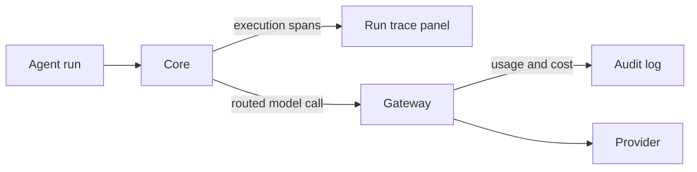

Measurement and audit are Gateway responsibilities. Evals tell you whether an agent is good. Audit lets you prove what it did.

## Evals

Evals measure output quality. With Gateway evals, you replay prompts (with per-case variables) through the pipeline and score the outputs against a judge rubric. The scores are evidence that an agent meets a quality bar.

## Audit

Audit is the trail of what happened. When you need to answer what an agent did, when, and at what cost, the audit trail is the source of truth.

- Calls and tool executions on the governed path emit audit records.
- Direct provider calls and external runtime-native tools have separate coverage.

## Run traces

Desktop provides a read-only run trace panel for a selected conversation or run. The two records cover different things:

| Record | Owner | What it holds |
|---|---|---|
| Run trace | Core | The ordered execution spans of a run |
| Audit log | Gateway | Model usage and cost for its routed requests |

Neither view establishes coverage of a direct external provider or runtime-native tool.

## Who can reach admin endpoints

The Gateway's admin endpoints (config, the audit log, and budget spend) share one authorization gate:

- The Gateway **master key** always passes, from any machine. That makes the master key the
  credential to protect: anyone holding it can reach these endpoints remotely.
- Without the master key, a request is accepted only under the zero-config dev posture: it comes
  from a loopback peer, base auth (`require_auth`) is off, mesh and fleet are off, and no master key
  has been set.
- Keyless requests are also refused when a browser marks them as a web-page fetch (any
  `Sec-Fetch-Site` value of `cross-site`, `same-site`, or `same-origin`), or when they carry a
  non-loopback `Host` header.
- Per-tenant API keys cannot read the audit log.

<Callout type="warn">
  Loopback is a fallback for an unconfigured dev node, not a network boundary. Once you turn on auth,
  mesh, or fleet, or set a master key, only the master key opens these endpoints. Treat the master key
  as the admin credential and keep it out of shared clients.
</Callout>

For the full surfaces, see [Gateway evals](/docs/gateway/evals), [Gateway audit](/docs/gateway/audit), and [Observability](/docs/surfaces/desktop/observability).

## Knowledge check

First, the reflection prompts. Answer them in your own words.

- What two questions do evals and audit each answer?
- What emits an audit record in the Gateway?
- Who can call admin endpoints like config and audit, and when does a keyless local call stop working?

Then confirm the details with a quick self-test.

<Quiz
  questions={[
    {
      q: "What question does an eval answer?",
      options: [
        "What exactly did the agent do?",
        "Is this agent good?",
        "Which provider served the request?",
      ],
      answer: 1,
      explain:
        "Evals measure output quality, answering whether an agent is good. Audit answers what it did.",
    },
    {
      q: "What emits an audit record in the Gateway?",
      options: [
        "Only failed requests",
        "Calls and tool executions on the governed path",
        "Only requests that use a paid provider",
      ],
      answer: 1,
      explain:
        "Calls and tool executions on the governed path emit audit records. Direct provider calls and external runtime-native tools need separate coverage checks.",
    },
    {
      q: "What does the Gateway use to score an eval output against a quality bar?",
      options: ["A judge rubric", "Rate limiting", "Egress compression"],
      answer: 0,
      explain:
        "The evals capability replays prompts and scores the output against a judge rubric, so you can measure whether an agent meets a bar.",
    },
    {
      q: "What does a caller on another machine need to read the Gateway audit log?",
      options: [
        "The Gateway master key",
        "Any per-tenant API key",
        "Nothing, because audit is open on the LAN",
      ],
      answer: 0,
      explain:
        "Config, audit, and budget spend share one admin gate. The master key always passes. A keyless call is allowed only from loopback on an unconfigured dev node (no auth, mesh, fleet, or master key), and per-tenant API keys cannot read audit data.",
    },
    {
      q: "What is the practical difference between eval evidence and the audit trail?",
      options: [
        "Evals measure output quality; audit records what governed calls and tools did",
        "Evals store provider keys; audit chooses the model",
        "They are two names for the same record",
      ],
      answer: 0,
      explain:
        "Evals establish whether an agent meets a quality bar, while audit is the source of truth for what happened and at what cost.",
    },
    {
      q: "Which read-only execution view does Desktop provide?",
      options: [
        "Read-only per-run trace viewing",
        "The ability to send any model call",
        "All audit record creation",
      ],
      answer: 0,
      explain:
        "Core run traces show execution spans; Gateway audit shows model usage and cost for its routed requests.",
    },
  ]}
/>

Finished? [Mark this lesson complete on the path view](https://ryuhq.com/academy/governing#lesson-evals-and-audit) to save your progress.

Next: you have finished the Governing track. Put it to use by learning to build what the Gateway governs in [Building on Ryu](/docs/learn/academy/builder).
