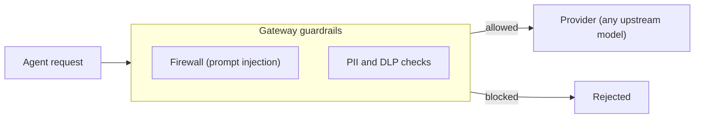

Guardrails are the firewall and data-protection surfaces of the Gateway. They decide what is safe to send and what is screened before a request reaches a provider.

## The firewall

The firewall screens requests, including for prompt injection. It runs inside the Gateway, so each agent does not need its own protection.

## PII and DLP

PII (personally identifiable information) and DLP (data loss prevention) controls govern what data is safe to send on egress. They keep sensitive data from leaving on an unintended model call. Because they run at the Gateway, they apply to every governed call.

These guardrails are Ryu's own and are separate from any upstream provider's controls, so they still apply when a request goes to a third-party model.

## Where to configure them

The desktop app has two places for guardrail settings:

- **Gateway → Safety filters** sets firewall, DLP, inspector, and inline-evaluator policy at the
  node, organization, or agent scope. It also shows command approval, catalog scanning, and which
  agents route model traffic through the Gateway.
- **Gateway → Guardrail policies** writes one named policy and assigns it to an organization, team,
  member, key, or agent.

## Egress compression

An optional egress compression transform can shrink request messages before the provider call. It is off by default (`compression.enabled = false`).

When compression cannot run (the service is down, times out, or returns a bad response):

- a self-hosted Gateway fails open, so the original request goes through unchanged;
- a hosted fleet Gateway refuses the request instead.

The Gateway re-screens the message text that compression changed before it sends the request.

For configuration details, see [Guardrail policies](/docs/gateway/guardrail-policies), [Gateway security](/docs/gateway/security), and [Compression](/docs/gateway/compression).

## Knowledge check

First, the reflection prompts. Answer them in your own words.

- What kind of attack does the firewall screen requests for?
- What do PII and DLP controls govern, and on which side of the call?
- What does it mean that the egress compression transform fails open?

Then confirm the details with a quick self-test.

<Quiz
  questions={[
    {
      q: "What kind of protection does the firewall provide on requests?",
      options: [
        "Prompt-injection style protections",
        "Rate limiting only",
        "Encryption of stored conversations",
      ],
      answer: 0,
      explain:
        "The firewall screens requests, including prompt-injection style protections, drawing on security tooling wired into the Gateway.",
    },
    {
      q: "What do PII and DLP controls govern, and on which side of the call?",
      options: [
        "What data is safe to send on egress",
        "What data a provider may return on ingress",
        "How long conversations are retained",
      ],
      answer: 0,
      explain:
        "PII and DLP controls govern what data is safe to send on egress, keeping sensitive data from leaving on a model call you did not intend.",
    },
    {
      q: "Because guardrails run at the Gateway, how widely do they apply?",
      options: [
        "Only to the default Ryu agent",
        "Across every governed call, rather than re-implemented per agent",
        "Only to requests that opt in per agent",
      ],
      answer: 1,
      explain:
        "Running at the Gateway means the controls apply across every governed call rather than being re-implemented per agent.",
    },
    {
      q: "What does it mean that egress compression fails open?",
      options: [
        "If compression cannot run, the request fails with an error",
        "If compression cannot run, the original request goes through unchanged",
        "Compression is always applied, even when it errors",
      ],
      answer: 1,
      explain:
        "Failing open means that if compression cannot run, the original request goes through unchanged rather than failing.",
    },
    {
      q: "How do Ryu's user-level guardrails relate to a provider's own protections?",
      options: [
        "They are separate controls that remain under your control before the provider call",
        "They are aliases for whatever protection the provider enables",
        "They only run after the provider returns a response",
      ],
      answer: 0,
      explain:
        "Ryu's guardrails are distinct from provider controls, so governed egress remains under your policy even when a third party serves the model.",
    },
    {
      q: "Where do you configure scoped firewall, DLP, inspector, and inline-evaluator policy?",
      options: [
        "Gateway, Guardrails in the desktop",
        "Separately inside every agent plugin",
        "Only in an upstream provider's console",
      ],
      answer: 0,
      explain:
        "The desktop Gateway dialog exposes scoped firewall, DLP, inspector, and inline-evaluator controls, plus related command, catalog, and agent-egress settings.",
    },
  ]}
/>

Finished? [Mark this lesson complete on the path view](https://ryuhq.com/academy/governing#lesson-guardrails) to save your progress.

Next: cap spend and manage keys in [Budgets and keys](/docs/learn/academy/governing/budgets-and-keys).
