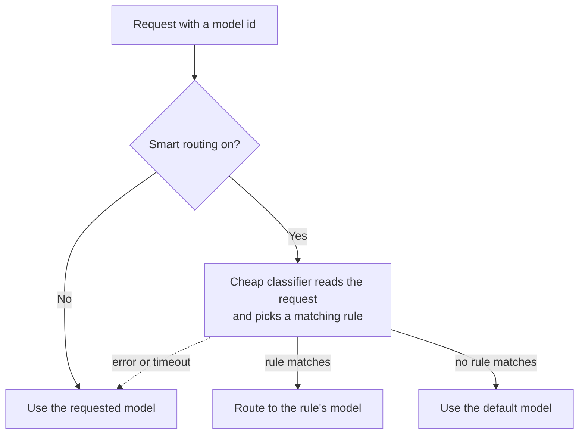

Model routing decides which provider and model serves each request. The base router resolves a model id to a provider. Smart routing is an optional layer on top of it.

## Smart routing

Smart routing is a classifier-driven router. You write plain-language rules, and a low-cost classifier model picks the model for each request. For example:

- "Coding questions go to Claude."
- "Casual chat goes to a local model."

You configure it under **Gateway → Model routing → Smart routing**. It is off by default. To use it, set:

- A low-cost **classifier model** that reads the request and chooses a rule.
- An ordered list of **rules**, each a description plus a target model.
- An optional **default** model for when no rule matches.

## It fails open

Smart routing fails open. If the classifier errors, times out, or returns an unusable answer, the originally requested model is used. Routing should improve outcomes, not become a single point of failure. Classifier calls are still governed, so a governance denial on that call is returned to the caller.

<Callout type="info">
  The routed model is returned in the `x-routed-model` response header, so you can see which model served a request.
</Callout>

## Nothing is hardcoded

A target can be any routable model id, including local models and OpenRouter slugs. The routing layer is not tied to one provider.

<Callout type="warn">
  Bare `gemini-*` model ids route through the native `genai` provider. Google Vertex is a separate opt-in provider that an operator targets through `routing.model_map` or `default_provider`; it is not claimed by a built-in prefix. A `google/...` model id can still be mapped to OpenRouter.
</Callout>

## When changes take effect

The smart-routing switch and its rules (`routing.smart_routing`) apply to new requests as soon as you save, with no restart. The base router's `model_map`, `fallback_chain`, and `provider_tiers` load at startup, so changes to them take effect on the next gateway restart.

## Reference

[Gateway routing](/docs/gateway/routing) is the canonical reference for the resolution order, `routing.smart_routing`, and every other routing setting.

## Knowledge check

First, the reflection prompts. Answer them in your own words.

- What does smart routing use to choose a model for each request?
- What happens to a request if the classifier times out?
- Which provider handles a bare `gemini-*` model id, and how is Vertex selected differently?
- Which routing settings apply as soon as you save, and which still need a gateway restart?

Then confirm the details with a quick self-test.

<Quiz
  questions={[
    {
      q: "How does smart routing pick a model for each request?",
      options: [
        "It always uses the cheapest available model",
        "A cheap classifier reads the request and chooses a matching rule",
        "It rotates evenly across all configured providers",
      ],
      answer: 1,
      explain:
        "Smart routing is classifier-driven: a cheap classifier reads the request and picks the rule whose target model should serve it.",
    },
    {
      q: "If the classifier errors or times out, what happens to the request?",
      options: [
        "The request is blocked and an error is returned",
        "The originally requested model is used",
        "The default model is always used instead",
      ],
      answer: 1,
      explain:
        "Smart routing fails open: on a classifier error or timeout, the originally requested model serves the request.",
    },
    {
      q: "How does a bare gemini-* model id route by default?",
      options: [
        "Through the native genai provider",
        "Through Vertex donated credit",
        "It is rejected unless rewritten as an OpenRouter slug",
      ],
      answer: 0,
      explain:
        "Bare gemini-* ids route through genai. Vertex is a separate opt-in provider selected through an operator model map or default provider.",
    },
    {
      q: "When does a change to smart-routing rules take effect?",
      options: [
        "As soon as you save, with no restart",
        "Only after the next gateway restart",
        "Only after the classifier is retrained",
      ],
      answer: 0,
      explain:
        "Smart-routing rules and the on/off switch are swapped in live for new requests. The base router's model map, fallback chain, and provider tiers still take effect on the next gateway restart.",
    },
    {
      q: "What does smart routing use when no plain-language rule matches?",
      options: [
        "The optional default model",
        "The most expensive model in the catalog",
        "A randomly selected provider",
      ],
      answer: 0,
      explain:
        "A smart-routing configuration can specify a default model for requests that do not match any ordered rule.",
    },
    {
      q: "How can a caller tell which model actually served a routed request?",
      options: [
        "The routed model is exposed on a response header",
        "It can only be inferred from the writing style",
        "The classifier rewrites the request body with the model name",
      ],
      answer: 0,
      explain:
        "The Gateway surfaces the routed model on a response header so callers can inspect the actual target.",
    },
  ]}
/>

Finished? [Mark this lesson complete on the path view](https://ryuhq.com/academy/governing#lesson-routing) to save your progress.

Next: protect requests and egress with the [Guardrails](/docs/learn/academy/governing/guardrails) surfaces.
