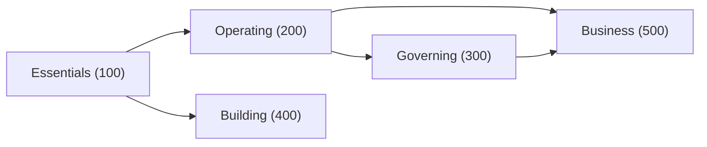

**Ryu Academy** has five guided paths, 21 lessons, and four official credentials. Start with the
app, then learn to operate, govern, or build on the platform. A separate Business path covers
deployment and multi-node use.

<Figure name="learn" />

Each lesson states what you will learn, walks through the feature with real steps, and ends with a
**knowledge check**. Work through a track end to end, or open the lesson you need.

<Cards>
  <Card title="Open Ryu Academy" href="https://ryuhq.com/academy" description="Browse the role-based learning experience." />
  <Card title="Search all learning" href="https://ryuhq.com/academy/catalog" description="Search every lesson and filter by level or format." />
  <Card title="My learning" href="https://ryuhq.com/academy/learn" description="Save lessons, continue a path, and earn completion badges." />
  <Card title="Earn credentials" href="https://ryuhq.com/certifications" description="Prepare for official exams or browse reviewed community credentials." />
</Cards>

The web Academy keeps four destinations together:

- **Overview** introduces the paths.
- **Catalog** searches and filters every lesson.
- **My learning** saves your place.
- **Certifications** holds exam preparation, exam progress, and publicly verifiable credentials.

Each path also has a native detail view with outcomes, prerequisites, practice, and an ordered
lesson sequence.

In **Catalog**, search lesson titles, descriptions, levels, course names, and topics, then narrow
the list by **Learning level** and **Format**. When nothing matches, **Show all learning** clears
the search and filters.

<Callout type="info">
  **Current as of October 25, 2026.** The published catalog contains 5 paths, 21 lessons, and about 4 hours 13 minutes of learning.
</Callout>

## Choose your track

<Cards>
  <DocCard
    title="Ryu Essentials"
    href="/docs/learn/academy/essentials"
    description="Beginner · 4 lessons · 40 minutes. Install Ryu, meet the default agent, and run your first chat."
  />
  <DocCard
    title="Operating Ryu"
    href="/docs/learn/academy/operator"
    description="Intermediate · 5 lessons · 62 minutes. Agent setup, models, skills, tools, memory, and automations."
  />
  <DocCard
    title="Governing Ryu"
    href="/docs/learn/academy/governing"
    description="Advanced · 5 lessons · 54 minutes. Routing, guardrails, budgets, keys, evals, and audit."
  />
  <DocCard
    title="Building on Ryu"
    href="/docs/learn/academy/builder"
    description="Advanced · 4 lessons · 58 minutes. The Runnable model, SDK, extensions, and Marketplace publishing."
  />
  <DocCard
    title="Ryu for Business"
    href="/docs/learn/academy/cloud"
    description="Advanced · 3 lessons · 39 minutes. Deploy, ship channel bots, and run a multi-node fleet."
  />
</Cards>

Each course has a **level** number. Level `100` is the starting point, and each step of `100`
assumes the courses before it. The arrows below follow each path's stated prerequisites.

## How the Academy works

- **Tracks by role.** Each course targets one kind of reader. Start with Essentials, then follow the
  track that matches your work.
- **Knowledge checks.** Every lesson ends with a short self-test. It is not graded and needs no
  sign-in. Sign in only when you want to save completion progress.
- **Applied practice.** Every path names a practice capstone, and lessons point at the real Ryu
  surface or a concrete action to try.
- **Saved learning.** Mark lessons complete from the native path view, continue from the next
  lesson, and reopen a lesson to revisit it. See [Learning progress](/docs/learn/academy/learning-progress).
- **Completion before credentials.** A finished path shows a Ryu Academy completion badge. The badge
  does not replace the server-scored certification exam.
- **Maturity notes.** Lessons say when a capability is available now, when configuration is not yet
  exposed, and when Ryu Cloud involves a managed service.
- **One source for exams.** Official question pools are generated from the published lesson
  quizzes.

## Get certified

When you have worked through a credential-bearing track, the [certifications guide](/docs/learn/academy/certifications)
lists the four official certifications, the 30-question source pool behind each 10-question exam,
and the skills each exam covers.

<Callout type="info">
  New to Ryu entirely? Begin with [Ryu Essentials](/docs/learn/academy/essentials). It assumes no prior
  knowledge and takes you to a working agent in four lessons.
</Callout>
