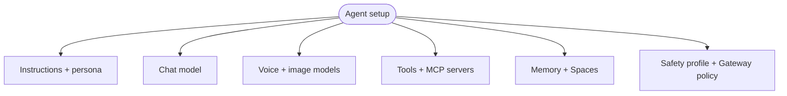
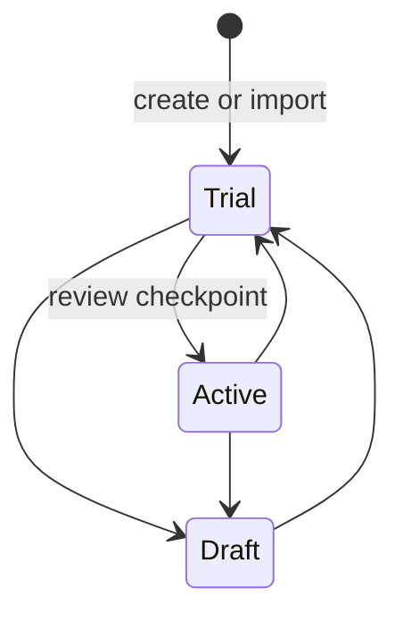

A Ryu agent is a saved assistant. Each agent has its own settings, so you can fit an agent to a job
without creating a new runtime. An agent's configuration includes:

- Instructions and persona.
- A chat model, plus optional voice and image models.
- Tools and MCP servers it may call.
- Memory and Spaces it can use.
- A safety profile and the Gateway policy that governs its calls.

For example, one agent can use a small local model with no tools for quick drafting, and another can
use a large model with a research toolset and a private Space.

## Lifecycle is separate from capability

An agent's configuration also has an execution posture, set under **Lifecycle & safety**. The
lifecycle controls whether the agent is available at all:

| Lifecycle | What it allows |
|---|---|
| **Draft** | Authoring only. The agent cannot be selected or run. |
| **Trial** | Manual foreground chat with effective **Read-only** access. Reads and real previews run; writes, unknown tools, external sends, memory writes, delegation, channels, and automation are blocked. |
| **Active** | Required for workflows, schedules, channels, and delegated work. |

New custom and imported agents start in **Trial**, so you can check the prompt before the agent
acts. Demoting an agent pauses its owned automations while preserving their definitions for later
review.

The safety profile controls what an active agent may do. The choices are **Read-only**,
**Approval required**, **Verified plans only**, and **Autonomous**. Lifecycle and safety profile
are independent, so changing a profile does not skip the Draft → Trial → Active review checkpoint.

## The Agents page

<TryInRyu page="agents" />

Open the **Agents** page from the sidebar (or jump there from the command palette with Ctrl+K). From
here you can:

- Browse the installed set of agents.
- Create a new agent on a single page, filling in its setup as you go.
- Edit an existing agent's configuration.

Each agent supports per-agent instructions, a list of rules you add and remove, and schedule presets
for recurring runs.

### Capability defaults

When you create an agent, its Tools & skills setting starts with no MCP, built-in, or plugin/app tool
grants, plus every globally enabled skill (an empty skills list means all enabled skills). Grant only
the tools the agent needs; granting every tool is an explicit opt-in with **Enable all**.

Use **Disable all** or switch off individual rows to narrow skills or revoke tool grants. Those choices
are saved on the agent and apply wherever it runs. Global app/plugin enablement, global skill
activation, Gateway policy, and human approval still gate execution.

ACP agents installed from the catalog, including agents added automatically during onboarding, use
the same defaults: their saved configuration starts with no tool grants, and any routable model traffic starts
Gateway-governed. Turn off the per-agent routing switch when direct provider traffic is intentional;
an existing explicit opt-out is never overwritten by an install or onboarding pass.

## The agents catalog

Only the default **Ryu** agent is installed by default. Every other agent is opt-in through the
agents catalog.

During onboarding, Ryu detects which agent CLIs you already have on your PATH and offers to add the
matching agents. Supported agents include Claude Code, Codex, Gemini CLI, bare Pi, OpenClaw, and
Hermes. You choose which ones are added.

<Callout type="info">
  The catalog only lists agents whose runtime it can reach. If an agent you expect is missing, it
  usually means its CLI is not yet on your PATH.
</Callout>

## The locked Ryu agent

The default **Ryu** agent is a locked built-in, so some of its settings cannot be changed. You can
still change its model and provider in its own config panel (the Ryu Pi config), which appears only
when you edit the Ryu agent. Other agents use the normal agent editor.

## Talking to several at once

Council (team) chat brings more than one agent into a single conversation. Use an @mention to
address a specific agent. Add several agents to the same thread to compare answers or split a task.

<Callout type="warn">
  Adding an agent from the catalog only makes it available. Its model, memory, and other settings
  still start from defaults; review the configuration before relying on it, and narrow its
  capability access when the job needs less reach.
</Callout>

## Knowledge check

First, the reflection prompts. Answer them in your own words.

- Name three independent parts of an agent's configuration.
- Which single agent is installed by default, and how do you add others?
- Why does the Ryu agent have its own config panel instead of the normal editor?

Then confirm the details with a quick self-test.

<Quiz
  questions={[
    {
      q: "What does an agent's setup control in Ryu?",
      options: [
        "Its instructions, model, tools, memory, voice, and safety settings",
        "Only the model used for one chat",
        "A folder of conversation history",
      ],
      answer: 0,
      explain:
        "An agent is a saved assistant with independent configuration for instructions, model, tools, memory, voice, persona, and safety.",
    },
    {
      q: "Which agent is installed out of the box?",
      options: [
        "Claude Code",
        "Only the default Ryu agent",
        "Every detected CLI agent",
      ],
      answer: 1,
      explain:
        "Only the default Ryu agent is installed by default. Everything else is opt-in through the agents catalog.",
    },
    {
      q: "Why does the Ryu agent use its own config panel?",
      options: [
        "It has no model setting to edit",
        "It is a locked built-in, so its model and provider are changed through the dedicated Ryu Pi config",
        "All agents share that same panel",
      ],
      answer: 1,
      explain:
        "The default Ryu agent is a locked built-in, so you change its model and provider through a dedicated config panel rather than the normal editor.",
    },
    {
      q: "What does adding an agent from the catalog do to its configuration?",
      options: [
        "Copies the Ryu agent's configuration",
        "Makes the agent available with default settings and no tool grants until you add them",
        "Auto-configures the best model and tools",
      ],
      answer: 1,
      explain:
        "Adding a catalog agent makes it available with default settings, no tool grants, and the globally enabled skills; review its model, grant the tools it needs, and check memory before using it.",
    },
    {
      q: "Which lifecycle state is required before an agent can run schedules, channels, workflows, or delegated work?",
      options: ["Draft", "Trial", "Active"],
      answer: 2,
      explain:
        "Trial is for manual foreground testing. Background and delegated execution requires the agent to pass review and become Active.",
    },
    {
      q: "What access posture does a new custom agent use in Trial?",
      options: [
        "Effective read-only access for manual foreground testing",
        "Fully autonomous access to every write tool",
        "No ability to run at all",
      ],
      answer: 0,
      explain:
        "Trial permits manual foreground tests with effective read-only access while blocking writes, external sends, delegation, channels, and automation.",
    },
  ]}
/>

Finished? [Mark this lesson complete on the path view](https://ryuhq.com/academy/operator#lesson-agents-as-cards) to save your progress.

Next: choose the model and provider in [Models and engines](/docs/learn/academy/operator/models-and-engines).
