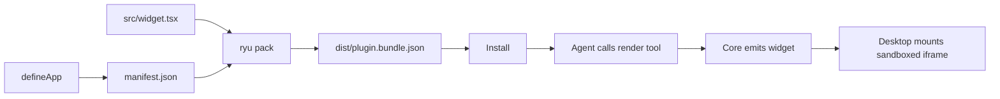

In this recipe, a Ryu App is a tool whose result renders an interactive widget inline in chat, using
the ChatGPT-Apps-style surface. The example authors a minimal widget with `defineApp`, bundles its UI
into a plugin manifest with `ryu pack`, and has an agent emit it into the chat stream.



## What you'll use

- [Ryu Apps](/docs/extend/develop/extensions/ryu-apps): the widget contract, the `window.openai` bridge, and the render-vs-companion split.
- [Apps in the desktop](/docs/surfaces/desktop/user-guide/apps): what a rendered widget looks like and where it appears.
- [The SDK](/docs/extend/develop/sdk): the `defineApp` factory and `ryu pack`.

## Prerequisites

- **Bun** on your PATH.
- **A running Ryu Core** with a model the Gateway can route.

## Steps

<Steps>

<Step>

### Scaffold the project

Start from the `ryu-app` template of `create-ryu-app`. It writes a `package.json` with the
`@ryuhq/sdk` dependency and a `pack` script, a valid `manifest.json`, the `defineApp` source in
`src/app.ts`, and a starter widget in `src/widget.tsx`.

```bash
bunx create-ryu-app my-first-app --template ryu-app
cd my-first-app
bun install
```

Without `--template`, `create-ryu-app` scaffolds an **agent** starter (`src/agent.ts`) instead. The
`companion-plugin` template is a variant whose widget calls a companion tool and adds a panel.

</Step>

<Step>

### Author the app manifest with `defineApp`

`defineApp` (`packages/sdk/src/runnable/app.ts`) assembles a `manifest.json` from a declarative
description. A **render** tool (`accessible` unset) produces the widget. A **companion** tool
(`accessible: true`) is a call target a mounted widget may invoke. Replace `src/app.ts` with a
`defineApp` call that declares both tools and writes the manifest to disk:

```ts
import { writeFileSync } from "node:fs";
import { defineApp } from "@ryuhq/sdk";

const manifest = defineApp({
  id: "com.example.checklist",
  title: "Checklist",
  version: "1.0.0",
  slug: "checklist",
  uiEntry: "src/widget.tsx",
  tools: [
    { name: "render", description: "Render a checklist", invoking: "Building…", invoked: "Ready" },
    { name: "toggle", description: "Toggle an item", accessible: true },
  ],
});

writeFileSync("manifest.json", JSON.stringify(manifest, null, 2));
```

Run the script once so it writes `manifest.json` to disk.

```bash
bun run src/app.ts
```

The render tool gets a `contributes.widgets[]` entry that binds it to `ui://widget/checklist.html`.
`defineApp` validates the whole manifest against `PluginManifestSchema` and throws with the failing
field when validation fails.

<Callout type="info">
The app descriptor is declarative, but a render tool can attach a `ToolRunnable` from `defineTool`.
That body is packed as Core's grant-gated `inline_js` backend, so the tool can own real behavior
while model calls still go through the governed host surface. The complete support example is
[Build a support widget with the Ryu SDK](/docs/extend/develop/extensions/support-widget).
</Callout>

</Step>

<Step>

### Write the widget UI

Edit `src/widget.tsx`, the `uiEntry`. The widget reads its data from the `window.openai` bridge
and calls the companion tool through the same bridge. Replace the template's `RyuWidgetBridge`
interface and `Widget` function with the code below. Keep the imports, the `declare global` block,
and the mount code at the end of the file.

```tsx
interface RyuWidgetBridge {
  callTool?(name: string, args: { label: string }): Promise<unknown>;
  i18n?: RyuI18nServices;
  toolInput?: { title?: string; items?: string[] };
  toolOutput?: { title?: string; items?: string[] };
}

function Widget() {
  const items = window.openai?.toolOutput?.items ?? [];
  return (
    <ul>
      {items.map((label) => (
        <li key={label}>
          <button type="button" onClick={() => window.openai?.callTool?.("toggle", { label })}>
            {label}
          </button>
        </li>
      ))}
    </ul>
  );
}
```

The widget must bundle to **self-contained** HTML with no external chunk. It renders inside a
null-origin sandboxed iframe under a `default-src 'none'` CSP, so an external `./chunk.js` reference
leaves it blank. The next step handles bundling.

</Step>

<Step>

### Bundle it with `ryu pack`

`ryu pack` validates the manifest and inlines the `uiEntry` source into the manifest's `ui_code`.
Core serves the widget HTML as an MCP resource.

```bash
bun run pack
```

This runs `bunx ryu pack .`, which bundles `src/widget.tsx` into a single self-contained blob and
writes `dist/plugin.bundle.json`. An invalid manifest exits non-zero and names the failing field.

</Step>

<Step>

### Emit it in chat

Install the packed app, then ask an agent to call the render tool. When the tool result carries the
widget binding, Core emits it and Desktop mounts the widget in the chat stream (served from its
`ui://widget/checklist.html` resource) instead of showing a plain tool row.

<Callout type="warn">
Not every agent can emit a widget. The default `ryu` agent (Pi) cannot, because it has no base-URL
or MCP hook to inject the app tools through. Use the local Gemma model or an OpenAI-compatible
agent, which route through Core's governed tool loop. The Desktop render path is built, but it
is not yet verified end to end.
</Callout>

</Step>

</Steps>

## Check your work

- `bun run pack` exits `0` and writes `dist/plugin.bundle.json` with a `ui_code` blob. A broken
  manifest exits non-zero and names the failing field, so a bad app never reaches the store.
- The bundled widget HTML has no external `./chunk.js` reference. It must be self-contained, or it
  renders blank under the sandbox CSP.
- With a widget-capable agent (local Gemma or an OpenAI-compatible agent), calling the render tool mounts
  the widget in chat. With Pi, the same call returns a plain tool result and no widget.

## Going further

- Give a plain agent a callable tool first, then graduate it to a widget: [A tool the model can call](/docs/learn/cookbook/a-tool-the-model-can-call).
- Write your first Gateway-governed agent in code: [Build your first agent in code](/docs/learn/cookbook/first-sdk-agent).
- Expose the same tools to any MCP host: [Expose an MCP server](/docs/learn/cookbook/expose-an-mcp-server).
