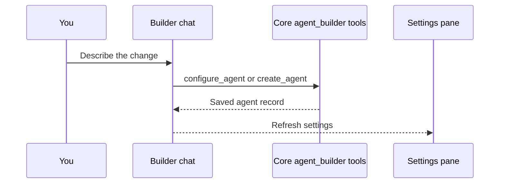

Describe a new agent in plain language instead of filling in each setting by hand. The builder
chat on the agent edit page sets the agent's model, tools, and persona for you.

## What you'll use

- [Agents](/docs/surfaces/desktop/user-guide/agents): agent setup and the builder studio.
- [A tool the model can call](/docs/learn/cookbook/a-tool-the-model-can-call): for when you want a custom tool, not a built-in one.

## Steps

<Steps>

<Step>

### Open the Agents page and start one

Each agent has its own chat model, tools, memory, and persona. Open the **Agents** page and click
**+** to start a new one.

<TryInRyu page="agents" />

</Step>

<Step>

### Describe what you want in the builder chat

The agent edit page has two panes. The left pane is a builder chat that edits *this* agent. The
right pane shows the agent's settings (model and provider, tools, connections, rules, instructions).

Tell the builder what you want in plain language:

> Make a formal research assistant that uses web search and answers with citations.

The builder applies the change for you. It uses Core's built-in `agent_builder` tools
(`get_agent`, `configure_agent`, and `create_agent`) to update the saved agent and refresh the
right-hand panel. For a brand-new agent, the first builder message creates a draft for you to edit.

<Callout type="info">
The builder conversation runs on the default **Ryu** agent runtime with `persist: false`, so these
builder turns never enter your chat history. You edit the built-in, locked `ryu` agent through its
own config, not this builder.
</Callout>

</Step>

<Step>

### Refine and review

Send more requests, such as "add the Spaces memory", "switch the model to a local one", or "make
the tone concise". Each request is one tool call against the agent record. The right pane shows the
current state, so you can see what the builder changed.

</Step>

<Step>

### Chat with it

Save, and the new agent appears in the chat picker. Select it and your messages route through that
agent's model, tools, and persona.

<TryInRyu page="chat" />

</Step>

</Steps>

## Check your work

- After each builder request, the right-hand panel refreshes to show the change (model, tools, or
  persona).
- The saved agent appears in the chat picker, and selecting it routes your messages through its
  configuration, not the default `ryu` agent.
- Because the builder runs with `persist: false`, your builder back-and-forth never shows up in your
  chat history.

## Going further

- Give the agent a skill instead of a tool: [Give an agent a new skill](/docs/learn/cookbook/give-an-agent-a-skill).
- Ground it in your own documents: [Ground an agent in your docs](/docs/learn/cookbook/ground-an-agent-in-your-docs).
- Put several agents in a coordination group: [Agent groups](/docs/core/agent-teams).
