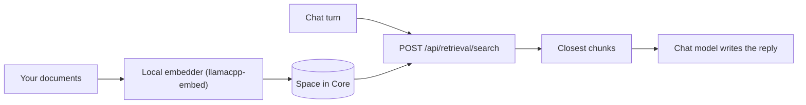

Give an agent your own documents, such as a handbook, codebase docs, or a folder of notes. Build a
Space, add your content, and attach it to an agent. The agent then answers from those documents as
well as its general knowledge.

## What you'll use

- [Spaces](/docs/surfaces/desktop/user-guide/spaces-memory): create a Space and attach it to an agent.
- [Spaces & RAG](/docs/core/spaces-rag): how retrieval is chunked, embedded, and scored.

## Steps

<Steps>

<Step>

### Create a Space

A Space stores documents in Core so Ryu can find them by meaning and keyword. Open the **Spaces**
page and create one with a name.

<TryInRyu page="spaces" />

Over the API that is `POST /api/spaces`.

</Step>

<Step>

### Add your documents

Add content to the Space. Ryu indexes each document for search by meaning and keyword.

```http
POST /api/spaces/:id/documents
```

You can also start a blank page and write notes in the editor. Saving re-embeds the page, so
retrieval stays current. The default embeddings run locally (the `llamacpp-embed` sidecar that
onboarding sets up), so your documents are embedded on your machine.

</Step>

<Step>

### Attach the Space to an agent

Attach the Space from the agent's edit page. Once attached, the agent finds the most relevant parts
on each turn and uses them in its answer. The shared retrieval route is `POST /api/retrieval/search`.
It searches Spaces and encrypted memory together and ranks results by similarity.



</Step>

<Step>

### Ask it

Chat with the agent and ask something only your documents would answer. It pulls the closest chunks
from the Space and writes its reply from them.

<TryInRyu page="chat" />

</Step>

</Steps>

<Callout type="info">
With the default local embedder, indexing stays on your machine and the Space is stored by Core.
If you configure a remote embeddings endpoint instead, document text is sent there to be embedded.
See [Spaces & RAG](/docs/core/spaces-rag). The chat model that writes the answer still receives the
retrieved chunks, so a cloud chat model sees them.
</Callout>

## Check your work

- Ask something only your documents would answer (a fact that is not general knowledge). The agent
  answers from your content instead of saying it does not know.
- Ask something your documents do *not* cover. The agent falls back to general knowledge or says it
  does not know.
- With the default local embedder (the `llamacpp-embed` sidecar), ingesting documents needs no
  provider key and works offline.

## Going further

- Let the agent also recall relevant past chats automatically: [Search and recall](/docs/surfaces/desktop/user-guide/search-and-recall).
- Turn meeting transcripts into a grounded Space automatically: [Meeting notes into a Space](/docs/learn/cookbook/meeting-notes-to-space).
- Use GraphRAG (entities and relations) alongside vector search: retrieval modes in [Spaces & RAG](/docs/core/spaces-rag).
