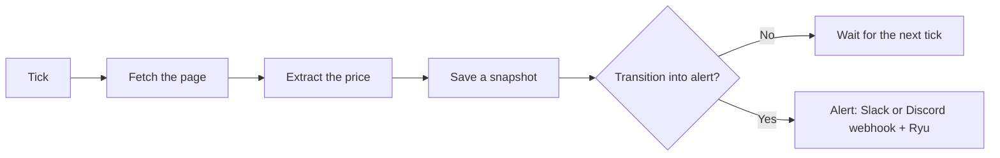

Set up a monitor on a product URL and route its price or stock alerts to Slack or Discord. The
monitor checks on a schedule and sends a message when the configured value changes.

## What you'll use

- [Monitors](/docs/surfaces/desktop/productivity/monitors): create a watch and choose a check type.
- [Website Monitoring](/docs/core/website-monitoring): the engine, check types, comparators, and notification fan-out.
- [Scheduler](/docs/core/scheduler): the tick loop that runs your monitor on a regular interval.

## Prerequisites

- **The Ryu desktop app** with the Monitors app enabled, or a running Core to call
  `POST /api/monitors`.
- Permission to create an **incoming webhook** in the Slack or Discord channel you want alerts in.
  You add this webhook in step 3. Without it, alerts show in Ryu but not in your channel.

## Steps

<Steps>

<Step>

### Open Monitors and add a monitor

In the desktop app, open **Monitors**, then add a new monitor. Monitors is a Ryu app. If you do not
see it, install it from the Store first. Paste the
product URL you want to watch.

</Step>

<Step>

### Choose Price (or Stock)

For a price watch, pick the **Price** check type. A price check captures a number from the page with
a regex (capture group 1 is the number), then compares it against the previous snapshot. Choose a
comparator: `drops_by_pct` fires when the value drops by at least a percentage, while `less_than`
fires when it crosses below a fixed threshold.

For a back-in-stock watch, pick **Stock** instead. It looks for an in-stock phrase on the page and
alerts when availability appears.

<Callout type="warn">
The price parser treats `.` as the decimal point and is not locale-aware. For a comma-decimal site
(`1.299,00`), use an `extract_regex` that captures a dot-decimal number. See
[Price comparators](/docs/core/website-monitoring#price-comparators).
</Callout>

To create the monitor over the API, send `POST /api/monitors`. `name`, `url`, `check`, and
`interval` are required.

```http
POST /api/monitors
Content-Type: application/json

{
  "name": "Headphones price",
  "url": "https://example.com/product",
  "interval": "1h",
  "check": {
    "type": "price",
    "extract_regex": "\\$([0-9.,]+)",
    "comparator": "drops_by_pct",
    "threshold": 10
  }
}
```

</Step>

<Step>

### Add a Slack or Discord webhook as the notify target

In your Slack or Discord server, create an **incoming webhook** for the channel you want the alert
posted to, and copy its URL. Then add a `webhook` notify target to the monitor pointing at that URL.
Over the API, add it to the monitor's `notify` array:

```json
{ "notify": [{ "kind": "webhook", "url": "https://hooks.slack.com/services/..." }] }
```

Ryu sends a JSON POST that carries both `text` and `content` (so it renders in Slack and Discord
alike) plus the structured `alert` payload. See
[Notification fan-out](/docs/core/website-monitoring#notification-fan-out) for the full target list,
which also includes Telegram, email, and mobile push alongside the desktop in-app toast.

</Step>

<Step>

### Let the scheduler run it

You do not start a loop yourself. Core keeps one scheduled job per monitor, named
`monitor: <name>`, on Ryu's tick loop. See [Scheduler](/docs/core/scheduler) for the tick loop itself.

The interval is a duration such as `1h` or `30m`, or a cron expression. Core raises an interval
shorter than one minute to one minute.



</Step>

<Step>

### Understand what fires an alert

A monitor alerts only on a **transition** into the alert state, never on every interval it stays
there. A price that drops by your percentage fires one alert when it crosses, not one per check while
it remains low.

</Step>

<Step>

### Test it without waiting

To test the setup without waiting for the next tick, run the monitor once from its row on the
**Monitors** page, or over the API.

```http
POST /api/monitors/:id/run
```

It returns the check status. The first run establishes the baseline snapshot, so a transition is
detected on the next run where the value actually crosses your rule.

</Step>

<Step>

### See your alerts

When an alert fires it lands in your Slack or Discord channel, and it also shows up in Ryu. The
**Monitors** page shows new alerts live as they happen, and you can pull the feed over the API:

```http
GET /api/monitors/alerts?limit=20
GET /api/monitors/:id/alerts
```

</Step>

</Steps>

<Callout type="info">
Monitors fetch with a swappable backend. The default is a plain HTTP GET, which does not render
JavaScript. If the price only appears after the page renders, switch the backend to `spider`, which
crawls via the Spider tool when it is available in the [MCP registry](/docs/core/mcp-registry).
</Callout>

## Check your work

- `POST /api/monitors/:id/run` returns the check status. The first run only establishes the baseline
  snapshot, so no alert fires yet.
- On the run where the value actually crosses your rule, exactly **one** alert posts to your Slack or
  Discord channel and appears on the Monitors page. It does not re-fire every tick while the price
  stays low, only on the transition.
- If the price never parses, confirm the page renders it server-side. A JavaScript-rendered price
  needs the `spider` backend (see the callout above).

## Going further

- Watch for any change to a region of the page instead of a number: the `content_diff` check type in [Website Monitoring](/docs/core/website-monitoring#check-types).
- Get the same alert on your phone: register a mobile push token, per [Caveats](/docs/core/website-monitoring#caveats).
- Stream alerts into your own tooling: subscribe to `GET /api/monitors/alerts/stream` (SSE), listed in [Routes](/docs/core/website-monitoring#routes).
