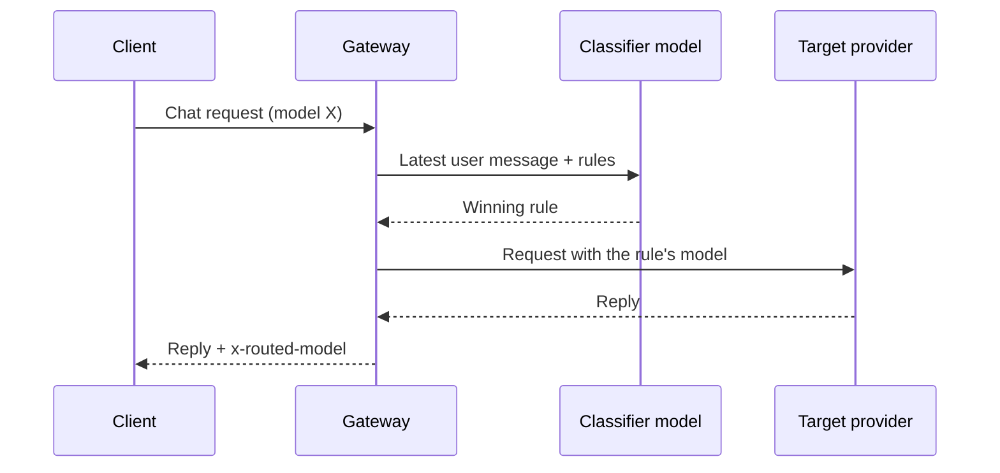

Use smart routing to send demanding requests to a strong model and casual requests to a local model.
The example enables the Gateway router, adds plain-language rules such as *coding goes to Claude,
chit-chat goes local*, and lets a classifier choose the destination for each request.

## What you'll use

- [Smart Model Routing](/docs/gateway/smart-routing): the classifier-driven router and its `routing.smart_routing` fields.
- [Routing](/docs/gateway/routing): how the Gateway picks a provider once the model is chosen.
- [Configuration](/docs/gateway/configuration): how Gateway config is read and written.

## Steps

<Steps>

<Step>

### Understand what smart routing does

Ordinary routing picks a *provider* for the model you asked for. Smart routing picks the *model
itself*, before provider routing runs.

A cheap classifier model reads only your latest user message, matches it against your ordered rules,
and rewrites the request's model to the winning rule's target. That target then resolves its provider
through the normal router, so a rule can point at a local model id or an `openrouter/...` slug.



</Step>

<Step>

### Turn it on and write rules

In Desktop, edit it under **Gateway → Model routing → Smart routing**. Saving needs the
`gateway.configure` permission. That card reads and writes the same Gateway config as the rest of
the dialog.

This recipe sets four `routing.smart_routing` fields:

- `enabled`
- `classifier_model`
- the ordered `rules`
- `default_model`, for requests no rule matches

Every field, with its default, is in the [Smart Model Routing configuration reference](/docs/gateway/smart-routing#configuration).

A rule set reads like plain language:

```toml
[routing.smart_routing]
enabled = true
classifier_model = "gemma-3-4b"   # a cheap, local classifier
default_model = "gemma-3-4b"

[[routing.smart_routing.rules]]
description = "coding, debugging, or writing code"
model = "claude-sonnet-4-5"

[[routing.smart_routing.rules]]
description = "simple chit-chat or greetings"
model = "gemma-3-4b"
```

Smart routing runs only when `enabled` is set and at least one rule exists. For a standalone
Gateway, `GATEWAY_SMART_ROUTING_ENABLED` and `GATEWAY_SMART_ROUTING_MODEL` set the switch and the
classifier model. The rules themselves are config-only.

<Callout type="info">
A rule's `model` is any id the Gateway can route. A bare `gemini-...` id uses the native Gemini
route and needs a Gemini API key. Without one, use an `openrouter/google/...` slug.
</Callout>

</Step>

<Step>

### Apply it

Save the card, or send the same change as `PUT /api/gateway/config` (which relays
`PUT /v1/config`). The `smart_routing` section hot-swaps, so new requests use the rules without a
Gateway restart. Other routing fields such as `model_map` and `fallback_chain` still wait for a
restart. See [Configuration](/docs/gateway/configuration).

</Step>

<Step>

### Confirm which model answered

The Gateway returns the model it routed to in the `x-routed-model` response header. Smart routing
fails open. An inactive config, an unparseable classifier reply, a classifier error, or a timeout
keeps the model you requested. A per-agent override
([`agent_routes`](/docs/gateway/smart-routing#per-agent-override-agent_routes)) replaces the global rules
for that agent.

</Step>

</Steps>

## Check your work

- Send a coding question and read the `x-routed-model` response header. It names your coding rule's
  target (for example `claude-sonnet-4-5`). Send a greeting and the header names the cheap local model.
- Break the classifier on purpose (stop it, or set an unroutable `classifier_model`). Requests keep
  the model you asked for instead of failing.
- A saved rule change applies to the next request with no restart. Because `cache_by_session` is on
  by default, an existing session keeps its earlier decision. Test a change in a new chat.

## Going further

- Cap what any of these models can spend: [Cap spend with a budget](/docs/learn/cookbook/cap-spend-with-a-budget).
- Add a firewall and PII/DLP in front of every routed call: [Security and governance](/docs/gateway/governance).
- Add fallbacks and circuit breaking for a provider outage: [Reliability](/docs/gateway/reliability).
