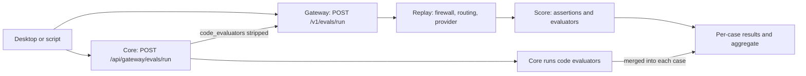

This recipe reads the Gateway evaluator catalog, checks which entries are wired to execution, and
runs an offline evaluation over a small dataset.

The catalog has 30 built-in entries. Two are blank Custom templates: an LLM rubric
(`llm_as_a_judge`) and a JS/Python function (`code_evaluator`). The other 28 cover Security, Safety,
Quality, Conversation, Trajectory, Image, and Voice.

"Eval" means two things here:

- **The catalog** (`GET /v1/evaluators`) is the shared definition surface.
- **The offline runner** (`POST /v1/evals/run`) replays a dataset and scores each case, with catalog
  `evaluators` ids, deterministic `assertions`, or both.



## What you'll use

- [Gateway evals](/docs/gateway/evals): the runner, its dimensions, and evaluator catalog.
- [Security and governance](/docs/gateway/governance): the policy surface the inline evaluators back.

## Prerequisites

- **A running Ryu Core**, which runs the Gateway as a managed sidecar. The release profile serves it
  on `http://127.0.0.1:7981`.
- A model the Gateway can route, so a dataset run has something to call.

## Steps

<Steps>

<Step>

### Discover the catalog

The catalog endpoint is read-only and is not behind the admin gate. It returns the built-in seed
table merged with any custom evaluators in the Gateway config. A custom entry overrides a built-in
with the same `id` and reports `builtin: false`.

```bash
curl http://127.0.0.1:7981/v1/evaluators
```

The response is `{ "evaluators": [...] }`. Each entry carries:

| Field | Values |
|---|---|
| `id` | Stable evaluator id, such as `pii_leakage` |
| `category` | `security`, `safety`, `quality`, `conversation`, `trajectory`, `image`, `voice`, or `custom` |
| `target` | `input`, `output`, `conversation`, `trajectory`, `image`, or `audio` |
| `capabilities` | `{ "inline": bool, "offline": bool }` |

Read `capabilities` first:

- The Quality, Conversation, Trajectory, and Voice categories are **offline-only**. They are never
  offered as inline guardrails, because they need a reference, a full conversation, or a trajectory
  to score.
- Entries that target `image` or `audio`, and the `code_evaluator` template, report `false` for
  both `inline` and `offline`. They are catalogued definitions with no executor yet.

</Step>

<Step>

### Read the status flags

Two flags tell you what runs today and how to read a score.

- `enforced` - `true` on exactly the five text detectors wired to real **inline** execution today:
  `pii_leakage`, `code_injection`, `prompt_injection`, `toxicity`, and `bias_fairness`. Every other
  entry ships `enforced: false`, including the two image judges, which need a vision-capable judge
  that is not wired yet. `enforced` is an inline-wiring flag, not an offline-capability flag.
- `higherIsBetter` - `false` on negative-signal judges (toxicity, bias, hallucination, and the like),
  where a high score means a worse output. The security regex detectors keep `true` because their
  scorer already inverts, so `1.0` means clean.

<Callout type="info">
Filter the list to the entries whose `enforced` is `true` to see the guardrails that block, sanitize,
or warn on the request path right now. Treat the rest as catalogued definitions, not live execution.
</Callout>

</Step>

<Step>

### Run an offline eval set

The runner is `POST /v1/evals/run`. It replays each prompt in `dataset` through the full pipeline
(firewall, routing, provider call) and scores each case. An explicit run always scores, independent
of passive evals.

- Pass registry evaluator ids in a run-level `evaluators` array, per-case `evaluators`, or both.
- Use `assertions` for deterministic checks.
- Use `max_concurrency`, `timeout_ms`, `repeat`, `cache`, and `tags` to bound and label the run.

```bash
curl -X POST http://127.0.0.1:7981/v1/evals/run \
  -H "Authorization: Bearer $RYU_GATEWAY_TOKEN" \
  -H "content-type: application/json" \
  -d '{
    "model": "gpt-4o-mini",
    "evaluators": ["exact_match"],
    "dataset": [
      {
        "prompt": "What is the capital of France?",
        "expected": "Paris"
      },
      {
        "prompt": "Reply with valid JSON only.",
        "assertions": [{ "kind": "json_valid" }]
      }
    ]
  }'
```

Assertion kinds fall into two families:

- **Deterministic** - containment, validity, latency, cost, Levenshtein distance, and nested
  assertion sets.
- **Model-assisted** - rubric, similarity, factuality, and relevance checks. Set `judge_model` to
  hold one judge fixed across every case.

The response returns, per case, raw usage, provider and model, the rendered prompt, metadata,
assertion results, and per-evaluator breakdowns, plus an aggregate. An empty `dataset` uses a
built-in 3-case set. See [Gateway evals](/docs/gateway/evals) for the full field list.

#### Run through Core

`POST /api/gateway/evals/run` on Core accepts the same body. It forwards the run with the Gateway
token when one is configured, and otherwise passes your `Authorization` header through.

It also takes an optional `code_evaluators: [{ id, lang, source }]` array (`lang` is `js` or
`python`). Core strips that array before forwarding, runs those functions locally, and merges their
scores into each case's `evaluators` array on a successful run. JavaScript runs in a deny-all
sandbox. A Python case is refused with `executed: false` when no command-capable sandbox is
available.

#### Score a completed call

To score a production result after the model call has already completed, use
`POST /api/gateway/evals/score` from Core. It accepts the response, optional trace latency and cost,
and the same assertions and evaluator ids, without replaying the provider call.

</Step>

</Steps>

## Check your work

- With no custom evaluators configured, `GET /v1/evaluators` returns 30 entries. Exactly five report
  `enforced: true` (the five listed in step 2). Every other entry, including both image judges,
  reports `false`.
- `POST /v1/evals/run` returns per-case scores and an aggregate. Registry `evaluators` add
  per-evaluator breakdowns.
- A multi-model run with `llm_judge` fans out `models * cases * (1 + judge_calls)` provider calls
  under Core's 120s proxy timeout, so keep the matrix small or it times out at the proxy.

## Going further

- Bias routing toward the current best provider with rolling eval scores: eval-driven routing in
  [Routing](/docs/gateway/routing#the-strategies).
- Read every scored call back out of the queryable audit log: [Gateway audit](/docs/gateway/audit).
- Cap what a run can spend before it fans out:
  [Cap what an agent can spend](/docs/learn/cookbook/cap-spend-with-a-budget).
