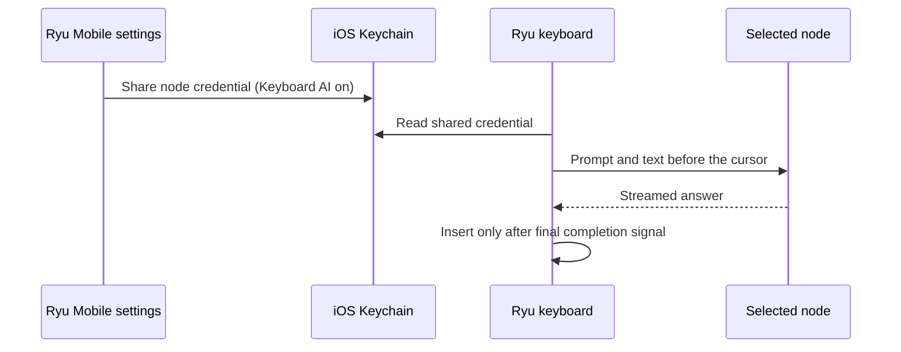

The Ryu keyboard lets you run AI actions from any text field. This page covers the **AI Keyboard**
settings screen in Ryu Mobile, Keyboard AI consent, and how keyboard answers are inserted.

<Callout type="warn">
  The settings screen does not install or enable the custom keyboard extension. Keyboard
  availability depends on the native build and the operating system. The Keyboard AI consent steps
  below describe the iOS keyboard, which reads the shared credential from the iOS Keychain.
</Callout>

## Keyboard settings

### When a save or load fails

The **AI Keyboard** settings screen keeps the last saved configuration visible if a local save
fails.

- The error offers **Retry saving settings**, which retries the same change.
- A refused snippet or skill-key save keeps its entered text available until it is saved or
  canceled.
- Changing a toggle only takes effect in the settings screen after the save completes.

If the saved configuration cannot be loaded, the screen keeps the settings closed and offers
**Retry loading settings**. It does not replace saved preferences with defaults after a failed read.
Retry loads the saved configuration before editing becomes available again.

### Shared settings on iOS

On iOS builds with the keyboard settings bridge, saved preferences are shared locally with the
keyboard extension. Older settings are migrated when no shared configuration exists.

- A failed read or migration stays visible for retry.
- This settings migration does not copy node credentials or clipboard history.

## Turn on Keyboard AI on iOS

1. In Keyboard settings, select a remote HTTPS node.
2. Turn on **Keyboard AI**. Ryu shares that node's credential with the iOS keyboard through
   Keychain. The shared settings file contains routing and preferences, never the credential.
3. In iOS Settings, turn on **Allow Full Access** for the keyboard. AI keys and clipboard capture
   need it.

Older settings start with AI off. Changing the node requires fresh consent. Invalid connection or
credential input is rejected before existing consent changes.

## What an AI action sends

An AI action sends its prompt and the text before the cursor to the selected node. Keyboard
requests do not save a chat transcript.

The agent that answers is chosen in this order:

1. the skill key's agent override, when it has one;
2. the keyboard agent;
3. the node's default agent.

Keyboard AI inserts an answer only after the response's final completion signal arrives. An
interrupted or malformed response, a server refusal, or a cancelled request does not produce an
insertable partial answer. Responses over 1 MiB of answer text are rejected.

## Turn off Keyboard AI

Turn off Keyboard AI to revoke the shared credential. Removing the node from Mobile also revokes it;
see [Connect and sign in](/docs/mobile/connect-and-sign-in#when-a-node-change-fails).

- If saving the disabled setting fails, the switch shows off, because access is already revoked.
  **Retry saving settings** saves that disabled configuration.
- A failed enable attempt revokes its credential. Turn AI on again after the storage error is
  resolved.

The screen checks whether the exact shared credential is still available when it opens. If access
was revoked, it shows AI off even when an earlier enabled preference is still saved. If that
consent check fails, settings stay closed until you retry loading them.

If an agent or feature change is saved and AI access is then unavailable, the change stays saved.
AI shows off, and retry saves the disabled preference while keeping that change.

## Clipboard capture

Clipboard capture needs **Allow Full Access**, and the clipboard feature and history must be turned
on. With **Exclude sensitive** on, capture is skipped for secure fields and when the current field's
secure-text status is unavailable.

## Related pages

<Cards>
  <DocCard href="/docs/mobile/native-surfaces" />
  <DocCard href="/docs/mobile/tools-and-privacy" />
  <DocCard href="/docs/mobile/connect-and-sign-in" />
</Cards>
