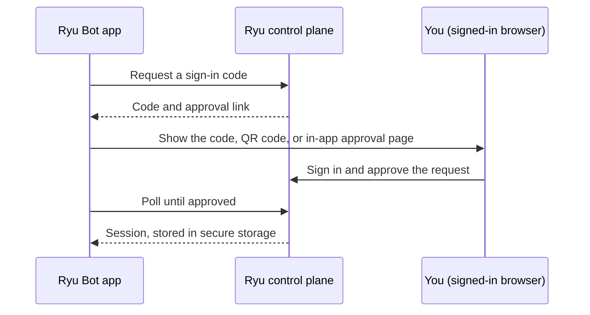

Ryu Bot is a set of native apps for phone, tablet, watch, TV, and car, for people who want Ryu's
managed chat away from the desktop.

Like [Bot](/docs/surfaces/desktop/bot) on the desktop, it is account-only. Sign in with a Ryu
account, keep an active subscription, and start a conversation. There is no AI stack to configure.

<Callout type="warn">
  Availability on each platform depends on its store release. Until a build is listed in the App
  Store or Google Play for your device, use [Ryu Mobile](/docs/mobile) or Bot on the desktop instead.
</Callout>

## Supported surfaces

| Platform | Surfaces | Minimum version |
| --- | --- | --- |
| Apple | iPhone and iPad, Apple Watch, Apple TV, CarPlay | iOS, watchOS, and tvOS 26 |
| Android | Phones and tablets, Google TV and Android TV, Android Auto | Android 8 |
| Wear OS | Wear OS watches | Wear OS 5 |

On iPhone and iPad, Ryu Bot uses the Liquid Glass design: a glass header over the chat list, a
floating glass composer, and glass menus. It respects **Reduce Transparency**, and devices without
Liquid Glass use solid surfaces. Android uses Material surfaces.

To turn the glass off on iPhone and iPad, open the account sheet and switch off **Liquid Glass**
under **Appearance**. Ryu Bot then uses solid surfaces and standard buttons instead of the glass
material. Apple Watch and Apple TV have no settings screen and keep the glass design.

Phones and tablets get the full feature set on this page. Watch, TV, and car apps offer a narrower
set; see [Watch, TV, and car](#watch-tv-and-car).

## What Ryu Bot includes

- **Chats.** Browse and search your saved conversations, open one, start a new chat, rename or
  delete a chat, and stop a reply that is still being written. Replies stream in as they are
  generated. If you leave the app while a reply is running, it keeps running on your workspace and
  the app picks it up again when you return.
- **Projects.** Group chats into projects. When projects are not available for your workspace, Ryu
  Bot offers **Folders** instead: lightweight chat groups that sync with the folders you create in
  Bot on the desktop.
- **Status while it works.** The assistant's status shows what it is doing, such as **Thinking…**,
  **Typing…**, the tool it is running, or **Waiting for you**. Screen readers announce status
  changes.
- **A small account sheet** that shows who is signed in, lets you sign out, and has the
  **Liquid Glass** appearance switch.
- **Phone apps.** From **Connect apps** in the account sheet, you can let Ryu use Calendar,
  Contacts, Location, and Alarms on your iPhone or Android phone while Ryu Bot is open. Ryu asks
  before it acts. This is rolling out gradually; see [Phone Apps](/docs/mobile/phone-apps).

## Voice mode

Voice mode is a full-screen, hands-free conversation. Tap the voice button in a chat to start it.
Ryu Bot asks for microphone access the first time, then listens; speak naturally, and Ryu replies
out loud.

- **Interrupt by speaking.** Start talking while Ryu is replying and the reply stops so Ryu can
  listen to you.
- **Mute and end.** Mute pauses your microphone without ending the call. End hangs up.
- **Captions.** What you said and Ryu's reply appear as live captions while you talk.
- **Saved to the chat.** When you end the call, the chat refreshes to show the spoken turns, followed
  by a short "Call ended" note with the call length.

Live voice works on your Ryu-managed workspace whenever your role lets you chat there. It follows the
same rules as typed chat: the same agents, the same conversations, and the same organization
permissions.

- Voice replies use the workspace's default built-in voice. Custom and cloned voices are reserved
  for the workspace owner.
- A long call reconnects by itself when your sign-in refreshes, so it keeps going without losing
  the captions.

When live voice is not available, for example on a workspace running an older version of Ryu, the
voice button uses **tap-to-talk** instead: tap, speak, and Ryu Bot transcribes your message on the
device, sends it, and reads the reply aloud.

| Surface | Voice |
| --- | --- |
| iPhone, iPad, Android phones and tablets | Voice mode where your workspace supports it, otherwise tap-to-talk |
| Apple Watch, Wear OS | Dictation and read-aloud; no live voice mode |
| Apple TV, Google TV, Android TV | Dictation with the remote where the device supports it, and read-aloud; no live voice mode |
| CarPlay, Android Auto | Hands-free tap-to-talk with replies read aloud |

## Voice input

The microphone button in the composer dictates a message. Tap it to start and tap again to stop, or
hold it and release when you are done.

Your words appear in the message box as you speak, with a level meter to show the microphone is
hearing you. You can review and edit the text before you send it.

Speech is recognized on the device where the device supports it. Ryu Bot asks for microphone and
speech recognition access the first time. If you decline, it links to the system settings.

## Read aloud

Choose **Read aloud** on any assistant reply to hear it, and tap **Stop** to end it. Ryu Bot reads
the text of the reply, says "code block" in place of code, and uses the device's built-in voice. In
the car, replies are read aloud automatically.

## Message actions

On a phone or tablet, long-press a message (or open its context menu) for these actions:

- **Copy** the whole message. Each code block also has its own **Copy** button, and long code
  scrolls sideways instead of wrapping.
- **Share** the message through the system share sheet, or **select text** to copy part of it.
- **Read aloud**, as described above.
- **Edit** and resend one of your messages. Ryu answers the edited version. Editing resends the
  text only. Attachments on the original message are not carried over.
- **Regenerate** an assistant reply to get a new answer.
- **Switch between versions.** After you edit or regenerate, arrows such as **‹ 2 / 3 ›** under the
  message move between the versions, and the rest of the chat follows the version you pick.
- **Rate a reply** with thumbs up or down.
- **Branch from here** copies the chat up to that message into a new chat.

If a reply fails, a **Retry** button on the failed turn sends it again. Edit, regenerate, and version
switching are unavailable while a reply is still being written.

Timestamps appear when you ask for them, and a scroll-to-bottom button appears when you scroll up
during a long chat.

### Attachments

On phones and tablets, attach photos from your library, take a photo with the camera, or pick a
file. Attachments show as thumbnails or file chips before you send and in the chat afterwards.

- Ryu Bot accepts images and plain-text files. PDF and Office documents are not supported.
- Large photos are resized before sending.
- Text files are limited to 2 MB.

## Siri, Shortcuts, and Spotlight

On iPhone and iPad, Ryu Bot works from Siri, the Shortcuts app, Spotlight, and the Action button
without any setup.

| Say to Siri | What happens |
| --- | --- |
| "Ask Ryu Bot" or "Start a chat in Ryu Bot" | Siri asks for your question, sends it, and reads Ryu's answer without opening the app. |
| "Talk to Ryu Bot" or "Start voice mode in Ryu Bot" | Ryu Bot opens on a new chat in [voice mode](#voice-mode). |

Siri asks you to unlock your device before it answers, because answers can come from your chats.
Siri reads a shortened answer when the reply is long and says the full answer is in Ryu Bot. The
question and answer are saved as a chat, like any other conversation.

### Shortcuts actions

The Shortcuts app offers these actions. You can also assign **Ask Ryu**, **Talk to Ryu**, or
**Start Voice Chat** to the Action button.

- **Ask Ryu** returns Ryu's full answer as text, so the next step of a shortcut can use it.
- **Continue Ryu Chat** sends a follow-up in a chat you pick, with that chat's history, and returns
  the answer.
- **Open Ryu Chat** opens a chat you pick.
- **List Bots** returns the bots you can send messages to, so a later step can pick one.
- **Send Message** sends a message to a bot you pick, or to Ryu when you leave it empty, and returns
  the reply without opening the app.
- **Start Dictation** listens and turns your speech into text on the device. A Live Activity on the
  lock screen and in the Dynamic Island offers **Cancel** and **Send**; Send sends the text to Ryu
  without opening the app. The lock screen shows only how many words you said, never the words.
- **Start Voice Chat** opens [voice mode](#voice-mode). While the call is on, a Live Activity offers
  **Hang up**, and running the action again, for example with a second press of the Action button,
  hangs up.

Shortcuts and Siri never use [your phone's apps](/docs/mobile/phone-apps). If a message needs that,
or needs your approval, the action says to open Ryu Bot.

When Ryu asks a simple multiple-choice question during an answer, Siri reads the options and sends
your pick. Dismissing the question ends the request.

### When Ryu Bot needs to open

Some answers need the app. Siri then says what to do, such as **Open Ryu Bot to continue**, and
Ryu Bot opens on that chat when it can. This happens when:

- you are signed out, your device has not been unlocked since it restarted, or your account needs
  setup;
- Ryu asks for your approval to use a tool, or asks a question Siri can't show;
- the reply takes too long, or Ryu Bot can't reach your workspace.

In Shortcuts, the action stops with that message instead of passing an empty answer to the next
step.

### Find chats in Spotlight

Turn on **Show Chats in Spotlight and Siri** in the account sheet to find your chats by title in
Spotlight and pick them in Siri and Shortcuts. It is off by default.

- Only chat titles are shared with Spotlight and Siri, never messages. Archived chats are left out.
- With the setting on, Siri can also suggest questions you typed and chats you opened.
- Ryu Bot removes the titles and suggestions when you turn the setting off, sign out, or switch
  account.
- On devices and in regions where Apple Intelligence and Siri AI are available, Siri can also tell
  which chat is on screen when you ask about it.

### Live Activity

While Ryu is answering, Ryu Bot shows a Live Activity on the lock screen and in the Dynamic Island.
It shows only whether Ryu is working, needs you, or is done, never the chat's content.

- Tap it to open that chat.
- Tap **Stop** to stop the reply without opening the app.

### Links and Android shortcuts

A Ryu Bot link can open a chat, start a new chat with text already in the message box, or start
voice mode. A link never sends a message: you review the text and send it yourself.

On Android, long-press the Ryu Bot icon for **Ask Ryu**, which opens a new chat, **Talk to Ryu**,
which starts voice mode, and **Dictate a message**. You can pin any of them to the home screen.
While you dictate, an ongoing notification shows **Cancel** and **Send**.

Add the **Talk to Ryu** tile to Quick Settings to start a voice chat from anywhere; tap it again
during the call to hang up. When another app opens one of these links, Ryu Bot asks before it turns
on the microphone.

## Recaps

Ryu Bot on Android and Wear OS can record [recaps](/docs/mobile/recaps): conversations you choose
to record, summarized privately on your Ryu node. You start each recap yourself from the app, the
Quick Settings tile, a home-screen widget, or the Wear OS tile, and Ryu Bot shows an ongoing
notification while it records. Calls pause the recap. Recap settings let you choose the evening
digest time, add [reminders](/docs/mobile/recaps#reminders) that only notify you, turn on
[summaries while recording](/docs/mobile/recaps#summaries-while-recording), export your recaps,
delete all of them, or withdraw consent.

## Sign-in

Ryu Bot signs in by approving a code with your Ryu account:

- On a phone or tablet, the approval page opens inside the app. Sign in there and approve the
  request, and Ryu Bot continues automatically.
- On Apple TV, Google TV, Android TV, and Wear OS, the screen shows a short code and a QR code.
  Scan the QR code or enter the code on a phone or computer where you are signed in to Ryu, then
  approve it.
- Apple Watch can sign in on its own with a code and QR code, the same way as Apple TV. When it is
  paired with an iPhone that is signed in to Ryu Bot, it reuses that phone's session instead.

The approval screen names the app as **Ryu Mobile**. Your sign-in is stored in the device's secure
storage (Keychain on Apple devices, the Android Keystore on Android), and signing out removes it.

## Managed workspace and subscription

Ryu Bot uses the same entry checks as Bot on the desktop: an active subscription and a ready
Ryu-managed workspace. The checks are described once in
[Bot sign-in and managed access](/docs/surfaces/desktop/bot#sign-in-and-managed-access).

On the native apps, a check that fails, for example because the device is offline, shows an error
with a retry action instead of asking you to subscribe. When you return from the subscription page,
Ryu Bot checks again. Ryu Bot connects only to your Ryu-managed workspace. It does not accept a
provider key, and it does not let you choose another node.

## What is intentionally left out

Ryu Bot keeps the native apps small. It has no model picker, provider settings, routing, plugins,
marketplace, agent editing, or node configuration. Models are chosen by Ryu's managed routing, the
same as Bot on the desktop.

Organization owners and admins set the Bot default for a managed workspace under **Agent →
Gateway → Default agent & model**; see [Bot defaults for organization admins](/docs/surfaces/desktop/bot#bot-defaults-for-organization-admins).

## How Ryu Bot differs from Ryu Mobile

| | Ryu Mobile | Ryu Bot |
| --- | --- | --- |
| Nodes | Managed, self-hosted, or local | Your Ryu-managed workspace only |
| Models | Node models plus downloaded on-device models | Ryu's managed routing |
| Configuration | Gateway, Channels, Credits, companion apps, native tools | None |
| Scope | The full mobile app | Chats and projects, built natively for each platform |

Choose [Ryu Mobile](/docs/mobile) when you need nodes, on-device models, or configuration. Choose
Ryu Bot when you just want to talk to Ryu.

## Watch, TV, and car

The smaller surfaces offer a deliberately narrow set of actions:

| Surface | What you can do |
| --- | --- |
| Apple Watch and Wear OS | Read recent chats, dictate a message, and read the reply or have it read aloud |
| Apple TV, Google TV, and Android TV | Read recent chats, dictate with the remote or voice input, and see the reply on screen or have it read aloud |
| CarPlay and Android Auto | Speak a message and hear the reply read aloud, using only the driving-safe templates the car system allows. No typing or long-form reading while driving |

Message actions are limited to what fits the device:

- Retry is available everywhere.
- Regenerate and rating are available on the watch and TV. The TV can also switch between versions.
- Attachments, editing, and branching are phone and tablet only.

Projects, renaming, deleting, and the account sheet are available on phones and tablets.

<Callout type="warn">
  CarPlay voice conversation also depends on Apple enabling it for the app.
</Callout>
