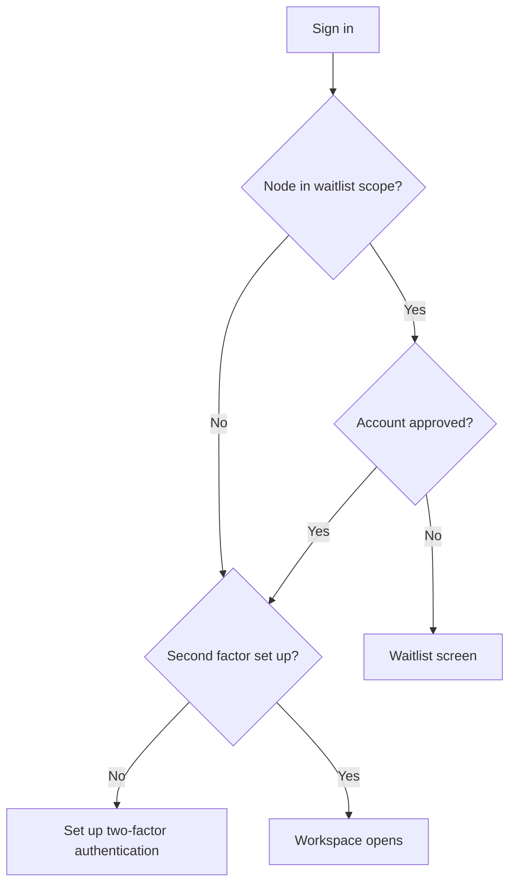
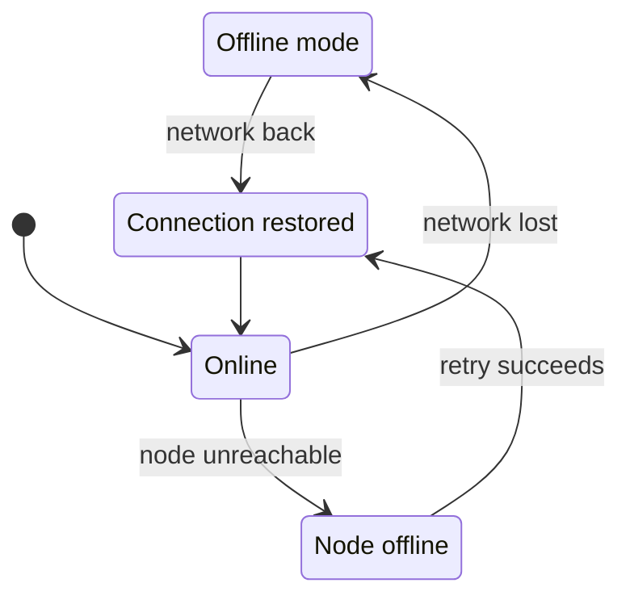

Ryu Mobile uses the agents of a Ryu node. This page shows how to connect to a node, switch nodes,
sign in, and keep working when the connection drops. To run a model on the phone instead, see
[On-device models](/docs/mobile/models).

## Try the sample workspace

Before you connect a remote node, Mobile offers a sample workspace with example follow-ups, project
plans, and reviews. The examples do not run agents or use credits.

- Choose **Connect to my workspace** when you are ready.
- Choose **Back to examples** to leave connection setup.

Your real workspace still needs node credentials, sign-in, and the usual access checks.

## Connect to a node

1. Scan the Ryu connect QR code that the node shows. Allow camera access when Mobile asks.
2. If the camera is not available, use the manual **Connect** form. Paste the
   `ryu://nodes/connect?...` link, or enter the node URL and token.
3. Choose **Connect**. Mobile selects that node and continues to sign-in.

## Switch nodes

Tap the node chip in the **Threads** header to switch between saved nodes. The same selector also
appears in the drawer and in Settings.

- **Add node** saves a remote node with a display name and URL. The bearer token is optional.
- **Auto-select best node** checks your saved remote nodes and selects the first one that answers.
  If none answer, Mobile uses the on-device node.
- Removing the active remote node also switches back to the on-device node.

Choosing a node closes the selector.

### When a node change fails

Saved node additions and selections take effect after local storage accepts the change. If a change
fails, retry it explicitly. The node selector keeps an unsuccessful addition available for retry and
reports selection or removal failures.

- Removing the active node first selects the on-device node. If saving the remaining node list then
  fails, the remote node can remain listed with the on-device node selected.
- Removing a node also revokes any [AI keyboard](/docs/mobile/ai-keyboard) credential shared for that
  node. Removing another node keeps the existing keyboard binding.
- A model link that targets another saved node opens the model catalog only after that node
  selection is saved. If selection fails, Mobile reports the error instead of opening the previous
  node's catalog.

## Sign in and account access

After sign-in, your account passes two checks before the workspace opens.

### Waitlist

Mobile follows the waitlist scope that the server sets:

- By default, every selected node is checked, including local, self-hosted, and earlier nodes.
- When the server limits the waitlist to managed nodes, only Ryu Cloud nodes that the control plane
  lists are checked.

If your account is still on the waitlist, a gated node shows a waitlist screen. It has actions to
open the web waitlist, check approval again, or sign out. If Mobile cannot check approval, an
account that was never confirmed stays locked until the check succeeds.

### Second factor

An approved account also needs a passkey or an authenticator app. Until it has one, Mobile shows
**Set up two-factor authentication** with **Set up on the web**, **Check again**, and **Sign out**.
The workspace opens when the second factor is in place. See
[Required second factor](/docs/security/authentication-account#required-second-factor).

## Confirm sensitive account changes

Some account changes ask you to verify your identity again. Depending on the methods your account
has, Mobile can use:

- an authenticator code (**Use my authenticator app**);
- an emailed code (**Email me a code**);
- your current password (**Use your password**);
- a backup code (**Use a backup code**);
- an emailed verification link (**Email me a verification link**).

For a link challenge, paste either the complete link or its token into the prompt. If sending the
code or link fails, choose the resend action to try again. If you cancel the prompt, the protected
action does not run.

## Offline and unreachable nodes

Mobile listens to the operating system's network state, not only the result of an app request.

- When Wi-Fi or cellular connectivity is unavailable, the app keeps the current screen and shows a
  small **Offline mode** banner while it waits.
- If the device is connected but the selected remote node cannot be reached, the banner changes to
  **Node offline**, retries automatically, and offers a manual retry.
- **Connection restored** confirms recovery without replacing the current screen.

The banner also covers the Gateway, Spaces, database, multiplayer, and plugin screens. In on-device
mode, the built-in local node is never reported as a remote outage.

In Chat, a message that cannot be sent while the node is unreachable leaves the conversation and
composer in place while the banner explains the outage. When the node is reachable, a failed send
shows the error with **Back to chat**, which returns to the conversation so you can send again.
Mobile does not resend the failed message automatically.

## Related pages

<Cards>
  <DocCard href="/docs/mobile/navigation-and-settings" />
  <DocCard href="/docs/mobile/models" />
  <DocCard href="/docs/security/authentication-account" />
</Cards>
