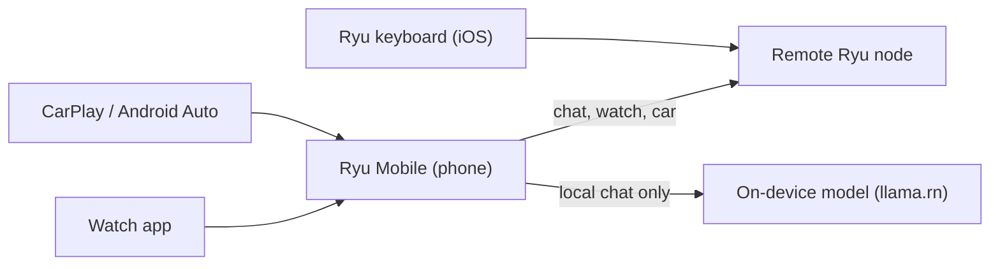

Ryu Mobile is the full Ryu app for iOS and Android. Connect it to a remote Ryu node and use that
node's agents, or run a GGUF model downloaded to the phone through `llama.rn`. To connect your first
node, see [Connect and Sign In](/docs/mobile/connect-and-sign-in).

<Figure name="mobile" />

Mobile uses the same navigation and names as Desktop. It has its own native bridge and leaves out
Desktop-only window and system controls. A "Supported on Mobile" label on an app or plugin shows the
support level that the app or plugin declares for Mobile.

The watch and car screens reach your agents through Ryu on the phone, and only on a remote node.
The iOS keyboard sends AI actions straight to the node you chose for it.

## Get started

<Cards>
  <DocCard href="/docs/mobile/connect-and-sign-in" />
  <DocCard href="/docs/mobile/navigation-and-settings" />
  <DocCard href="/docs/mobile/devices-and-layout" />
</Cards>

## Use Ryu Mobile

<Cards>
  <DocCard href="/docs/mobile/chats-and-spaces" />
  <DocCard href="/docs/mobile/agents" />
  <DocCard href="/docs/mobile/billing-and-marketplace" />
</Cards>

## On-device AI

<Cards>
  <DocCard href="/docs/mobile/models" />
  <DocCard href="/docs/mobile/tools-and-privacy" />
</Cards>

## Native surfaces

<Cards>
  <DocCard href="/docs/mobile/native-surfaces" />
  <DocCard href="/docs/mobile/watch-and-car" />
  <DocCard href="/docs/mobile/ai-keyboard" />
</Cards>

## Ryu Bot apps

Ryu Bot is a separate, account-only chat app for phone, tablet, watch, TV, and car. Choose it when
you only want managed chat and do not need nodes, on-device models, or configuration.

<Cards>
  <DocCard href="/docs/mobile/bot" />
</Cards>

## Related surfaces

<Cards>
  <DocCard href="/docs/surfaces" />
  <DocCard href="/docs/browser-extension" />
  <DocCard href="/docs/hardware" />
</Cards>
