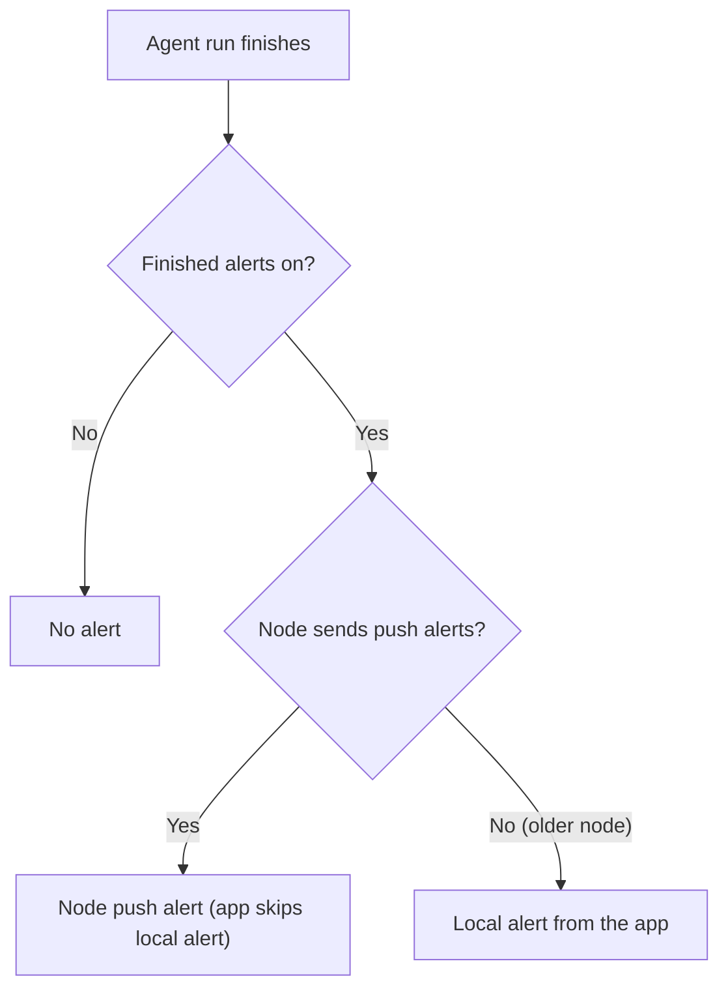
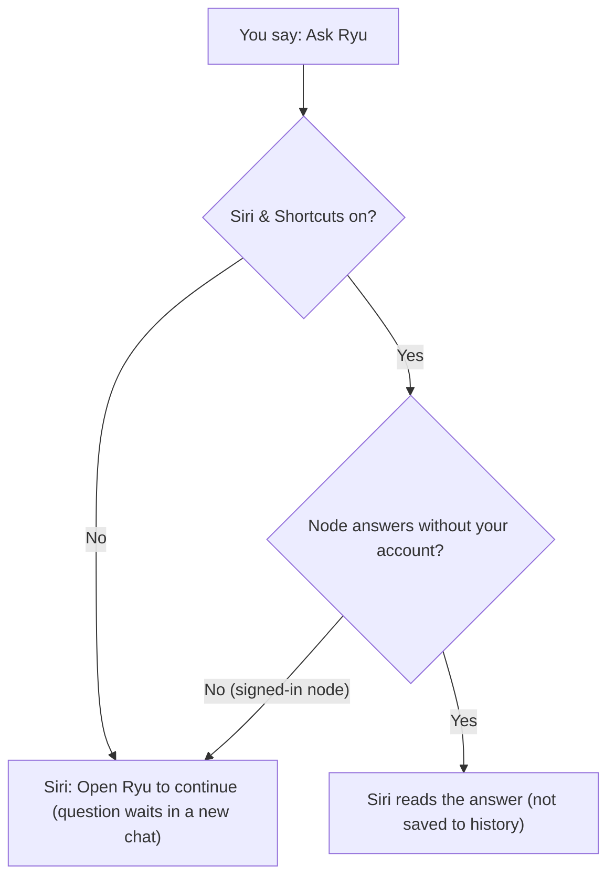
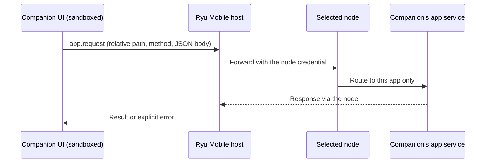

This page covers the parts of Ryu Mobile that live outside the main app screens: notifications,
Live Activities, Siri and Shortcuts, Spotlight, quick actions, haptics, and the native bridge that
companion apps use. The watch and
car apps are on [Watch and car apps](/docs/mobile/watch-and-car), and the keyboard is on
[AI keyboard](/docs/mobile/ai-keyboard).

## Live Activities

On iOS, an enabled Live Activity shows a running agent on the lock screen and Dynamic Island. On
Android, the equivalent is a low-priority ongoing agent notification. The **Live Activity** setting
also controls the run mirror on Apple Watch; see
[Follow agent runs on the watch](/docs/mobile/watch-and-car#follow-agent-runs-on-the-watch).
The run status on the lock screen and Dynamic Island (for example **Working** or **Needs input**)
uses the language you picked in Ryu, and the progress percentage uses your iPhone's number format.
A status update that your node pushes while Ryu is closed shows the status in your iPhone's
language.

Tapping the Live Activity opens that conversation in Ryu, even when you are already in another chat.

### Stop button

On iOS 17 and later the Live Activity has a **Stop** button that stops the agent run without opening
Ryu first.

1. If the chat screen is showing that conversation, Ryu stops the stream and cancels the run there.
2. Otherwise Ryu tries to cancel the run with the node connection that
   [Siri & Shortcuts](#siri-and-shortcuts) uses.
3. If neither works, the run keeps going and Ryu opens that conversation, so you can stop it from the
   chat.

The Live Activity ends only after the node confirms the run was cancelled.

## Finished alerts

When an agent finishes, Ryu posts a finished alert from that agent, the way chat apps show a new
message.

- On iOS 15 and later it is a communication notification: the agent's avatar replaces the app icon
  and the agent's name is the sender. On Android the avatar is the notification's large icon.
- Uploaded and DiceBear avatars show as they are, emoji avatars use the matching Twemoji image, and
  icon or animated avatars show the agent's initial on its avatar colour. Only that initial is sent
  to the image service.
- With **Finished alerts** on, the node also pushes the alert, so it arrives even when the app is
  closed or suspended. The app then skips its own local alert to avoid duplicates.
- The push names the agent but carries no conversation content.
- Nodes from before this feature keep the local alert only. Turning **Finished alerts** off stops
  both.

## Notification permission

On first launch the app asks once whether to turn on notifications, with a preview of an agent
notification.

- iOS and Android 13+ then show the system prompt. Older Android versions allow notifications by
  default.
- Choose **Not now** to skip. **Settings → Notifications** turns them on later, or opens system
  Settings when they were declined there.
- Push registration is scoped to the active node and only starts after notifications are allowed.

## Quick actions and haptics

When enabled, quick actions expose New Chat, Settings, and enabled companion apps from the app icon.
The **Quick actions** preference in Mobile Settings removes or restores the menu after the app loads
its settings and enabled companion list.

Haptics cover sends, quick actions, and run outcomes, and respect the Haptics setting in the app.

## Siri and Shortcuts

On iOS 16 and later, Ryu adds actions to Siri, the Shortcuts app, Spotlight and the Action button.
These Siri phrases work out of the box, and each action is also a Shortcuts tile:

| Say to Siri | What happens |
| --- | --- |
| "Ask Ryu" or "Ask Ryu a question" | Siri asks for your question and reads Ryu's answer without opening the app. |
| "New chat in Ryu" or "Start a Ryu chat" | Ryu opens on a new, empty chat. |
| "Draft a prompt in Ryu" | Ryu opens with your prompt in the composer. You review it and send it yourself. |
| "Open Ryu settings" | Ryu opens on Settings. |
| "Send a message with Ryu" | Siri asks what to send, sends it, and reads the reply without opening the app. |
| "List my Ryu agents" | Siri lists the agents you can talk to in Ryu. |

Shortcuts also offers **Open Ryu conversation**, which opens a conversation you pick. In Shortcuts,
**Ask Ryu** returns the answer as plain text that the next step can use, and you can pick which
agent answers. **Send message to Ryu** does the same for one message and an agent you pick, and
**List Ryu agents** returns the agents so a later step can pass one to it. Shortcuts and Siri never
use [your phone's apps](/docs/mobile/phone-apps).

### The Siri & Shortcuts setting

Answering without opening Ryu and listing your chats in Spotlight are off by default. Turn them on
in **Settings → Notifications & OS → Siri & Shortcuts**. The setting is on iOS only, and it applies
to the signed-in account on the active remote node.

- **Ask Ryu** and **Send message to Ryu** answer in a one-off turn that is not saved to your chat
  history.
- Many signed-in nodes only answer requests that carry your account, and Siri cannot send that. On
  those nodes, and whenever the setting is off or the node refuses the request, Siri says **Open Ryu
  to continue**. Your question then waits in a new chat with the prompt in the composer, and nothing
  is sent until you send it.
- **Send message to Ryu** follows the same rules: with the setting off, or on a node that needs your
  account, the message waits in a new chat and the action says to open Ryu.
- **List Ryu agents** returns an empty list while the setting is off.
- The other phrases and Shortcuts actions open Ryu, so they work with the setting off.

### Spotlight and onscreen awareness

With the setting on, Ryu shares only conversation titles and agent names with Siri and Spotlight,
never messages. On iOS 18 and later, your recent chat titles appear in Spotlight, and opening one
takes you to that chat. On iOS 18.2 and later, on devices and in regions where Apple Intelligence
and Siri AI are available, Siri can also tell which conversation is on screen.

Ryu wipes these titles and the Spotlight index when you sign out, switch account or node, or turn
the setting off.

### Android launcher shortcut

On Android, long-press the Ryu icon for an **Ask Ryu** shortcut, which you can also pin to the home
screen. It opens a new chat. Like every Ryu link, it never sends anything by itself.

## Recaps

When [Recaps](/docs/mobile/recaps) are set up, a recap you start shows a Live Activity on iPhone,
or an ongoing notification on Android, for as long as it records. On iOS 18 and later you can also
start one from the Action Button or a control, and on Android from the **Start a recap** Quick
Settings tile; those starts must be confirmed within 10 seconds or nothing is kept. Recaps appear
in Siri and Spotlight only if you turn that on in the Recaps settings.

## Which surfaces are available

The native capability tool reports which of these surfaces are available in the current build and
whether notifications are currently permitted. Expo Go and the browser report fewer native
capabilities than a development client or store build.

## For extension developers

Apps and plugins check `host.capabilities` before they show a native action. The OS, build,
foreground state, or a permission can make a capability unavailable. A plugin must not infer iOS or
Android behavior from the user agent. The cross-surface contract is in
[Native bridges](/docs/extend/develop/extensions/native-bridges).

### Native bridge for companion apps

Companion UIs run sandboxed. They use the same read-only `host.capabilities` descriptor. When their
approved grants allow it, they can also call these narrow native bridge methods:

- `native.haptics`
- `native.notifications.create`
- `native.liveActivities.update`

The bridge bounds text and keeps the node credential on the trusted host. It returns an explicit
unavailable or permission failure when the OS surface is missing.

### Calling the companion's own app service

Companions with an approved `app:http` grant can call their own app service through
`app.request`.

- The companion cannot choose another app's service or receive the node credential.
- A refused save returns an error rather than a successful result.
- Writes are not retried automatically. Use the app's explicit retry action after checking the error.
- Temporary read failures have a bounded retry, and closing the companion cancels its pending reads.

### Document and mount lifecycle

- Replacing a companion document stops streaming requests owned by its previous document. Late
  replies from that document cannot update the replacement.
- Ordinary rerenders keep an unchanged document mounted, preserving its current work.
- Cancelling a pending Companion mount also cancels its catalog and bundle reads.
- Changing apps or nodes stops the obsolete load before it can start another bundle download.

## Related pages

<Cards>
  <DocCard href="/docs/mobile/watch-and-car" />
  <DocCard href="/docs/mobile/recaps" />
  <DocCard href="/docs/mobile/tools-and-privacy" />
  <DocCard href="/docs/extend/develop/extensions/native-bridges" />
</Cards>
