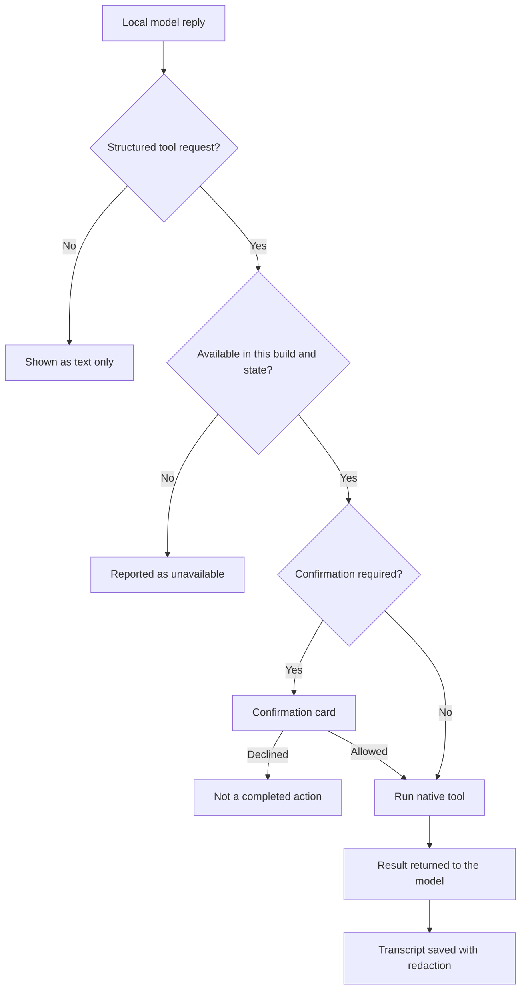

This page explains which tools a model running on the phone can use, and how Mobile asks before it
acts. When a node is reachable, the local model can use Ryu and MCP tools only through Core's typed
MCP and approval APIs. Native Mobile tools work without a node.

## Native tools

The native registry groups its tools by area:

| Area | Tools |
| --- | --- |
| Device status | `mobile.device.status`, `mobile.device.capabilities`, `mobile.device.battery`, `mobile.app.state` |
| Navigation and haptics | `mobile.navigation.open`, `mobile.navigation.haptic` |
| Notifications and OS surfaces | `mobile.notifications.create`, `mobile.live_activity.update`, `mobile.quick_actions.set` |
| Camera, media, and sharing | `mobile.media.capture`, `mobile.media.select`, `mobile.share` |
| Clipboard | `mobile.clipboard.read`, `mobile.clipboard.write` |
| User-selected files | `mobile.files.import`, `mobile.files.export` |
| Contacts | `mobile.contacts.search`, `mobile.contacts.read`, `mobile.contacts.create`, `mobile.contacts.update` |
| Calendar | `mobile.calendar.search`, `mobile.calendar.create`, `mobile.calendar.update`, `mobile.calendar.delete` |
| BLE discovery | `mobile.hardware.scan`, `mobile.hardware.devices`, `mobile.hardware.action` |
| Ryu-owned background tasks | `mobile.tasks.schedule`, `mobile.tasks.list`, `mobile.tasks.cancel` |

### How local chat uses tools

Local chat is instructed to answer general questions directly. It requests a tool when it needs
current device data, connected-service data, or an action. It is also instructed to base claims
about device actions or device data on the returned tool result.

Tool support depends on the local model's chat template. Mobile sends tool definitions, assistant
requests, and tool results through the model's structured tool format.

- A written example or explanation of a tool call does not run an action or create a confirmation.
  Only a structured request can reach the approval flow.
- Failed, unavailable, or declined requests do not count as completed actions.

## Permissions and confirmations

Every descriptor declares its risk, OS permission, foreground requirement, offline availability, and
confirmation policy. Sensitive reads and all writes show an in-app confirmation card by default.
Searching or reading contacts, searching the calendar, and opening a link with
`mobile.navigation.open` each ask first. The link card shows the full URL, so you can see whether it
would send data such as names or email addresses to a website before anything leaves the device.
The card asks a plain question for that tool, such as “Allow Ryu to read your clipboard?”, then
shows the tool name, its risk level (low, medium, or high, or a remote Core action), and the
destination for a link, before offering the decision. The question, risk level, and destination
appear in the app language. For a remote Core approval, the card uses Core's own question in your
language when Core provides one, and otherwise asks “Allow Ryu to run this action on your
computer?”.

Tool results and arguments are redacted before a local transcript is saved. On-device
conversations (their IDs start with `local:`) are separate from Core conversations. Their content
reaches Core only when you copy it there yourself.

## Phone apps in node chats

Separately from the native tools above, chats with a node can let Ryu use Calendar, Contacts,
Location, and Alarms on the phone through **Settings → Connect apps**. Those actions run only while
Ryu is open and the phone is unlocked, and each one goes through Core's approval card. See
[Phone Apps](/docs/mobile/phone-apps).

## Tool-call explanations

The [Action Summary](/docs/plugins/action-summary) plugin (`@ryu/action-summary`) adds a
first-person question plus a short out-of-band explanation for thinking blocks and tool calls in
remote Core conversations. The Mobile chat renders that intent above the summary as a separate
callout. Core's remote approval request carries the same question and summary bridge.

On-device models receive the same one-sentence instruction before native tool use. If a model emits
a bare function call, the chat shows a short line for that tool in the app language, such as
“I’m going to check the battery.” The model itself keeps an English description of the call.
Sensitive actions still pause on a confirmation card. The explanation does not replace the
permission or confirmation boundary.

A local run stops after a fixed number of tool steps (eight by default) and says so in the chat in
the app language.

## Offline behavior

When the device is offline, remote tools are unavailable and the native registry remains available
only for operations that the current build and permission state support. An unavailable capability
is shown as unavailable; it is not treated as a successful tool call. For the connection banners,
see [Offline and unreachable nodes](/docs/mobile/connect-and-sign-in#offline-and-unreachable-nodes).

Extension developers detect native actions through `host.capabilities`; see
[For extension developers](/docs/mobile/native-surfaces#for-extension-developers).

## Spotlight and Siri chat indexing

On iPhone and iPad, Ryu can list your chats in Spotlight and offer them to Siri and Shortcuts. This
is opt-in and off by default.

- **Ryu Mobile:** turn on **Settings → Notifications & OS → Siri & Shortcuts**. It applies to the
  signed-in account on the active remote node.
- **Ryu Bot:** turn on **Show Chats in Spotlight and Siri** in the account sheet.

Only chat titles (and, in Ryu Mobile, agent names) are shared with Spotlight and Siri, never
message content. Ryu removes the indexed titles when you turn the setting off, sign out, or switch
account (or, in Ryu Mobile, switch node). To stop indexing, turn the same setting off; nothing else
is needed. For what Siri can do with this, see
[Siri and Shortcuts](/docs/mobile/native-surfaces#siri-and-shortcuts) and
[Siri, Shortcuts, and Spotlight in Ryu Bot](/docs/mobile/bot#siri-shortcuts-and-spotlight).

## Related pages

<Cards>
  <DocCard href="/docs/mobile/native-surfaces" />
  <DocCard href="/docs/mobile/phone-apps" />
  <DocCard href="/docs/mobile/models" />
  <DocCard href="/docs/core/mcp-registry" />
</Cards>
