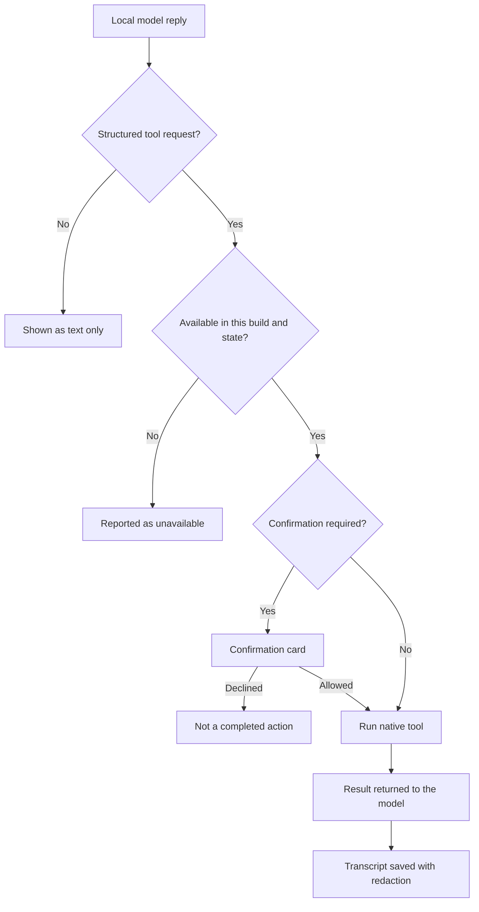

This page explains which tools a model running on the phone can use, and how Mobile asks before it
acts. When a node is reachable, the local model can use Ryu and MCP tools only through Core's typed
MCP and approval APIs. Native Mobile tools work without a node.

## Native tools

The native registry groups its tools by area:

| Area | Tools |
| --- | --- |
| Device status | `mobile.device.status`, `mobile.device.capabilities`, `mobile.device.battery`, `mobile.app.state` |
| Navigation and haptics | `mobile.navigation.open`, `mobile.navigation.haptic` |
| Notifications and OS surfaces | `mobile.notifications.create`, `mobile.live_activity.update`, `mobile.quick_actions.set` |
| Camera, media, and sharing | `mobile.media.capture`, `mobile.media.select`, `mobile.share` |
| Clipboard | `mobile.clipboard.read`, `mobile.clipboard.write` |
| User-selected files | `mobile.files.import`, `mobile.files.export` |
| Contacts | `mobile.contacts.search`, `mobile.contacts.read`, `mobile.contacts.create`, `mobile.contacts.update` |
| Calendar | `mobile.calendar.search`, `mobile.calendar.create`, `mobile.calendar.update`, `mobile.calendar.delete` |
| BLE discovery | `mobile.hardware.scan`, `mobile.hardware.devices`, `mobile.hardware.action` |
| Ryu-owned background tasks | `mobile.tasks.schedule`, `mobile.tasks.list`, `mobile.tasks.cancel` |

### How local chat uses tools

Local chat is instructed to answer general questions directly. It requests a tool when it needs
current device data, connected-service data, or an action. It is also instructed to base claims
about device actions or device data on the returned tool result.

Tool support depends on the local model's chat template. Mobile sends tool definitions, assistant
requests, and tool results through the model's structured tool format.

- A written example or explanation of a tool call does not run an action or create a confirmation.
  Only a structured request can reach the approval flow.
- Failed, unavailable, or declined requests do not count as completed actions.

## Permissions and confirmations

Every descriptor declares its risk, OS permission, foreground requirement, offline availability, and
confirmation policy. Sensitive reads and all writes show an in-app confirmation card by default.
The card puts a first-person question such as “Can I read the current battery and power state?”
above the plain-language summary, then offers the decision.

Tool results and arguments are redacted before a local transcript is saved. On-device
conversations (their IDs start with `local:`) are separate from Core conversations. Their content
reaches Core only when you copy it there yourself.

## Tool-call explanations

The [Action Summary](/docs/plugins/action-summary) plugin (`@ryu/action-summary`) adds a
first-person question plus a short out-of-band explanation for thinking blocks and tool calls in
remote Core conversations. The Mobile chat renders that intent above the summary as a separate
callout. Core's remote approval request carries the same question and summary bridge.

On-device models receive the same one-sentence instruction before native tool use. If a model emits
a bare function call, the native loop supplies a short descriptor-based line instead. Sensitive
actions still pause on a confirmation card. The explanation does not replace the permission or
confirmation boundary.

## Offline behavior

When the device is offline, remote tools are unavailable and the native registry remains available
only for operations that the current build and permission state support. An unavailable capability
is shown as unavailable; it is not treated as a successful tool call. For the connection banners,
see [Offline and unreachable nodes](/docs/mobile/connect-and-sign-in#offline-and-unreachable-nodes).

Extension developers detect native actions through `host.capabilities`; see
[For extension developers](/docs/mobile/native-surfaces#for-extension-developers).

## Related pages

<Cards>
  <DocCard href="/docs/mobile/native-surfaces" />
  <DocCard href="/docs/mobile/models" />
  <DocCard href="/docs/core/mcp-registry" />
</Cards>
