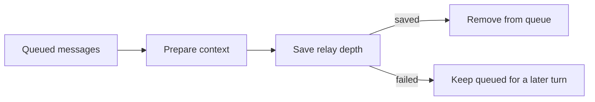

## What it does

Lets the agents on this node talk to each other. Any agent can look up who else is here, leave one of them a message, and inspect the pair's bounded message history. A message is delivered at the start of the recipient's next turn, so delegation stays asynchronous and scoped to the calling agent. Works with every agent Ryu can run - the flagship agent, Claude Code, Codex, and any custom agent you have added - because it ships as ordinary tools rather than one agent's private feature.

This page is part of the [Plugins catalog](/docs/plugins), [plugin manifests](/docs/extend/develop/extensions/plugin-json-manifest), [plugin runtime](/docs/extend/develop/extensions/plugin-runtime), [unified tool catalog](/docs/core/unified-tool-catalog), [Marketplace](/docs/extend/develop/extensions/marketplace), [Gateway governance](/docs/gateway/governance) documentation path. In the same category, compare [Bytebot Desktop](/docs/plugins/bytebot), [Codex Computer Use](/docs/plugins/codex-computer-use).

## What it exposes

### Tools

### `agents.directory` - Agent Directory

List the other agents on this node - their ids, names and what each one is for. Call this first when the user names an agent loosely or when you want to hand work to a specific agent. Returns `{ok, agents:[{id, name, description, model, engine}], count}`; the `id` is what agents.send addresses. Takes no arguments.

Backend: HTTP · Method: GET

_No parameters_ (empty schema).
### `agents.send` - Message an Agent

Leave a message in another agent's inbox and carry on - nothing waits. The recipient reads it at the start of its next turn. Use this to hand something over ("the deploy is done, your turn"), or to reply to a message you received. The sender is taken from the calling agent, not from anything you write. Returns `{ok, id, from, to, hops, delivery}`, or `{ok:false, refused:"hop_limit"}` when the relay chain is already at its limit.

Backend: Sandboxed JS

| Parameter | Type | Required | Description |
|---|---|---|---|
| `to` | string | yes | The recipient agent's id, as listed by agents.directory. |
| `text` | string | yes | The message. Write it so it stands alone - the recipient cannot see this conversation. |
| `reply_to` | string | no | Optional. The id of the message you are replying to, as it appeared in your inbox. |

### `agents.thread` - Agent Message History

Read what you and another agent have already said to each other, or - with no arguments - list the agents you have exchanged messages with. Use it before asking again, so you do not re-ask something that was answered. Scoped to the calling agent: it can only ever show threads this agent is part of. Returns `{ok, agent, with, messages:[{seq, from, to, text}]}`, or `{ok, agent, peers}` when no peer is named.

Backend: Sandboxed JS

| Parameter | Type | Required | Description |
|---|---|---|---|
| `with` | string | no | The other agent's id. Omit to list every agent you have a thread with. |

## Permissions

**Grants:** `tool:execute`, `storage:kv`, `tool:http-egress:127.0.0.1`

## UI it contributes

### Turn hooks

- **agent-comms.deliver** (on: `pre_user_turn`)
- **agent-comms.directory** (on: `tool_result`)

## In the transcript

When an agent messages other agents, the desktop chat shows one **Messaged** line for the whole
fan-out instead of a bubble per message. The line shows the recipients' avatars and a count, such
as **Messaged 7 agents**, or the recipient's name when there is only one.

- Select the line to list the recipients with the latest message to each.
- Pick a recipient to open that exchange as a read-only conversation headed **Sender ⇄ Recipient**.
  Choose **Close chat** to return.
- A message that Switchboard refused (for example, at the hop limit) is marked **Not delivered** in
  the list, in the conversation, and as a count on the line itself.

## Queue recovery

The delivery hook removes queued messages only after it prepares their context and saves the
conversation's relay depth. If that save fails, the messages stay queued for a later turn. If
another write changes the inbox while delivery or invalid-inbox cleanup runs, the newer messages
are kept.

This is local queue handling. It does not guarantee that the other agent completed the work.

## Engine requirement

Requires Ryu >=0.1.0.

## Activation

Activates on: `*`
