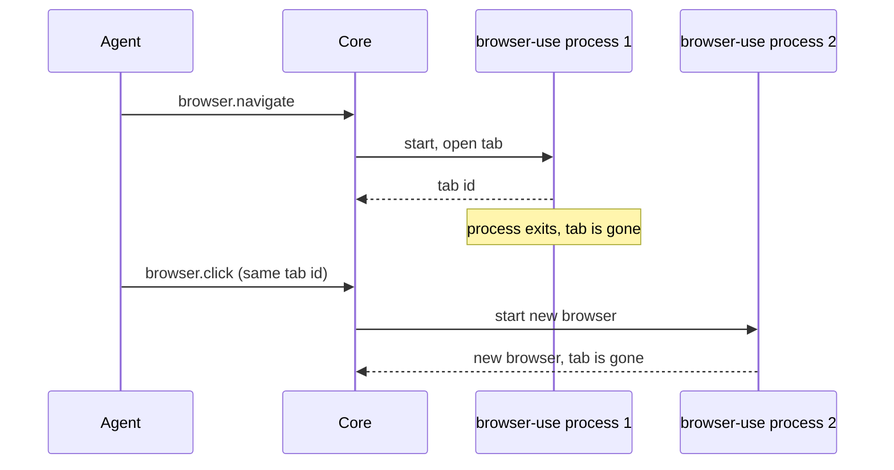

<Callout type="info">
**Hidden from the store.** This plugin is not offered in the store; the description below explains why.
</Callout>

This page is part of the [Plugins catalog](/docs/plugins), [plugin manifests](/docs/extend/develop/extensions/plugin-json-manifest), [plugin runtime](/docs/extend/develop/extensions/plugin-runtime), [unified tool catalog](/docs/core/unified-tool-catalog), [Marketplace](/docs/extend/develop/extensions/marketplace), [Gateway governance](/docs/gateway/governance) documentation path. In the same category, compare [Agent Browser](/docs/plugins/agentbrowser), [Cloudflare Browser Run](/docs/plugins/cloudflare-browser-run), [Ego Browser](/docs/plugins/ego-browser).

## What it does

Browser Use connects the open-source [browser-use](https://github.com/browser-use/browser-use) browser to Ryu. It is a preview: it is hidden from the Store, and it does not work as Ryu's Browser layer yet.

## Why it is not usable as the Browser layer yet

Ryu starts a fresh browser-use process for every tool call, and browser-use keeps its browser inside that process. A tab that one call opens is gone before the next call runs.

So `browser.navigate` cannot return a tab that `browser.snapshot`, `browser.click`, or any other verb can use afterwards. Calling the `browseruse.browser_*` tools directly has the same limit: each call starts a new browser. Browser Use stays hidden from the Store while that is the case.

What does work is a task that finishes within one call. `browseruse.retry_with_browser_use_agent` hands a whole task to the browser-use agent and returns its result.

## Declared Browser layer mapping

The plugin declares how the standard `browser.*` verbs map onto browser-use. These bindings do not work yet, for the reason above:

| Ryu verb | Browser Use behavior |
| --- | --- |
| `browser.navigate` | Opens the URL in a new tab and returns that tab's id |
| `browser.tabs` | Lists open tabs with browser-use's tab ids |
| `browser.snapshot` | Lists interactive elements; each one's reference is `@e` plus browser-use's index |
| `browser.click` | Clicks an element by reference |
| `browser.type` | Overwrites the field; requires `replace: true` |
| `browser.scroll` | Scrolls 500 px up or down |
| `browser.screenshot` | Captures the current page |

Verbs that take a `tab_id` switch to that tab first. browser-use always clears a field before typing, cannot press Enter after typing, and scrolls a fixed 500 px vertically. An append request, `submit`, a left or right scroll, or another scroll distance returns an error instead of doing something different.

<Callout type="warn">
  Do not select Browser Use in the Browser provider picker. Keep the default browser or another working provider selected.
</Callout>

## Requirements

- [uv](https://docs.astral.sh/uv/) on `PATH`. Ryu launches browser-use's MCP server with `uvx` from the pinned 0.13.11 release, with anonymous telemetry and cloud sync turned off. The first launch downloads that release.
- The reserved `mcp:server` permission. An operator must allow it for this plugin in the [Gateway grant policy](/docs/gateway/governance) before the plugin can be enabled.
- A model key configured for browser-use, if you use `browseruse.retry_with_browser_use_agent`.

## What it exposes

### Capabilities

- **Browser** - capability `browser.control`
  - Grant: `browser:control`
  - Target: local-machine
  - Verbs:
    - `browser.navigate` -> `browseruse.browser_navigate` (adapter also calls `browseruse.browser_list_tabs`)
    - `browser.tabs` -> `browseruse.browser_list_tabs`
    - `browser.snapshot` -> `browseruse.browser_get_state` (adapter also calls `browseruse.browser_switch_tab`)
    - `browser.click` -> `browseruse.browser_click` (adapter also calls `browseruse.browser_switch_tab`)
    - `browser.type` -> `browseruse.browser_type` (adapter also calls `browseruse.browser_switch_tab`)
    - `browser.scroll` -> `browseruse.browser_scroll` (adapter also calls `browseruse.browser_switch_tab`)
    - `browser.screenshot` -> `browseruse.browser_screenshot` (adapter also calls `browseruse.browser_switch_tab`)

### MCP server

MCP (Model Context Protocol) is a standard way for an AI host to find and call tools. An MCP server provides those tools.

- **`browseruse`** - Browser Use MCP server, launched via `uvx browser-use@0.13.11 --mcp` with anonymous telemetry and cloud sync off. Tools include browser_navigate, browser_click, browser_type, browser_get_state, browser_extract_content, browser_get_html, browser_screenshot, browser_scroll, tab management, session management, and retry_with_browser_use_agent. Unavailable until uv is installed and the pinned package can be fetched.

## Permissions

**Grants:** `mcp:server`, `tool:execute`

## Engine requirement

Requires Ryu >=0.1.0.
