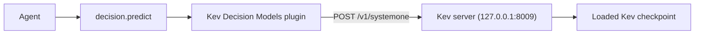

This page is part of the [Plugins catalog](/docs/plugins), [plugin manifests](/docs/extend/develop/extensions/plugin-json-manifest), [plugin runtime](/docs/extend/develop/extensions/plugin-runtime), [unified tool catalog](/docs/core/unified-tool-catalog), [Marketplace](/docs/extend/develop/extensions/marketplace), [Gateway governance](/docs/gateway/governance) documentation path. In the same category, compare [Cloudflare Clef Decisions](/docs/plugins/cloudflare-clef), [FunctionGemma Local Planner](/docs/plugins/functiongemma), [Laya Local Decisions](/docs/plugins/laya), [Needle 3 Local Planner](/docs/plugins/needle3).

Kev is a family of small typed-decision models that run behind a local System One HTTP server.
Ryu's **Kev Decision Models** plugin connects that server to the node selector's **Decision
Models** layer. Read the [Decision Models guide](/docs/core/decision-models) for provider selection
and the shared typed request contract. Agents use the same `decision.predict` tool as other providers.



## Start the local model server

Install Kev on the same node that runs Ryu and start one checkpoint on port 8009. The plugin
always calls that fixed loopback address. For example, Kev documents this command for Kev-4B:

```sh
uv run --extra serve python -m kev.serve --run jaredpalmer/kev-4b --port 8009
```

The first run downloads the model adapter and Qwen base model. Ryu does not install the Kev Python
environment, download model weights, or start the server. It calls `POST /v1/systemone` and
`GET /v1/models` on `http://127.0.0.1:8009`.

## Enable and configure

Install and enable **Kev Decision Models** from [Marketplace](/docs/surfaces/desktop/user-guide/marketplace) after the local server
is ready. Review its loopback access in the [permission controls](/docs/security/permissions).

<Callout type="warn">
  The connector supports only a keyless Kev server over loopback HTTP. Core does not send API keys
  over plaintext HTTP, so a Kev server configured with `KEV_API_KEY` does not work with this
  plugin. Ryu does not store or send a Kev API key.
</Callout>

Ryu sends `model: "kev-latest"` by default, which Kev maps to the checkpoint the server loaded. If
the Kev server fails or is not running, the call returns an error. Ryu does not fall back to another
provider.

## Models and references

Kev publishes 0.8B, 4B, 9B, and 27B checkpoints. Their hardware requirements differ substantially;
choose the checkpoint for your node before starting Kev. Ryu's model catalog is for downloadable
GGUF, MLX, and safetensors weights and does not manage these custom Kev checkpoints.

- [Kev source and setup guide](https://github.com/jaredpalmer/kev)
- [Kev model collection](https://huggingface.co/collections/jaredpalmer/kev-6aad9d)
- [Kev-0.8B](https://huggingface.co/jaredpalmer/kev-0.8b), [Kev-4B](https://huggingface.co/jaredpalmer/kev-4b), [Kev-9B](https://huggingface.co/jaredpalmer/kev-9b), and [Kev-27B](https://huggingface.co/jaredpalmer/kev-27b)

## What it exposes

### Tools

### `kev.predict` - Kev Predict

Run typed yes/no, choice, or score questions against the Kev model already served on this node. Returns probabilities, not prose.

Backend: HTTP · Method: POST

| Parameter | Type | Required | Description |
|---|---|---|---|
| `state` | string | yes | The text, JSON object, or list to evaluate. |
| `questions` | object | yes | Question ids mapped to typed `noul`, `choice`, or `score` definitions. |
| `model` | string | no | Optional System One model alias. Defaults to `kev-latest`, which selects the checkpoint loaded by the local Kev server. |

### `kev.models` - Kev Models

List model details from the Kev server running on this node.

Backend: HTTP · Method: GET

_No parameters_ (empty schema).

### Capabilities

- **Typed Decisions** - capability `decision.typed`
  - Verbs:
    - `decision.predict` -> `kev.predict`

## Permissions

**Grants:** `tool:http-egress:127.0.0.1`

| Level | Description | Implies |
|---|---|---|
| **View Kev model availability** | List model details from the local Kev server. |  |
| **Run local Kev decisions** | Send bounded state and typed questions to the Kev server on this node. | `kev.view` |

## Engine requirement

Requires Ryu >=0.1.0.
