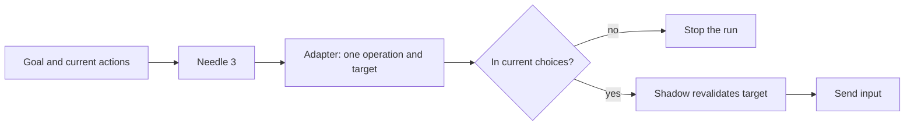

## What it does

Needle 3 Local Planner runs [Cactus Compute Needle 3](https://huggingface.co/Cactus-Compute/needle3),
a small Apache-2.0 tool-calling model, as a local computer-use planner for
[Shadow](/docs/plugins/shadow).

`@ryu/needle3` pins the model weights (about 35 MB) and provisions a local Python sidecar. The
sidecar needs Python 3.11 through 3.14 on the node that runs Core. The runtime may fetch its small
platform engine on first use. Inference and the weights stay local.

This page is part of the [Plugins catalog](/docs/plugins), [plugin manifests](/docs/extend/develop/extensions/plugin-json-manifest), [plugin runtime](/docs/extend/develop/extensions/plugin-runtime), [unified tool catalog](/docs/core/unified-tool-catalog), [Marketplace](/docs/extend/develop/extensions/marketplace), [Gateway governance](/docs/gateway/governance) documentation path. In the same category, compare [Kev Decision Models](/docs/plugins/kev), [Laya Local Decisions](/docs/plugins/laya), [Ollaya Decision Models](/docs/plugins/ollaya).

## Set it up

1. Install the plugin from [Marketplace](/docs/surfaces/desktop/user-guide/marketplace) and
   review the permissions it requests.
2. Enable the plugin. The first enable downloads the model and provisions the sidecar.
3. In **Settings → Plugins → Shadow → Computer use**, choose **Local model plugin**, then choose
   **Needle 3 · Base**.

## How it plans actions

Needle receives the goal and a bounded list of the actions available right now. The adapter
reduces its tool call to one operation and an optional target, checks it against the current
choices, and Shadow validates it again before any input is sent. Shadow never presses Enter or
submits forms automatically.

The fine-tuned confidence head is uncalibrated and reports `null`. Because of that, the adapter
accepts only one zero-argument tool call from the current closed action list. If the runtime
supplies a numeric confidence, the adapter applies its local threshold.

Needle 3 selects actions. It does not write prose, so text entry still uses Shadow's configured
text model. See [Shadow computer-use planners](/docs/plugins/shadow#computer-use-planners) and
[Bundle Hugging Face models in a plugin](/docs/extend/develop/extensions/local-model-plugins).

## What it exposes

### Tools

### `needle3.status` - Needle 3 Status

Check whether the pinned Needle 3 model bundle and local tool-calling runtime are available.

Backend: HTTP · Method: GET

_No parameters_ (empty schema).

## Permissions

**Grants:** `tool:http-egress:127.0.0.1`

| Level | Description | Implies |
|---|---|---|
| **Can view local model status** | See whether the pinned Needle 3 model and runtime are ready. |  |
| **Can run local computer-use decisions** | Run a bounded, local tool-selection pass over Shadow's current action choices. | `needle3.view` |

## UI it contributes

### computer use planners

- **Needle 3 · Base** - Apache-2.0, 29–121M-parameter on-device tool-calling model.

## Engine requirement

Requires Ryu >=0.1.0.

## Sidecar

Runs an out-of-process sidecar: `needle3`.
