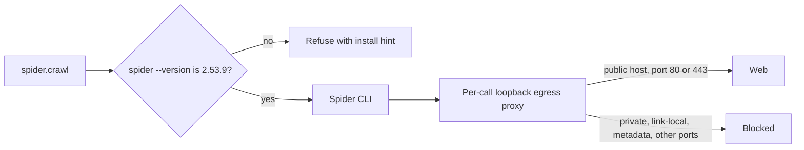

This page is part of the [Plugins catalog](/docs/plugins), [plugin manifests](/docs/extend/develop/extensions/plugin-json-manifest), [plugin runtime](/docs/extend/develop/extensions/plugin-runtime), [unified tool catalog](/docs/core/unified-tool-catalog), [Marketplace](/docs/extend/develop/extensions/marketplace), [Gateway governance](/docs/gateway/governance) documentation path. In the same category, compare [Scrapling](/docs/plugins/scrapling), [Serper](/docs/plugins/serper), [Spider Cloud](/docs/plugins/spidercloud), [Tavily Search](/docs/plugins/tavily).

## What it does

Spider crawls web pages and extracts their content with the local [Spider](https://spider.cloud) CLI. It runs as a command tool and needs no API key.

Core runs the CLI behind a loopback egress proxy that it starts for each call. The proxy screens and IP-pins every connection the crawler opens. It refuses private, loopback, link-local, and cloud-metadata targets, and any port other than 80 and 443.

## Install the Spider CLI

Spider is a local CLI that you install yourself; Ryu does not bundle or download it. Install the pinned version and add the binary to Core's command-tool allowlist:

```bash
cargo install spider_cli --version 2.53.9 --locked
export RYU_COMMAND_TOOL_ALLOWLIST="spider=$HOME/.cargo/bin/spider"
```

The allowlist entry is `name=absolute-path`. The plugin refers to the `spider` key and never to a filesystem path.

<Callout type="warn">
  Install exactly `2.53.9`. Core's egress screening only works if the crawler sends its traffic
  through the `HTTP_PROXY` and `HTTPS_PROXY` variables Core sets for each call, and `2.53.9` is the
  release confirmed to do that. Another release may connect directly and skip the screening.
  `--locked` builds with the dependency versions that release shipped with.
</Callout>

Core checks the installed version before every crawl. The plugin declares a binary version
requirement of `=2.53.9`, so Core runs `spider --version` (which prints `spider_cli 2.53.9`). It
refuses the call if the output reports another version or cannot be read.

The error names the installed version, the required version, and the install command above. Core
re-checks automatically when the binary file changes, so reinstalling `2.53.9` clears the error on
the next call.



See [agent tool-egress SSRF screening](/docs/gateway/agent-hardening#agent-tool-egress-ssrf-screening) for how the proxy screens each connection, and [plugin runtime](/docs/extend/develop/extensions/plugin-runtime) for how command tools run.

## What it exposes

### Tools

### `spider.crawl` - Spider Crawl

Crawl command for the Spider CLI. Core screens the URL before the CLI starts and routes every connection the CLI makes through a screening egress proxy. The extract capability supplies depth=0 and limit=1; crawl forwards the caller's depth and limit values with the declared defaults.

Backend: CLI command

| Parameter | Type | Required | Description |
|---|---|---|---|
| `url` | string | yes | The URL to crawl and extract content from. |
| `depth` | integer | no | Requested link depth for the command (declared default 1). |
| `limit` | integer | no | Maximum number of pages to crawl (default 10). |

### Capabilities

- **Extract** - capability `web.extract`
  - Verbs:
    - `web.extract` -> `spider.crawl`
- **Crawl** - capability `web.crawl`
  - Verbs:
    - `web.crawl` -> `spider.crawl`

## Permissions

**Grants:** `tool:command:spider`

## Engine requirement

Requires Ryu >=0.1.0.
