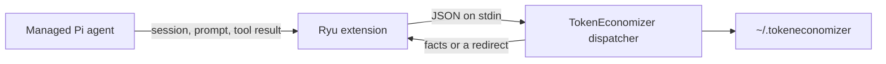

This page is part of the [Plugins catalog](/docs/plugins), [plugin manifests](/docs/extend/develop/extensions/plugin-json-manifest), [plugin runtime](/docs/extend/develop/extensions/plugin-runtime), [unified tool catalog](/docs/core/unified-tool-catalog), [Marketplace](/docs/extend/develop/extensions/marketplace), [Gateway governance](/docs/gateway/governance) documentation path. In the same category, compare [Research Assistant](/docs/plugins/sample), [Sample Widget](/docs/plugins/sample-widget), [toolsmith-example](/docs/plugins/toolsmith-example).

## What it does

Connects the managed Pi agent (the default Ryu agent) to your own install of [TokenEconomizer](https://github.com/microsoft/TokenEconomizer), an open-source research plugin from Microsoft Research and UC Berkeley. TokenEconomizer learns from the sessions an agent has already run in a repository and uses that to cut waste in later sessions there:

- **Micro-skills** learn facts about the repository, such as which test command works, and add the confirmed ones to the system prompt at session start.
- **The loop guard** asks a judge model whether a turn that keeps hitting the same failures is stuck, and if so sends the agent one redirect. It never stops a turn.

TokenEconomizer's third mechanism, tool pruning, does nothing on Pi.

Ryu does not bundle TokenEconomizer. The plugin ships one Pi extension that sends Pi's session, prompt, tool-result and turn-end events to TokenEconomizer's own dispatcher and applies its answers. If TokenEconomizer is missing or fails, the agent carries on as if the plugin were off.



## Set it up

You need Python 3.10 or newer.

1. Clone TokenEconomizer:

   ```bash
   git clone https://github.com/microsoft/TokenEconomizer.git
   ```

2. Enable the plugin, open its **TokenEconomizer** settings tab, and enter the absolute path of the clone (or of its `plugin` folder).
3. Start a new chat. Pi loads extensions when its process starts, so chats that are already open keep running without it.

Clearing the folder turns the plugin off from the next chat.

| Setting | Values | Effect |
| --- | --- | --- |
| TokenEconomizer folder | An absolute path, or empty | Empty turns the plugin off |
| Micro-skills | Use TokenEconomizer's setting, Off, From repeated failures only, On | "From repeated failures only" makes no model calls |
| Loop guard | Use TokenEconomizer's setting, On, Off | |

"Use TokenEconomizer's setting" leaves the mechanism to TokenEconomizer's own configuration. The other values apply only to Ryu's managed agent.

## Model calls and data

The loop guard's judge and the micro-skills fact proposer are extra model calls. They run through the managed Pi agent itself, so they use the same model routing and sign-ins as your chats. What TokenEconomizer learns stays on your machine in its own folder (`~/.tokeneconomizer` unless `TOKENECONOMIZER_HOME` is set). See what it learned and what it did from a terminal:

```bash
~/.tokeneconomizer/bin/te --host pi status
```

## Limits

- It runs only in the default managed agent. Agents with limited model access and sub-agents run without it.
- TokenEconomizer's `/te` command is not available in chat. Use the `te` command in a terminal.
- For Claude Code, install TokenEconomizer's own Claude Code plugin as its README describes. This plugin does not change Claude Code.
- Savings depend on the repository and the work. Ryu has not measured them; TokenEconomizer's published figures come from its authors' benchmarks.

See [plugin runtime](/docs/extend/develop/extensions/plugin-runtime) for how plugins extend the managed agent.

## UI it contributes

### Pi extensions

- **tokeneconomizer** - Connects the managed Pi agent to your TokenEconomizer install.

### Settings tabs

- **TokenEconomizer** (fields: TokenEconomizer folder (text), Micro-skills (select), Loop guard (select))

## Engine requirement

Requires Ryu >=0.1.0.

## Activation

Activates on: `*`
