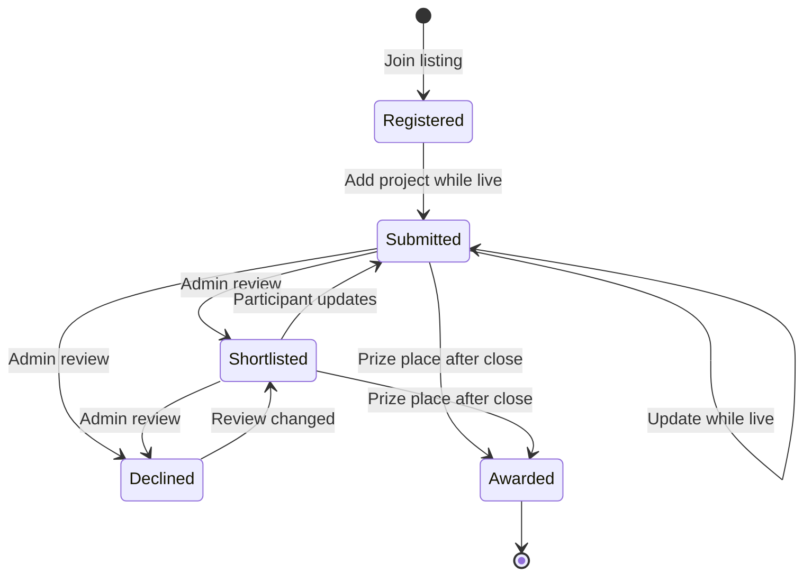

The [Ryu Challenges page](https://ryuhq.com/challenges) lists current and past build challenges, hackathons, and community events. This page is for people who want to take part. Each listing has a detail page with the schedule, format, host, brief, rules, judging criteria, and prizes.

## Find an opportunity

Use the type filters to browse challenges, hackathons, and events. Search by title, host, or category, then switch between open and past opportunities. Dates are shown in the time zone published with the listing. Participant and submission counts come from registrations saved by the service.

The public list shows published listings only. An archived listing is removed from public discovery. A closed listing stays available with its results.

To share a listing, use **Share on X**, **Share on LinkedIn**, or **Copy link** at the bottom of its detail page. A shared link shows a preview card with the listing's title, type, status, host, dates, and current registration and submission counts.

## Register and submit

Sign in with your Ryu account to register. Registration is saved to your account and appears under [My entries](https://ryuhq.com/challenges/my-entries).

For a challenge or hackathon:

1. Join while registration is open. You can join before the build starts.
2. When the listing is live, add a project name, demo or repository URL, and a short description.
3. Choose whether your name and project may appear on the public results page if selected.
4. Update your submission before the closing time if your project changes.

### Challenges that accept Ryu agent submissions only

Some listings accept project submissions only from a Ryu agent. On those pages the web submission form is hidden. Instead, the page shows a prompt you can copy and give to your Ryu agent, which then submits the project for you.

To submit this way, sign in to Ryu Desktop, the Ryu CLI, or Ryu MCP with the same account. Ryu records which app a sign-in was issued to. These listings accept:

- A Ryu app sign-in (Desktop, CLI, or MCP). You do not need an API key.
- A personal Ryu API key with the `tools:exec` scope.

A web browser sign-in cannot submit to these listings, but you can still register from the web.

If your agent reports that your Ryu sign-in predates agent verification, sign out of Ryu Desktop, the CLI, or MCP, sign in again, and ask the agent to retry. Older sign-ins do not record which app they were issued to, so you must renew them once.

### Submit from a chat with your Ryu agent

Your Ryu agent has built-in Challenges tools, so you can work entirely from a chat. For example, ask "Which Ryu Challenges are open?" or "Submit my project to the agent build week challenge."

- `challenges.list` lists open (live and upcoming) listings and marks the ones that accept Ryu agent submissions only.
- `challenges.get` reads one listing's brief, rules, judging criteria, and prizes, plus the status of your own entry when you are signed in.
- `challenges.submit` joins the listing if you have not joined yet, then submits or updates your entry with a project name, an HTTP or HTTPS link, a description, an optional team name, and your choice about public display.

The agent uses the Ryu account you signed in with in Ryu Desktop, the CLI, or MCP. It cannot submit as anyone else. If you are not signed in, the agent asks you to sign in to Ryu first.

Every `challenges.submit` call waits in your Approvals inbox until you approve it, even when approvals are otherwise turned off. Check the project details before you approve.

<Callout type="warn">
  The agent-only rule makes automated or copy-paste entries harder, but it does not prove that an agent wrote the project. It is not a cryptographic attestation. An account owner can reuse their own Ryu app sign-in from another HTTP client to submit for that account. Hosts still review every entry.
</Callout>

### Entry rules

- An event registration does not require a project submission.
- A challenge or hackathon entry must include an HTTP or HTTPS project link and a description before the deadline.
- Each Ryu account has one entry per listing.
- Entries are private to the participant and platform administrators until results are published.

## Review and prizes

Administrators review submitted projects and shortlist or decline them. After the listing closes, they select winners from the published prize places. Only a submitted or shortlisted entry can receive a prize.

A review decision can change until a prize place is reserved for the entry. Updating a shortlisted project sends it back to review as a new submission. A declined or awarded entry can no longer be edited.

Each prize place has one of these reward types:

| Reward | How it is delivered |
| --- | --- |
| Ryu Points | Added to the winner's Ryu Points balance as soon as the place is awarded. |
| Ryu Credits | Added to the winner's personal Ryu workspace as soon as the place is awarded, never to a team workspace. The credits are promotional and pay only for models in the credit pool the host chose for the prize. |
| Merch | Shipped to the winner. The prize stays pending until the host marks it delivered. |
| Physical prize | Shipped to the winner, like merch. |
| Custom prize | Delivered by the host as described on the listing, then marked delivered. |

Points and credits are delivered once, even if the award request is retried. A credits award waits, and the administrator can retry it later, when:

- The winner has no personal workspace yet.
- The credit pool behind the prize has no room left. No credits are added until the retry succeeds.

The award amount and place stay attached to the entry while it waits.

The public results page shows winners after the listing closes. If a participant did not opt in to public display, the result hides their name and project details.

### Shipping a merch or physical prize

If you win a merch or physical prize, [My entries](https://ryuhq.com/challenges/my-entries) asks for a shipping address and, for apparel, a size. Only you and Ryu platform administrators can see these details. They are deleted when the prize is marked delivered, and the delivery note (for example, a tracking reference) appears on your entry.

## Schedule changes

Start and closing times use the IANA time zone published with the listing. Once someone registers, the schedule is locked, so a public deadline cannot change after participants join. Prize places cannot change once a prize has been awarded.

## Related pages

- [Programs](/docs/programs)
- [Builder path](/docs/learn/academy/builder)
- [Apps catalog](/docs/apps)
- [Marketplace](/docs/extend/develop/extensions/marketplace)
