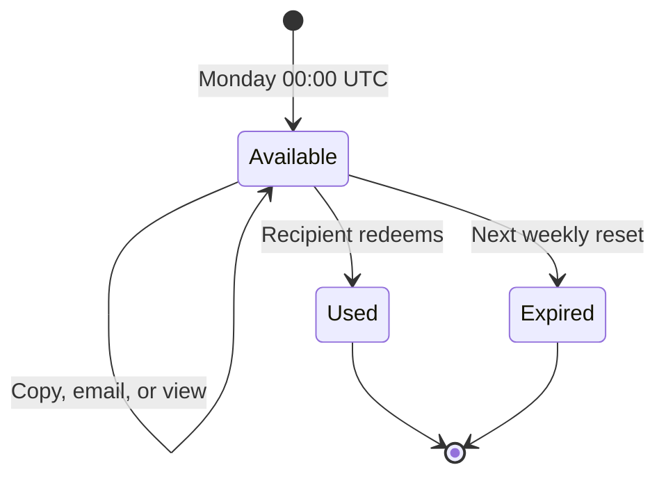

Invite passes and milestone passes give new people access to Ryu. They are separate from the
credit and cash rewards on [Referrals and Affiliates](/docs/programs/referrals). Open the live
[Referrals page](https://ryuhq.com/referrals) to see and share your passes.

Pass codes and links are masked by default. The reveal and hide controls are described in
[Share your referral link](/docs/programs/referrals#share-your-referral-link).

## Weekly invite passes

Once your account has access, open [Referrals](https://ryuhq.com/referrals) to
share invite passes each week. The number depends on your plan.

| Plan | Invite passes per week |
|---|---:|
| Free, Ryu Desktop licence, or another one-time purchase | 3 |
| Ryu Plus | 5 |
| Ryu Pro | 6 |
| Ryu Max | 7 |
| Ryu Teams Lite | 7 |
| Ryu Teams | 8 |
| Ryu Business | 10 |

### Send a pass

Each pass uses Ryu's interactive 3D pass card, with its access code, redemption status, and
expiry. To send one:

- Copy the invite below its card and send it to a friend.
- Or choose **Send by email**, enter one recipient and an optional personal note. Ryu emails
  that pass's card link and access code. Each pass can be emailed once; you can still copy its
  link afterward.

Emailing or viewing a pass does not consume it; redeeming it does.

### Redeem a pass

The link opens the same 3D card on its own invite page, with its status (available, redeemed,
or expired). Recipients sign in or create an account, return to that card, and choose
**Redeem my pass**. They do not need to retype the code.

The bottom ticket stub tears away after redemption succeeds. The sender sees the same effect
when the pass status changes to **Used**.

The six-character code also works in the waitlist's access-code form. You can paste it with
spaces or hyphens; the form removes them and normalizes the code to uppercase before
redemption.

### Weekly reset and limits

- Each member pass grants access to one account.
- Fresh passes for your plan are available every Monday at 00:00 UTC. The page shows the next
  reset in your local time.
- Upgrading mid-week adds the extra passes right away. Passes already issued that week stay
  available after a downgrade.
- Unused passes expire at the reset and do not roll over.
- Accounts still on the waitlist cannot issue passes. Once an invited account has access, it
  can share its own weekly passes.

### Track your passes

The page lets you refresh redemption status. The **Invite history** tab lists each pass, the
address it was emailed to when applicable, and whether it is available, failed delivery,
expired, or redeemed. A copied pass link has no identifiable recipient until an account
redeems it.

### Passes, rewards, and admin codes

Invite passes grant account access. Referral credits and rewards follow the
[referral program rules](/docs/programs/referrals#credit-referral-campaign).

Admin-issued access codes can optionally expire at a chosen date and time, have a maximum
number of redemptions, or use both limits. A code stops working when either limit is reached.

## Milestone passes

Using Ryu also earns a milestone pass: one code that several people can share. It is separate
from your weekly invite passes and does not use up any of them.

Open [Referrals](https://ryuhq.com/referrals) to see your progress in agent hours. Once you
reach the milestone, the page shows your milestone pass: one access code, the number of seats it
holds, and how many are still open. Copy the invite or choose **Give it away on X** to post it
with your referral link.

How seats work:

- Seats are first come, first served, and a claimed seat never frees up.
- Each person who signs up through your link, or redeems the code on the waitlist screen, takes
  one seat and counts as your referral.
- While Ryu has a waitlist, a seat also lets that person skip the queue.
- After the waitlist ends, the same code keeps working as a referral code until its seats run
  out.
- The code itself does not expire, and you cannot redeem your own pass.

## Share a pass card

The back of each waitlist and referral pass has a QR code that opens your referral link
(`/r/CODE`).

From **Share your pass**, pick a format and a shape:

| Format | What you can do with it |
|---|---|
| Still image | Copy or download |
| Ten-second looping video | Download |
| Looping GIF | Download. Smaller (480 pixels on its short edge) and plays on its own in chat apps such as Slack, Discord and iMessage. |

Every format comes in portrait (9:16), feed (4:5), post (3:4), square (1:1), or landscape (16:9).

Video export can take longer on a slower device. Keep the window in the foreground until the
file is ready. Closing the chooser stops an active export and resets the next share to the
default image format.

Milestone passes and unlocked battle-pass tiers have a **Share card** action too. It opens the
same chooser with a card for the milestone or tier you reached. The card shows the counts the
Referrals page already shows for it, such as agent hours and seats, or quest progress, reward and
points. Its back carries a QR code to your invite link, and the X and LinkedIn actions share that
same link.

## Related pages

- [Referrals and Affiliates](/docs/programs/referrals)
- [Creator Program](/docs/programs/creator-program)
